# Class Diagram

This matches the actual classes under `src/main/java/lld/parkinglot/` -
every field/method shown here exists in the implementation (trimmed to the
members that matter for the design discussion; see the source for full
javadoc).

```mermaid
classDiagram
    class VehicleType {
        <<enumeration>>
        MOTORCYCLE
        CAR
        BUS_OR_TRUCK
    }

    class SpotSize {
        <<enumeration>>
        SMALL
        MEDIUM
        LARGE
        +canFit(VehicleType) boolean
    }

    class SpotStatus {
        <<enumeration>>
        AVAILABLE
        RESERVED
        OCCUPIED
        OUT_OF_SERVICE
    }

    class Vehicle {
        -String licensePlate
        -VehicleType type
        +getLicensePlate() String
        +getType() VehicleType
    }

    class Gate {
        -String id
        -String name
        -int floorNumber
        -Kind kind
    }

    class ParkingSpot {
        -String id
        -int floorNumber
        -int spotNumber
        -SpotSize size
        -AtomicReference~SpotStatus~ status
        -Vehicle currentVehicle
        +tryReserve() boolean
        +occupy(Vehicle) void
        +releaseReservation() void
        +vacate() void
        +tryMarkOutOfService() boolean
        +bringBackInService() boolean
    }

    class Floor {
        -int floorNumber
        -List~ParkingSpot~ spots
    }

    class ParkingLot {
        -String name
        -List~Floor~ floors
    }

    class Ticket {
        -String id
        -Vehicle vehicle
        -ParkingSpot spot
        -String entryGateId
        -Instant entryTime
        -TicketStatus status
        -Money feeCharged
        +close(String, Instant, Money) void
    }

    class Payment {
        -String id
        -String ticketId
        -Money amount
        -PaymentMethod method
        -PaymentStatus status
    }

    class SpotAllocationStrategy {
        <<interface>>
        +reserveSpotFor(Vehicle, Gate) Optional~ParkingSpot~
    }

    class NearestAvailableSpotAllocationStrategy {
        -SpotRepository repository
    }

    class PricingStrategy {
        <<interface>>
        +calculateFee(Ticket, Instant) Money
    }

    class HourlyPricingStrategy
    class FlatRatePricingStrategy

    class PaymentProcessor {
        <<interface>>
        +charge(String, Money) Payment
    }

    class CashPaymentProcessor
    class CardPaymentProcessor
    class WalletPaymentProcessor

    class SpotRepository {
        <<interface>>
        +reserveSpot(int, SpotSize) Optional~ParkingSpot~
        +releaseReservation(ParkingSpot) void
        +freeSpot(ParkingSpot) void
        +markOutOfService(String) boolean
        +bringBackInService(String) boolean
    }

    class InMemorySpotRepository

    class TicketRepository {
        <<interface>>
        +tryClaimPlate(String) boolean
        +releaseClaim(String) void
        +save(Ticket) void
        +findById(String) Optional~Ticket~
    }

    class InMemoryTicketRepository
    class PaymentRepository {
        <<interface>>
    }
    class InMemoryPaymentRepository

    class ParkingLotService {
        -SpotRepository spotRepository
        -TicketRepository ticketRepository
        -SpotAllocationStrategy allocationStrategy
        -PricingStrategy pricingStrategy
        -PaymentService paymentService
        +parkVehicle(Vehicle, Gate) Ticket
        +unparkVehicle(String, Gate, PaymentMethod) ExitReceipt
    }

    class PaymentService {
        -Map~PaymentMethod,PaymentProcessor~ processorsByMethod
        +pay(String, Money, PaymentMethod) Payment
    }

    class EntryGateService {
        -Gate gate
        +processEntry(Vehicle) Ticket
    }

    class ExitGateService {
        -Gate gate
        +processExit(String, PaymentMethod) ExitReceipt
    }

    class AdminService {
        +markSpotOutOfService(String) void
        +bringSpotBackInService(String) void
        +occupancySnapshot() Map~SpotStatus,Long~
    }

    class ParkingLotBuilder {
        +withFloor(int, Map) ParkingLotBuilder
        +build() ParkingLot
    }

    SpotAllocationStrategy <|.. NearestAvailableSpotAllocationStrategy
    PricingStrategy <|.. HourlyPricingStrategy
    PricingStrategy <|.. FlatRatePricingStrategy
    PaymentProcessor <|.. CashPaymentProcessor
    PaymentProcessor <|.. CardPaymentProcessor
    PaymentProcessor <|.. WalletPaymentProcessor
    SpotRepository <|.. InMemorySpotRepository
    TicketRepository <|.. InMemoryTicketRepository
    PaymentRepository <|.. InMemoryPaymentRepository

    ParkingLotService --> SpotRepository
    ParkingLotService --> TicketRepository
    ParkingLotService --> SpotAllocationStrategy
    ParkingLotService --> PricingStrategy
    ParkingLotService --> PaymentService
    PaymentService --> PaymentProcessor
    PaymentService --> PaymentRepository
    NearestAvailableSpotAllocationStrategy --> SpotRepository

    EntryGateService --> ParkingLotService
    EntryGateService --> Gate
    ExitGateService --> ParkingLotService
    ExitGateService --> Gate
    AdminService --> SpotRepository

    ParkingLot "1" *-- "many" Floor : owns
    Floor "1" *-- "many" ParkingSpot : owns
    ParkingSpot "1" o-- "0..1" Vehicle : currently holds
    Ticket "1" --> "1" Vehicle
    Ticket "1" --> "1" ParkingSpot
    ParkingLotBuilder ..> ParkingLot : builds
    ParkingSpot --> SpotSize
    ParkingSpot --> SpotStatus
    Vehicle --> VehicleType
```

**Relationship notes:**
- `ParkingLot *-- Floor *-- ParkingSpot` is composition: spots cannot
  outlive their floor, and floors cannot outlive the lot - enforced simply
  by construction-time ownership (no spot is ever created outside a
  `Floor`'s constructor call in `ParkingLotBuilder`).
- `ParkingSpot o-- Vehicle` is aggregation: a `Vehicle` exists independently
  of any spot (it is a value object re-created per ticket) and a spot merely
  references the vehicle currently in it.
- Every `*Strategy`/`*Processor`/`*Repository` interface is implemented by
  exactly the classes shown; `ParkingLotService` depends only on the
  interfaces, never the concrete classes - Dependency Inversion in action.
