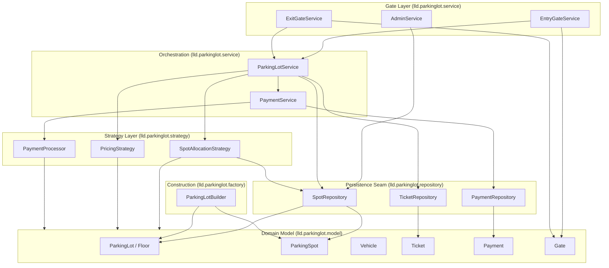

# Component Diagram

Shows the major packages/layers and the direction of dependencies. Arrows
point from a dependent to its dependency (standard "depends-on" direction).

**Reading guide:** everything above the dashed "Domain" line is replaceable
without touching the domain model. Swapping `InMemorySpotRepository` for a
database-backed implementation, or `NearestAvailableSpotAllocationStrategy`
for a different allocation policy, requires no change to `ParkingSpot`,
`Ticket`, or any other entity - this is the payoff of the Strategy +
Repository seams described in README section 7.
