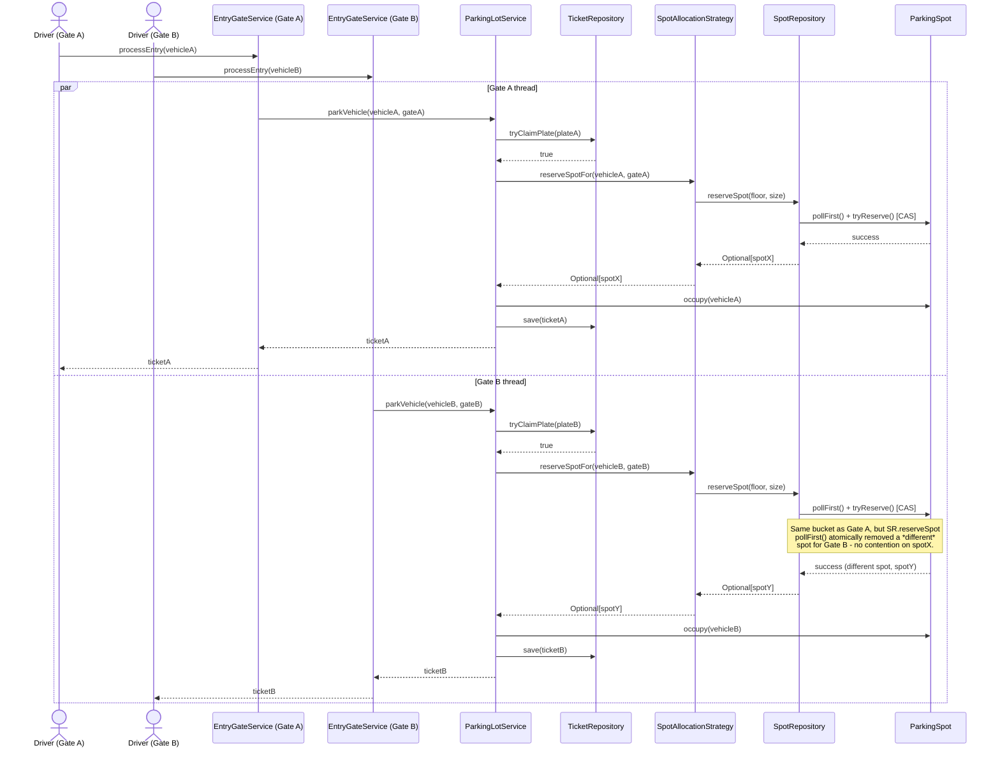

# Sequence Diagram: Vehicle Entry (`parkVehicle`)

Matches `EntryGateService.processEntry` -> `ParkingLotService.parkVehicle`.
Two concurrent callers (Gate A, Gate B) are shown to make the race-handling
explicit, matching the "concurrent spot allocation from multiple entry
gates" scoping requirement.

**Failure branch (lot full / duplicate plate), not shown above for clarity:**
- If `tryClaimPlate` returns `false`, `parkVehicle` throws
  `VehicleAlreadyParkedException` immediately - no spot is touched.
- If `reserveSpotFor` returns empty, `parkVehicle` calls
  `ticketRepository.releaseClaim(plate)` to undo the claim, then throws
  `NoAvailableSpotException` - the plate is not "stuck" claimed.
