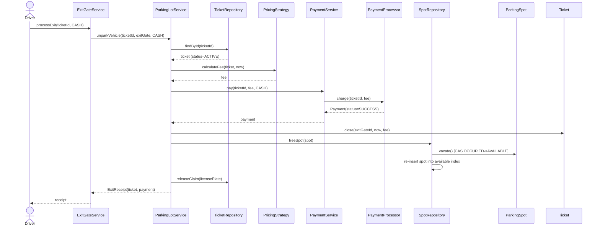

# Sequence Diagram: Vehicle Exit (`unparkVehicle`)

Matches `ExitGateService.processExit` -> `ParkingLotService.unparkVehicle`.

**Why payment happens before the ticket is closed and the spot is freed:**
if `PaymentProcessor.charge` reports a failure, `PaymentService.pay` throws
`PaymentFailedException` *before* any of `Ticket.close`, `SpotRepository.freeSpot`,
or `TicketRepository.releaseClaim` run - so a failed payment leaves the
system in exactly its pre-exit-attempt state (ticket still ACTIVE, spot
still OCCUPIED, plate still claimed) and the driver can simply retry the
exit with a different payment method. This ordering is the core of the
"no spot is ever given away for free" invariant (README section 5).
