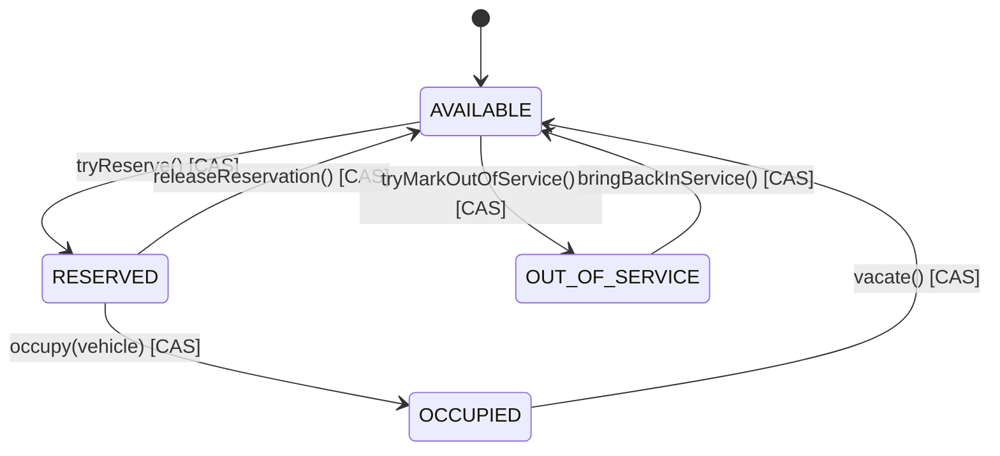

# State Diagram: `ParkingSpot` Lifecycle

Every arrow is exactly one `AtomicReference.compareAndSet` call in
`ParkingSpot` - there is no state reachable by two sequential CASes, which
is what makes each transition individually atomic and race-free regardless
of how many threads call it concurrently. See README section 11 for the
full concurrency argument.
