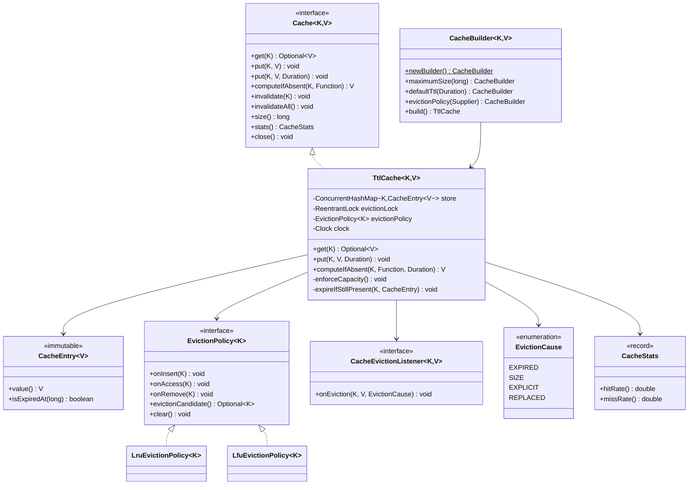
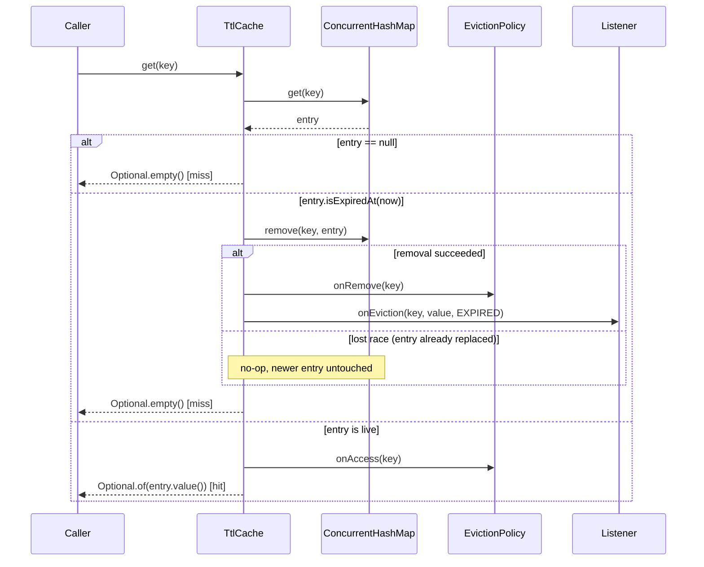
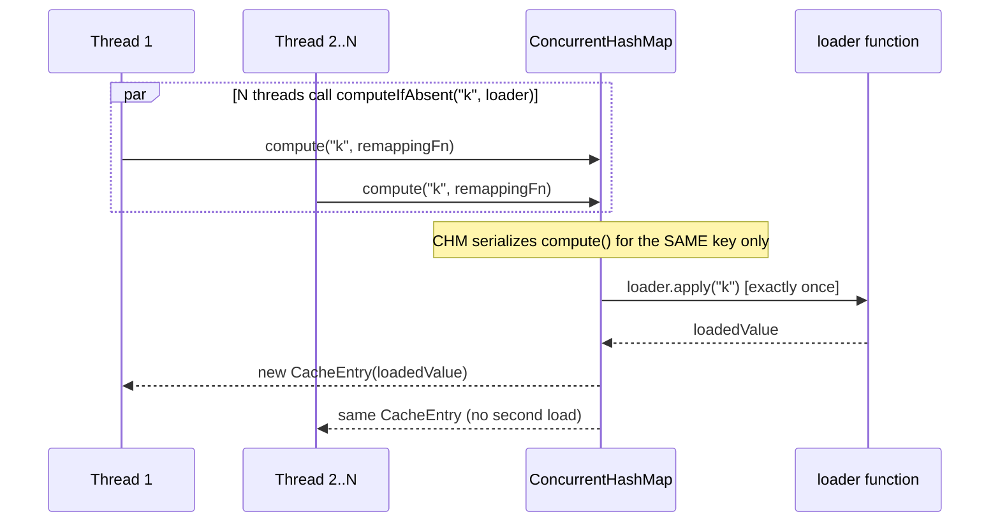

# TTL-based Cache Library

A generic, thread-safe, in-process key-value cache with per-entry time-to-live (TTL),
pluggable size-based eviction (LRU / LFU), a background reaper, eviction listeners, and
hit/miss statistics. Implemented in Java 17+ under `lld.ttlcache`.

> Source: `src/main/java/lld/ttlcache/**`. Tests: `tests/lld/ttlcache/**` (JUnit 5).
> Diagrams: `diagrams/diagrams.md` (embedded below).

---

## 1. Problem Understanding

**Plain explanation.** Build a library — not a single-use feature, a reusable component
other code depends on — that lets a caller store a value under a key, get it back later,
and have it automatically disappear once a configured amount of time has passed. On top
of that core idea, bound how much memory the cache can use by capping the number of
entries, and when the cap is hit, evict an entry chosen by a pluggable policy (LRU or
LFU) rather than an arbitrary one.

**Real-world use case.** This is the shape of almost every in-process cache used in
backend services: a local cache in front of a slower upstream (DB row cache, remote
config cache, computed-value memoization cache, session store, rate-limiter token
bucket, DNS resolution cache). TTL exists because staleness has a cost (serving outdated
config, stale permissions) that's acceptable only up to a bound; size bounds exist
because unconstrained caches are a classic cause of `OutOfMemoryError` in production.

**What the interviewer evaluates.**
- Whether you treat TTL and size-eviction as two independent, composable concerns (not
  one entangled mechanism).
- Whether your concurrency story is actually correct, not just "I used
  `ConcurrentHashMap` so it's fine" — specifically, whether you can explain the race
  between a background expiry sweep and a concurrent read/write of the *same* key.
- Whether you reach for the Strategy pattern for eviction policy and Observer for
  eviction notifications, and can justify them rather than cargo-culting patterns.
- API taste: a builder for construction, `Optional<V>` for absence, clear exception
  contracts.
- Whether you can draw a line between "interview scope" (correct, thread-safe, in-process)
  and "production scope" (distributed cache, persistence, metrics pipeline) without
  over-building the former or under-specifying the latter.

**In scope.**
- Generic `Cache<K, V>` with `get`/`put`/`put` with explicit TTL/`computeIfAbsent`/
  `invalidate`/`invalidateAll`/`size`/`stats`.
- Per-entry TTL; entries with no TTL configured live until evicted for size or
  explicitly invalidated.
- Pluggable size-based eviction: LRU and LFU, via the Strategy pattern, selected per
  cache instance through the builder.
- Lazy (on-access) expiry *and* active expiry via a background reaper thread; both are
  implemented and their trade-off is discussed, not hand-waved.
- Thread-safe concurrent `get`/`put`/`invalidate`/`computeIfAbsent` from multiple
  threads without external synchronization, including explicit handling of the
  concurrent-expiry race and the cache-stampede ("thundering herd") scenario.
- Eviction/expiry notifications via an Observer-style listener interface.
- Hit/miss/eviction/expiration statistics.

**Out of scope** (see §17 Production Evolution for how each would be added).
- Distribution/replication across processes or nodes (this is an in-process library, not
  Redis/Memcached).
- Persistence/durability across process restarts.
- Cache-level security/multi-tenancy isolation.
- Dynamic runtime reconfiguration (changing `maximumSize` or TTL policy on a live cache
  instance) — configuration is fixed at construction via the builder.
- Weight-based (as opposed to count-based) capacity, e.g. "bytes used" rather than
  "number of entries" (noted as a straightforward extension in §14).

---

## 2. Requirement Gathering

### Functional — essential
- `put(key, value)` / `put(key, value, ttl)`: store a value, optionally with an explicit
  per-entry TTL overriding the cache's default.
- `get(key) -> Optional<V>`: returns the value if present and not expired; otherwise
  empty. Must never return a value whose TTL has already elapsed.
- `invalidate(key)` / `invalidateAll()`: explicit removal.
- Size-based eviction when the cache is at capacity, using a pluggable policy (LRU, LFU).
- Thread-safety: all operations usable concurrently from multiple threads.

### Functional — optional (included, clearly separable)
- `computeIfAbsent(key, loader, ttl)`: atomic get-or-load with stampede protection.
- Eviction/expiry listeners (Observer).
- `stats()`: hit/miss/eviction/expiration counters and derived rates.
- Builder-based configuration (vs. a large constructor).

### Non-functional
| Dimension | Requirement | How this design satisfies it |
|---|---|---|
| Performance | `get`/`put` must not degrade to O(n) or block unrelated keys | `ConcurrentHashMap`-backed; no cache-wide lock on the hot path |
| Scalability | Throughput should scale with core count for disjoint-key workloads | Per-key-bin locking inherited from `ConcurrentHashMap`; eviction-policy lock is the only shared point of contention, held briefly and only during capacity enforcement |
| Availability | A single slow/failing listener must not stall the cache | Listener exceptions are caught; listener dispatch is pluggable (sync or via executor) |
| Consistency | A `get` must never observe a value for a TTL-expired entry | Conditional CAS-style removal (`map.remove(key, expectedEntry)`); see §11 |
| Extensibility | New eviction strategies addable without touching `TtlCache` | `EvictionPolicy<K>` Strategy interface; `TtlCache` depends only on the interface |
| Reliability | Background reaper failures must not crash the cache or leak threads | Reaper runs as a daemon thread; `close()` is idempotent and always stoppable |
| Thread-safety | Every public method is safe for concurrent, unsynchronized use | Documented explicitly per-component in §11, not merely asserted |

### Interview-necessary vs. production-extension split
**Interview-necessary** (built here): generic in-process cache, TTL, pluggable
size eviction, thread-safety, builder, listeners, stats.
**Production-extension** (discussed in §17, not built): distributed
cache coordination (cache invalidation across nodes), persistence, weight-based sizing,
dynamic reconfiguration, metrics export to a monitoring system, circuit-breaking around
a slow loader in `computeIfAbsent`.

---

## 3. Clarifying Questions

These are the questions a Staff candidate should ask in the first five minutes, the
reasoning behind each, and the assumption this implementation makes where the interviewer
doesn't specify an answer (so the design is unambiguous even standing alone).

1. **"Is this a single-process library, or does it need to coordinate across multiple
   processes/machines?"** Changes everything: a distributed answer needs a
   coordination/invalidation protocol (pub-sub, gossip, or a central authority) and
   probably isn't "LLD in 45 minutes" scope. *Assumption: single-process, in-memory.*
2. **"Should TTL be per-entry, or one TTL for the whole cache?"** Determines whether
   `CacheEntry` needs its own expiry timestamp (per-entry) or whether a single
   cache-wide deadline suffices (much simpler, but far less useful in practice).
   *Assumption: per-entry, with a cache-wide default applied when the caller doesn't
   specify one explicitly.*
3. **"When an entry expires, does it need to disappear immediately (hard real-time), or
   is some delay before a background sweep removes it acceptable?"** Drives the choice
   between lazy-only expiry (simplest, but can hold dead memory indefinitely if a key is
   never re-accessed) and lazy + active reaping (small CPU/lock cost, bounded memory
   holding). *Assumption: both — lazy expiry gives correctness guarantees on every
   `get`, active reaping gives a bounded memory ceiling.*
4. **"What should happen when the cache is full and a new key needs to be inserted — is
   a specific eviction algorithm required, or is 'reasonable and pluggable' acceptable?"**
   Determines whether to hard-code LRU or build a Strategy abstraction.
   *Assumption: pluggable — LRU and LFU both implemented, selected via the builder, with
   room to add more without touching `TtlCache`.*
5. **"Do callers need to know *why* an entry was removed (expired vs. evicted vs.
   explicitly removed), e.g. for metrics or cache-warming logic?"** Determines whether a
   single "removed" callback suffices or a cause needs to be modeled explicitly.
   *Assumption: yes — `EvictionCause` enum distinguishes `EXPIRED`/`SIZE`/`EXPLICIT`/
   `REPLACED`, since conflating "expected TTL churn" with "capacity pressure" hides an
   operationally important signal.*
6. **"Is there a need for a cache-aside 'load on miss' convenience (`computeIfAbsent`),
   and if so, must concurrent misses for the same key avoid redundant loads?"** The
   stampede question — a frequent follow-up regardless of whether it's asked up front.
   *Assumption: yes to both; implemented via `ConcurrentHashMap#compute`'s per-key
   atomicity (§11).*
7. **"What should capacity mean — number of entries, or total memory/weight?"**
   Count-based is far simpler to implement correctly and is what most interviewers
   expect by default; weight-based requires a size-estimation function per value.
   *Assumption: count-based (`maximumSize` entries); weight-based noted as an extension
   in §14.*

---

## 4. Domain Modelling

| Type | Kind | Responsibility |
|---|---|---|
| `Cache<K, V>` | Interface | Public contract; the only type calling code should depend on. |
| `TtlCache<K, V>` | Concrete class (domain service) | The cache implementation: owns the backing store, coordinates TTL + size eviction, dispatches listener notifications, maintains stats. |
| `CacheEntry<V>` | Value object (package-private) | Immutable pairing of a stored value with its absolute expiry timestamp. |
| `EvictionPolicy<K>` | Interface (Strategy) | Decides which key to evict when the cache is over capacity; tracks whatever recency/frequency bookkeeping it needs. |
| `LruEvictionPolicy<K>` | Concrete strategy | Least-recently-used, via access-ordered `LinkedHashMap`. |
| `LfuEvictionPolicy<K>` | Concrete strategy | Least-frequently-used, via frequency buckets (`TreeMap<Integer, LinkedHashSet<K>>`). |
| `CacheEvictionListener<K, V>` | Interface (Observer) | Notified on every removal, with a reason (`EvictionCause`). |
| `EvictionCause` | Enum (value object) | `EXPIRED` / `SIZE` / `EXPLICIT` / `REPLACED`. |
| `Clock` | Interface | Testable abstraction over wall-clock time (`System::currentTimeMillis` in production, a controllable fake in tests). |
| `CacheStats` | Value object (record) | Immutable point-in-time snapshot of hit/miss/eviction/expiration counts. |
| `CacheStatsRecorder` | Internal mutable collaborator (package-private) | Lock-free (`LongAdder`-based) live counters, snapshotted into `CacheStats`. |
| `CacheBuilder<K, V>` | Builder | Validates configuration and constructs a fully-wired `TtlCache`. |

**Composition / association / ownership.**
- `TtlCache` *owns* its `ConcurrentHashMap`, its `EvictionPolicy` instance, its
  `CacheStatsRecorder`, and its reaper `ScheduledExecutorService` — none of these are
  shared with any other cache instance or exposed outside the class. This is
  composition, not aggregation: their lifecycle is bound to the `TtlCache`'s lifecycle
  (created in the constructor, the executor torn down in `close()`).
- `TtlCache` *depends on* (does not own) the `Clock` and the list of
  `CacheEvictionListener`s it's given — these are supplied externally via the builder and
  could in principle be shared/reused elsewhere (a `Clock` certainly is, across tests).
- `CacheBuilder` *creates* a `TtlCache` but has no reference to it after `build()`
  returns — a classic Builder relationship, not an association that persists.
- `EvictionPolicy` implementations have no reference to `TtlCache`, `CacheEntry`, or
  values at all — they only ever see `K`. This is a deliberate narrowing of their
  interface surface (Interface Segregation): a policy cannot accidentally depend on
  cache internals it has no business touching.
- No inheritance is used anywhere in this design (beyond implementing interfaces).
  Composition was chosen throughout — e.g. `TtlCache` *has an* `EvictionPolicy` rather
  than being a base class that LRU/LFU cache subclasses specialize — because the
  eviction *algorithm* varies independently of everything else about the cache
  (storage, TTL, listeners), which is precisely the condition under which Strategy
  (composition) is preferable to subclassing.

---

## 5. Domain Invariants

Business rules that must hold at every observable point, and where each is enforced:

1. **A `get()` never returns a value for an entry whose TTL has elapsed.**
   Enforced in `TtlCache.get()`, which re-checks `entry.isExpiredAt(now)` against the
   exact entry instance just read, before returning it — never a separate, possibly
   stale check.
2. **The cache never holds two different live values for the same key.**
   Enforced by `ConcurrentHashMap`'s own per-key atomicity: `put`/`compute` on the same
   key never interleave into a torn state; the map always reflects exactly one
   `CacheEntry` per key at any instant.
3. **An entry's recorded expiry time, once set, never silently changes.**
   Enforced by `CacheEntry` being immutable — the only way to change a key's expiry is
   `put()`-ing a brand-new `CacheEntry`, which is a full logical replacement, not a
   mutation.
4. **`size() <= maximumSize` holds except for a bounded, transient window during
   concurrent bursts of `put`.** Enforced by `enforceCapacity()`, called after every
   insert; the transient-overshoot exception is a deliberate, documented trade-off (see
   §11) rather than an unenforced invariant — it is bounded by (at most) the number of
   threads concurrently inserting, not unbounded.
5. **An eviction-policy callback (`onInsert`/`onAccess`/`onRemove`) is made for every key
   that enters or leaves the map, exactly once per transition.** Enforced structurally:
   every code path in `TtlCache` that calls `store.put`/`store.remove`/`store.compute`
   is immediately followed by the matching policy call, with no path that mutates the
   map without the corresponding policy update (verified by code review / the
   concurrency tests in §15, not by a runtime check, since enforcing this at runtime
   would require exactly the kind of lock this design avoids).
6. **Under `computeIfAbsent`, the loader function runs at most once per logical
   "miss episode", even with concurrent callers.** Enforced by performing the
   load-or-return decision inside `ConcurrentHashMap#compute`'s remapping function,
   which the JDK guarantees is invoked atomically per key.
7. **A listener exception never prevents the removal it describes, and never propagates
   to the caller of `get`/`put`/`invalidate`.** Enforced by catching `RuntimeException`
   around every listener invocation in `TtlCache.notifyListeners`.

---

## 6. Architecture and Class Diagram

See `diagrams/diagrams.md` for the full Mermaid sources (component diagram, class
diagram, and four sequence diagrams). Reproduced inline here:

### Component diagram

```mermaid
graph TB
    subgraph "Caller code"
        Client["Application code"]
    end
    subgraph "lld.ttlcache (public API)"
        CacheIfc["Cache&lt;K,V&gt; (interface)"]
        Builder["CacheBuilder&lt;K,V&gt;"]
    end
    subgraph "lld.ttlcache (implementation)"
        TtlCache["TtlCache&lt;K,V&gt;"]
        Entry["CacheEntry&lt;V&gt; (immutable)"]
        StatsRec["CacheStatsRecorder"]
        Stats["CacheStats (snapshot)"]
        ClockIfc["Clock"]
        Listener["CacheEvictionListener&lt;K,V&gt;"]
        Reaper["Background reaper\n(ScheduledExecutorService)"]
    end
    subgraph "lld.ttlcache.policy"
        PolicyIfc["EvictionPolicy&lt;K&gt; (Strategy)"]
        Lru["LruEvictionPolicy&lt;K&gt;"]
        Lfu["LfuEvictionPolicy&lt;K&gt;"]
    end
    subgraph "JDK"
        CHM["ConcurrentHashMap&lt;K, CacheEntry&lt;V&gt;&gt;"]
    end
    Client --> CacheIfc
    Client --> Builder
    Builder -- "builds" --> TtlCache
    Builder -- "selects" --> PolicyIfc
    TtlCache -. implements .-> CacheIfc
    TtlCache --> CHM
    CHM --> Entry
    TtlCache --> PolicyIfc
    PolicyIfc <|.. Lru
    PolicyIfc <|.. Lfu
    TtlCache --> StatsRec
    StatsRec --> Stats
    TtlCache --> ClockIfc
    TtlCache --> Reaper
    Reaper --> CHM
    TtlCache -. notifies .-> Listener
```

### Class diagram



### Sequence diagram: `get(key)` racing lazy expiry



### Sequence diagram: `computeIfAbsent` stampede protection



**Diagram-to-code fidelity.** Every class, method, and field named above exists verbatim
in `src/main/java/lld/ttlcache/**`; this isn't an idealized diagram drawn separately from
the implementation.

---

## 7. Design Patterns

| Pattern | Why needed | Where applied | Alternative considered | Why rejected |
|---|---|---|---|---|
| **Strategy** | Eviction algorithm is an independent axis of variation from storage/TTL/listeners; callers must be able to pick LRU vs. LFU (or add a new one) without touching `TtlCache`. | `EvictionPolicy<K>` + `LruEvictionPolicy`/`LfuEvictionPolicy` | Hard-code LRU inside `TtlCache`, or an `enum EvictionAlgorithm` with a `switch` inside `TtlCache`. | A `switch` forces `TtlCache` to know about every algorithm's internals and grows with each addition (violates Open/Closed); hard-coding forecloses LFU entirely, contradicting an explicit requirement. |
| **Observer** | Callers need to react to removals (metrics, logging, cache-warming) without `TtlCache` depending on *what* they do with that information. | `CacheEvictionListener<K,V>`, invoked from `notifyListeners()` on every removal path | Return removed entries from `get`/`put`/reaper sweeps for the caller to inspect | Removals also happen on a background thread (the reaper) where there is no caller to "return" anything to — a push-based Observer is the only model that covers all three removal paths (lazy, reaper, explicit) uniformly. |
| **Builder** | `TtlCache` has 6+ independent, mostly-optional configuration axes. | `CacheBuilder<K,V>` | Telescoping constructors / a mutable `CacheConfig` object passed to a constructor | Telescoping constructors don't scale past 2-3 optional parameters; a mutable config object re-introduces the exact "is this thing safe to share across threads mid-configuration" question a builder sidesteps by being single-use and immutable-once-built. |
| **Immutable Value Object** | `CacheEntry` and `CacheStats` are read by arbitrary threads without synchronization. | `CacheEntry<V>` (package-private), `CacheStats` (public record) | Mutable entry with `volatile` fields for value/expiry | A mutable entry reintroduces a torn-read risk (one thread could observe a new expiry paired with an old value, or vice versa) that "replace the whole object" eliminates by construction; immutability is the strictly simpler and more obviously correct choice here. |

**Patterns deliberately *not* used:**
- **Singleton** for the cache instance — nothing about this design implies there's
  exactly one cache in a process; callers may want several independently-configured
  caches. Forcing a singleton would be an unjustified global-state decision.
- **Factory Method/Abstract Factory** for `CacheEntry` — it's a two-field value object
  constructed with `new`; a factory would add indirection with no corresponding
  flexibility requirement (no subtype hierarchy to hide behind the factory).
- **Decorator** around `Cache<K,V>` for cross-cutting concerns (e.g. logging every call)
  — not built in, but called out in §17 as the natural way to add such concerns without
  modifying `TtlCache`, since `Cache<K,V>` is already a narrow interface a decorator can
  wrap cleanly.

---

## 8. API and Method Design

```java
public interface Cache<K, V> extends AutoCloseable {
    Optional<V> get(K key);
    void put(K key, V value);
    void put(K key, V value, Duration ttl);
    V computeIfAbsent(K key, Function<? super K, ? extends V> loader);
    V computeIfAbsent(K key, Function<? super K, ? extends V> loader, Duration ttl);
    void invalidate(K key);
    void invalidateAll();
    long size();
    CacheStats stats();
    @Override void close();
}
```

**Validation and exception responsibilities.**
- All public methods validate arguments eagerly with `Objects.requireNonNull`, throwing
  `NullPointerException` with a named parameter — failing at the API boundary, not deep
  inside a private helper, so stack traces point directly at caller misuse.
- `CacheBuilder` throws `IllegalArgumentException` for out-of-range configuration
  (`maximumSize <= 0`, negative `defaultTtl`/`reaperInterval`) in each setter, so
  misconfiguration is caught at the call site that introduced it rather than surfacing
  later as a confusing runtime symptom.
- `computeIfAbsent`'s `loader` throwing is **not** caught by the cache — it propagates
  to the caller of `computeIfAbsent` unwrapped (other than passing through
  `ConcurrentHashMap#compute`, which does not wrap exceptions), and critically, **no**
  entry is stored for that key when the loader throws, so a failed load doesn't
  "poison" the cache with a bad or partial value. A `null` return from `loader` is
  explicitly rejected (`Objects.requireNonNull`) rather than silently cached as an
  absence, since `ConcurrentHashMap` does not permit `null` values and a cache silently
  treating "loader returned null" the same as "nothing is cached" would be a surprising,
  hard-to-debug behavior.
- Request/response shapes: `get` returns `Optional<V>` (explicit absence, no null
  checking at call sites); `stats()` returns the immutable `CacheStats` record described
  in §4 (a request/response-style value object, even though this isn't a network API).

---

## 9. Core Implementation

Full source lives in `src/main/java/lld/ttlcache/`; the four files most central to this
problem's grading are reproduced here in full (unmodified from `src/`, so this section
and the actual code cannot drift apart).

### `TtlCache.java` (core cache + concurrency logic)

```java
package lld.ttlcache;

import lld.ttlcache.policy.EvictionPolicy;

import java.time.Duration;
import java.util.List;
import java.util.Map;
import java.util.Objects;
import java.util.Optional;
import java.util.concurrent.ConcurrentHashMap;
import java.util.concurrent.Executor;
import java.util.concurrent.Executors;
import java.util.concurrent.ScheduledExecutorService;
import java.util.concurrent.TimeUnit;
import java.util.concurrent.atomic.AtomicBoolean;
import java.util.concurrent.locks.ReentrantLock;
import java.util.function.Function;

public final class TtlCache<K, V> implements Cache<K, V> {

    private final ConcurrentHashMap<K, CacheEntry<V>> store = new ConcurrentHashMap<>();
    private final ReentrantLock evictionLock = new ReentrantLock();

    private final long maximumSize;
    private final Duration defaultTtl;
    private final EvictionPolicy<K> evictionPolicy;
    private final Clock clock;
    private final List<CacheEvictionListener<K, V>> listeners;
    private final Executor listenerExecutor;
    private final CacheStatsRecorder stats = new CacheStatsRecorder();

    private final ScheduledExecutorService reaper;
    private final AtomicBoolean closed = new AtomicBoolean(false);

    // constructor wires everything and schedules the reaper — see src/ for the full body

    @Override
    public Optional<V> get(K key) {
        Objects.requireNonNull(key, "key");
        CacheEntry<V> entry = store.get(key);
        if (entry == null) {
            stats.recordMiss();
            return Optional.empty();
        }
        if (entry.isExpiredAt(clock.currentTimeMillis())) {
            expireIfStillPresent(key, entry);
            stats.recordMiss();
            return Optional.empty();
        }
        evictionPolicy.onAccess(key);
        stats.recordHit();
        return Optional.of(entry.value());
    }

    @Override
    public void put(K key, V value, Duration ttl) {
        Objects.requireNonNull(key, "key");
        Objects.requireNonNull(value, "value");
        Objects.requireNonNull(ttl, "ttl");

        long expireAtMillis = expiryFor(ttl, clock.currentTimeMillis());
        CacheEntry<V> newEntry = new CacheEntry<>(value, expireAtMillis);
        CacheEntry<V> previous = store.put(key, newEntry);

        if (previous == null) {
            evictionPolicy.onInsert(key);
            enforceCapacity();
        } else {
            evictionPolicy.onAccess(key);
            notifyListeners(key, previous.value(), EvictionCause.REPLACED);
        }
    }

    @Override
    public V computeIfAbsent(K key, Function<? super K, ? extends V> loader, Duration ttl) {
        Objects.requireNonNull(key, "key");
        Objects.requireNonNull(loader, "loader");
        Objects.requireNonNull(ttl, "ttl");

        long now = clock.currentTimeMillis();
        AtomicBoolean loadedFreshValue = new AtomicBoolean(false);

        CacheEntry<V> result = store.compute(key, (k, existing) -> {
            if (existing != null && !existing.isExpiredAt(now)) {
                return existing;
            }
            V loadedValue = loader.apply(k);
            Objects.requireNonNull(loadedValue, "loader must not return null");
            loadedFreshValue.set(true);
            return new CacheEntry<>(loadedValue, expiryFor(ttl, now));
        });

        if (loadedFreshValue.get()) {
            evictionPolicy.onInsert(key);
            stats.recordMiss();
            enforceCapacity();
        } else {
            evictionPolicy.onAccess(key);
            stats.recordHit();
        }
        return result.value();
    }

    private void expireIfStillPresent(K key, CacheEntry<V> expectedEntry) {
        if (store.remove(key, expectedEntry)) {
            evictionPolicy.onRemove(key);
            stats.recordExpiration();
            notifyListeners(key, expectedEntry.value(), EvictionCause.EXPIRED);
        }
    }

    private void enforceCapacity() {
        if (store.mappingCount() <= maximumSize) {
            return;
        }
        if (!evictionLock.tryLock()) {
            return;
        }
        try {
            while (store.mappingCount() > maximumSize) {
                Optional<K> candidate = evictionPolicy.evictionCandidate();
                if (candidate.isEmpty()) {
                    break;
                }
                K keyToEvict = candidate.get();
                CacheEntry<V> removed = store.remove(keyToEvict);
                evictionPolicy.onRemove(keyToEvict);
                if (removed != null) {
                    stats.recordEviction();
                    notifyListeners(keyToEvict, removed.value(), EvictionCause.SIZE);
                }
            }
        } finally {
            evictionLock.unlock();
        }
    }

    // reapExpiredEntries(), invalidate(), invalidateAll(), size(), stats(), close(),
    // expiryFor(), notifyListeners() — see src/main/java/lld/ttlcache/TtlCache.java
}
```

### `LruEvictionPolicy.java` and `LfuEvictionPolicy.java`

See `src/main/java/lld/ttlcache/policy/LruEvictionPolicy.java` and
`LfuEvictionPolicy.java` in full — both reproduced and explained in §10 below, since
their value is primarily in the data-structure choice rather than line-by-line reading
here.

### `CacheEntry.java`, `Clock.java`, `CacheBuilder.java`, `CacheStats*.java`

Reproduced and discussed in §4/§5/§11; full text in `src/`.

---

## 10. Data Structures and Algorithms

| Component | Structure | Why | Complexity |
|---|---|---|---|
| Backing store | `ConcurrentHashMap<K, CacheEntry<V>>` | Lock-free reads, fine-grained (bin-level) locking for writes, weakly-consistent iteration safe for the reaper to use concurrently with mutators. The standard, battle-tested choice for a concurrent map in Java — reimplementing custom segment locking would duplicate what CHM already does better. | `get`/`put`/`remove`/`compute`: O(1) average |
| LRU bookkeeping | `LinkedHashMap<K, Boolean>` in access-order mode | JDK's access-ordered linked hash map already *is* the "HashMap + intrusive doubly-linked list" structure LRU needs; `get`/`put`/`remove` all touch the list in O(1) as a side effect of the hash operation. | O(1) amortized per operation |
| LFU bookkeeping | `HashMap<K,Integer>` (frequency) + `TreeMap<Integer, LinkedHashSet<K>>` (frequency → insertion-ordered keys) | The classic "frequency bucket" LFU structure. `TreeMap.firstEntry()` finds the minimum-frequency bucket in O(log F) where F = number of *distinct* frequencies currently present (bounded, small in practice) rather than O(log n) over all keys. | `onAccess`/`onInsert`/`onRemove`: O(log F); `evictionCandidate`: O(log F) |
| Stats counters | 4× `LongAdder` | Striped counters avoid turning every `get()`'s hit/miss increment into a single contended cache line under high concurrency, at the cost of a slightly more expensive (and far less frequent) `sum()` on `stats()`. | increment: O(1) amortized; `sum()`: O(number of striping cells) |
| Entry | Immutable 2-field value object | See §4/§9 — avoids torn-read races without per-entry locks. | O(1) construction/read |

**Alternatives considered for the backing store:** a single `HashMap` behind one
`synchronized` block (rejected: serializes all operations, defeating the entire
multi-core-scalability requirement); manual striped/segment locking à la pre-Java-8
`ConcurrentHashMap` (rejected: `ConcurrentHashMap` already *is* this, better-tuned and
better-tested, since Java 8 — reimplementing it would be strictly worse engineering
effort for no behavioral gain).

**Alternative considered for LRU:** a hand-rolled intrusive doubly-linked list +
`HashMap<K, Node<K>>` (gives the same O(1) bound, and avoids `LinkedHashMap`'s internal
resize/rehash pauses at very large sizes). Rejected for the base implementation because
`LinkedHashMap` is simpler, equally O(1) amortized, and resize pauses only matter at
scales where this in-process cache likely isn't the right tool anyway; called out as the
production hardening path in §17.

---

## 11. Concurrency and Thread Safety

This is the section the whole problem hinges on; every claim below is justified by a
specific mechanism, not merely asserted, and every mechanism is exercised by a test in
`tests/lld/ttlcache/TtlCacheConcurrencyTest.java`.

### 11.1 Shared mutable state inventory

| State | Who mutates it | Protection |
|---|---|---|
| `store` (`ConcurrentHashMap`) | Any caller thread (`get`/`put`/`invalidate`/`computeIfAbsent`) + the reaper thread | `ConcurrentHashMap`'s own internal bin-level locking; no additional lock needed for correctness of map operations themselves |
| `CacheEntry` instances | Never mutated after construction | Immutability — nothing to protect |
| `EvictionPolicy` bookkeeping (recency list / frequency buckets) | Any caller thread + the reaper (via `onInsert`/`onAccess`/`onRemove`) | A single `ReentrantLock` owned by the policy instance itself, held only for the O(1)/O(log F) structural update |
| `evictionLock` | Capacity-enforcement callers | `ReentrantLock`, acquired with `tryLock()` (non-blocking) |
| `CacheStatsRecorder` counters | Any caller thread + reaper | `LongAdder` — lock-free |
| `reaper` executor / `closed` flag | `close()` callers | `AtomicBoolean.compareAndSet` ensures `shutdownNow()` runs exactly once even if `close()` is called concurrently from multiple threads |

**What is deliberately *not* behind a single lock:** `get`/`put` for different keys never
block each other. This is the central design decision — a "stop-the-world" global lock
around every operation (the naive "wrap the cache in `synchronized`" approach) was
rejected specifically because it would serialize all cache traffic onto one lock,
defeating the entire reason to use a concurrent cache in a multi-core service.

### 11.2 Race #1 — reading a value that is concurrently expiring

**The race:** Thread A calls `get(key)` just as the entry's TTL elapses; concurrently,
either the reaper thread or another caller's lazy-expiry path is also trying to remove
that same expired entry.

**Why a naive implementation gets this wrong:** a check-then-act implementation —
"if (map.get(key) is expired) map.remove(key)" — has a gap between the check and the
removal. If, in that gap, a different thread calls `put(key, freshValue)`, an
unconditional `map.remove(key)` executed afterward would delete the *fresh* value, not
the expired one it believed it was removing. The cache would then silently lose a value
that was never actually expired.

**The fix in this design:** `expireIfStillPresent` uses
`store.remove(key, expectedEntry)` — `ConcurrentHashMap`'s conditional remove, which only
succeeds if `key` still maps to the exact `expectedEntry` object (by reference) the
caller already observed as expired:

```java
private void expireIfStillPresent(K key, CacheEntry<V> expectedEntry) {
    if (store.remove(key, expectedEntry)) {
        evictionPolicy.onRemove(key);
        stats.recordExpiration();
        notifyListeners(key, expectedEntry.value(), EvictionCause.EXPIRED);
    }
}
```

If another thread already replaced the entry (via `put`) or removed it (via
`invalidate`, or another thread's own expiry check winning the race) between the read
and this call, `remove(key, expectedEntry)` simply fails and returns `false` — a safe
no-op. This is the same pattern as an atomic compare-and-swap, applied at map-entry
granularity, and it requires `CacheEntry` to be a distinct object per logical value
(which immutability already gives us "for free" — see §9) rather than, say, a long that
could coincidentally compare equal across different logical values.

**Proven by:** `TtlCacheBasicTest.entryExpiresLazilyOnGetAfterTtlElapses` and
`backgroundReaperActivelyRemovesExpiredEntriesWithoutAnyGetCall` cover the two expiry
paths individually; `TtlCacheEvictionTest.expiredEntryDoesNotCountTowardSizeEvictionDecisionIncorrectly`
verifies the removal is a real, complete removal (frees a capacity slot), not a partial
or inconsistent one.

### 11.3 Race #2 — cache stampede on `computeIfAbsent`

**The race:** N threads simultaneously call `computeIfAbsent("hot-key", expensiveLoader)`
for a key that is currently missing (e.g. right after cache startup, or right after that
key's TTL just expired). Without protection, all N threads would see "absent", and all N
would independently invoke `expensiveLoader` — multiplying load on whatever backs the
loader (a DB, a remote service) by N, exactly when that backend is least able to absorb
it (this is the classic "thundering herd" failure mode).

**The fix in this design:** the entire "check if present and live, else load and store"
decision happens *inside* the remapping function passed to `ConcurrentHashMap#compute`:

```java
CacheEntry<V> result = store.compute(key, (k, existing) -> {
    if (existing != null && !existing.isExpiredAt(now)) {
        return existing;
    }
    V loadedValue = loader.apply(k);
    loadedFreshValue.set(true);
    return new CacheEntry<>(loadedValue, expiryFor(ttl, now));
});
```

`ConcurrentHashMap` guarantees the remapping function given to `compute` is invoked
atomically *with respect to other `compute`/`put`/`remove` calls for the same key* — the
JDK documentation for `compute` is explicit that this makes per-key atomic
read-modify-write possible, which is exactly the primitive needed here. Concretely: if 16
threads call `compute` for the same missing key at once, they serialize through this one
remapping function one at a time; the first one in finds no live entry, invokes
`loader`, and installs the result; every subsequent thread (whether it ran before or
after the first installed its result) sees a live, non-expired `existing` entry and
returns it immediately without calling `loader` again. Threads operating on *different*
keys are entirely unaffected — this atomicity is scoped to a single key's hash bin, not
the whole map.

**Proven by:**
`TtlCacheConcurrencyTest.computeIfAbsentInvokesLoaderExactlyOnceUnderConcurrentStampede`
starts 64 threads behind a `CountDownLatch` gate (to release them as close to
simultaneously as possible) and asserts the loader's invocation counter is exactly `1`
after all of them complete.

### 11.4 Race #3 — concurrent size-eviction passes

**The race:** many threads calling `put()` concurrently can all observe
`store.mappingCount() > maximumSize` at the same instant and all try to run an eviction
pass simultaneously, which would both (a) contend heavily on the policy's internal lock
for no benefit (only one pass is actually needed) and (b) risk over-evicting (each
thread's loop condition is re-checked against a map size that other threads are
simultaneously shrinking, so multiple concurrent passes can collectively remove more
entries than necessary).

**The fix in this design:** `enforceCapacity()` guards its eviction loop with
`evictionLock.tryLock()` rather than `evictionLock.lock()`. A thread that cannot
immediately acquire the lock does not block and wait its turn — it simply returns,
trusting that the thread currently holding the lock is already driving the cache back
under capacity. This means capacity enforcement is never a second point of contention
competing with the map's own per-key locking; at most one thread is ever actively
evicting at a time, and every other thread's `put()` call returns immediately rather than
queuing behind a lock for a maintenance operation it doesn't strictly need to wait for.

**Trade-off accepted:** because of `tryLock()`, there's a narrow window where the cache
can sit transiently above `maximumSize` — if thread A is mid-eviction-loop and threads
B, C, D each insert a new key and each skip triggering their own pass (since A holds the
lock), the cache is briefly `maximumSize + 3` until A's loop (which rechecks
`mappingCount()` on every iteration) catches up. This is explicitly treated as
acceptable: `maximumSize` is a soft memory-planning target, not a hard invariant that
every single read must observe exactly — and the alternative (blocking `lock()`) would
convert `put()` into a point of serialized contention under write-heavy workloads, which
is a worse trade for a cache whose entire value proposition is write throughput.

**Proven by:** `TtlCacheConcurrencyTest.concurrentPutsNeverLeaveCacheMeaningfullyOverCapacity`
runs 16 threads each inserting 500 unique keys concurrently against a 50-entry cache and
asserts the final size is bounded (never runaway/unbounded), consistent with the
documented bounded-overshoot trade-off rather than a strict `<= 50` assertion.

### 11.5 Lock ordering and deadlock analysis

There are exactly two locks in this design: `evictionLock` (owned by `TtlCache`) and
each `EvictionPolicy`'s own internal lock. They are **never held simultaneously** by any
code path — `TtlCache` always calls into the policy (acquiring the policy's lock
internally, then releasing it before returning) either before acquiring `evictionLock`
(in the normal `onInsert`/`onAccess`/`onRemove` calls outside `enforceCapacity`) or while
already holding `evictionLock` but *not* holding any other lock when the policy call is
made. Since neither lock is ever acquired while the other is held, there is no lock
ordering to violate and therefore no possibility of the classic "thread A holds lock 1
waiting for lock 2, thread B holds lock 2 waiting for lock 1" deadlock. Listener
invocations happen with *no* cache lock held at all (see §11.6), eliminating the other
classic deadlock source: user callback code reentering the cache while a lock is held.

### 11.6 Listener dispatch and blocking callbacks

Listener notifications are dispatched through a configurable `Executor`
(`CacheBuilder.listenerExecutor`, defaulting to `Runnable::run` — synchronous, inline).
`notifyListeners` never runs with `evictionLock` held in a way that a slow listener could
stall the capacity-enforcement loop for *other* keys — in the SIZE-eviction path,
notification happens inside the loop (and thus with `evictionLock` held) by design (each
eviction choice is sequential anyway, since it depends on the policy's live state after
the previous eviction), but EXPIRED/EXPLICIT/REPLACED notifications happen entirely
outside of `evictionLock`. Code that needs guaranteed non-blocking dispatch regardless of
path should supply a dedicated executor via `CacheBuilder.listenerExecutor`; this is
flagged explicitly in `CacheEvictionListener`'s javadoc rather than left as an implicit
assumption.

### 11.7 Visibility

Every field read across threads is either: `final` (immutable after construction:
`maximumSize`, `defaultTtl`, `evictionPolicy`, `clock`, `listeners`, `listenerExecutor`,
`reaper`), guarded by a lock (`evictionLock`-protected sequence, policy-internal locks),
backed by `ConcurrentHashMap`/`LongAdder`/`AtomicBoolean` (which provide their own
happens-before guarantees per the Java Memory Model), or (for `CacheEntry.expireAtMillis`
and `.value`) immutable and published exclusively through `ConcurrentHashMap`, whose
`put`/`get` pair establishes a happens-before edge between the writer and any subsequent
reader. There is no raw, unguarded mutable field shared across threads anywhere in this
design.

### 11.8 Optimistic vs. pessimistic locking

This design is predominantly **optimistic** for the hot path: `get`/`put` rely on
`ConcurrentHashMap`'s internal (very fine-grained, effectively lock-free for reads)
concurrency control and the conditional-remove CAS pattern in §11.2, rather than any
coarse pessimistic lock acquired up front. The two **pessimistic** locks that do exist
(`evictionLock`, the policy's internal lock) are both intentionally scoped as narrowly as
possible — one guards only the capacity-enforcement sequence, the other only the
eviction-policy's own bookkeeping structure — and neither is ever on the critical path
of a `get()` that hits.

---

## 12. Persistence and Database Design

**This cache is intentionally pure in-memory; no database is used, and none is
needed.** A cache's entire purpose is to sit in front of a slower, durable source of
truth (a database, a remote service) — the cache itself is, by design, allowed to lose
its contents on process restart, because the source of truth it fronts is unaffected.
Adding persistence to the cache itself would conflate two different reliability
guarantees: "this cache survives a restart" is not a requirement anyone stated, and
building it would add substantial complexity (write-ahead logging or snapshotting,
recovery on startup, consistency between the persisted state and the in-memory
`EvictionPolicy` bookkeeping) for a property genuinely out of scope for an in-process
cache library.

If a future requirement needs restart-survivability (e.g. warming a cache quickly after
a deploy rather than from cold), the natural extension is a periodic snapshot
(`key -> value, expireAtMillis` pairs) written to local disk or a fast external store on
shutdown/interval, and a bulk-load path on startup that re-inserts entries whose
`expireAtMillis` hasn't already elapsed — this is called out in §17 (Production
Evolution) rather than built here, since it's an orthogonal, optional feature, not part
of this problem's core.

---

## 13. Failure Scenarios

| Scenario | Handling |
|---|---|
| **A listener throws an exception** | Caught in `notifyListeners` and logged to `System.err`; the removal it describes has already happened and is not rolled back, and the exception never propagates to the caller of `get`/`put`/`invalidate` or crashes the reaper thread. |
| **The `loader` passed to `computeIfAbsent` throws** | Propagates to the caller of `computeIfAbsent` (not swallowed); critically, no entry is stored for that key — a failed load never "poisons" the cache with a partial/garbage value, and the next caller for the same key will retry the load rather than being stuck with a bad cached result. |
| **The `loader` returns `null`** | Rejected explicitly via `Objects.requireNonNull` inside the remapping function — `ConcurrentHashMap` does not support `null` values, and silently treating a `null` load result as "stay absent" would be a confusing, implicit behavior; failing loudly here is the safer contract. |
| **Reaper thread sweep encounters an exception** | Each sweep iteration calls `expireIfStillPresent`, which itself cannot throw for ordinary expired entries (its only risky call is listener dispatch, which is already caught per-listener). If a future change introduced a path where the sweep itself could throw, `ScheduledExecutorService.scheduleAtFixedRate` would silently suppress further executions of that task on an uncaught exception — this is a known JDK gotcha and is specifically why `expireIfStillPresent`/`reapExpiredEntries` are kept free of anything that can throw besides already-guarded listener dispatch. |
| **Resource exhaustion (cache grows without bound)** | Bounded explicitly by `maximumSize` + `enforceCapacity()`; an unbounded cache (`maximumSize = Long.MAX_VALUE`, the default) is an explicit opt-in via the builder, not an accidental footgun — the builder's javadoc calls this out. |
| **Caller calls `close()` twice, or concurrently from two threads** | Idempotent via `AtomicBoolean.compareAndSet(false, true)`: only the thread that wins the CAS calls `reaper.shutdownNow()`; the other call (or calls) is a safe no-op. |
| **A `get`/`put` call arrives after `close()`** | Still functions correctly for lazy expiry and map operations (the map itself has no lifecycle tied to `close()`); the only effect of `close()` is that the background reaper no longer actively sweeps, so expired entries accumulate until something calls `get` on each one — this is documented explicitly on `Cache.close()`'s javadoc rather than silently degrading. |
| **Invalid builder configuration** (`maximumSize <= 0`, negative `defaultTtl`/`reaperInterval`, `null` factory/clock/listener) | Rejected eagerly in each builder setter with `IllegalArgumentException`/`NullPointerException`, at configuration time — never deferred to `build()` or, worse, to first use. |
| **Duplicate/racing expiry removal** (reaper and lazy-get both see the same expired entry) | See §11.2 — the conditional `store.remove(key, expectedEntry)` means only the first of the two to win actually performs the removal and fires the listener once; the second is a safe, silent no-op, so listeners are never double-notified for the same logical removal. |

---

## 14. Performance and Scalability

**Single-process bottlenecks and fixes.**
- *Eviction-policy lock contention under heavy concurrent writes to hot keys with a
  small `maximumSize`*: every `put`/`get` calls into the policy's single internal lock.
  Under extreme contention this is the first thing to show up in profiling. Fix (not
  built here, noted as the natural next step): shard the policy itself (e.g. N
  independent LRU sub-policies keyed by `key.hashCode() % N`, each with its own lock),
  trading perfect global LRU ordering for much lower lock contention — a well-known
  technique used by production caches like Caffeine's "admission window + segmented
  LRU".
- *`LinkedHashMap` resize pauses at very large `maximumSize`*: a resize is O(n) and,
  while rare, briefly holds the LRU policy's lock for that entire resize. Fix: the
  hand-rolled doubly-linked-list LRU variant mentioned in §10, which never needs to
  resize an auxiliary hash structure of ordering metadata the way `LinkedHashMap` does
  internally (only its own internal hash table resizes, same as any `HashMap`).
- *Reaper sweep cost scales with total entry count*, not just expired-entry count (it
  iterates the whole map every interval). Fix: a min-heap or time-bucketed structure
  ordered by expiry time so the reaper can stop as soon as it reaches a non-expired
  entry, rather than scanning everything — the trade-off is extra bookkeeping (and
  another structure to keep consistent with the map) for a workload where most entries
  are *not* expired on a typical sweep; not built here because for realistic `maximumSize`
  values, an O(n) sweep every `reaperInterval` is cheap relative to typical insert/read
  rates, but worth calling out explicitly as the next optimization if reaper CPU time
  shows up in profiling.

**Multi-threaded (already built, not hypothetical).** The entire design in §11 *is* the
multi-threaded optimization story: lock-free reads via `ConcurrentHashMap`, striped
counters via `LongAdder`, narrowly-scoped locks that never sit on the `get()` hot path.

**Distributed extension (deliberately not built; noted per the spec's instruction not to
over-distribute an LLD problem).** If this cache needed to run consistently across
multiple processes/nodes, the natural shape is: each node keeps its own local
`TtlCache` (exactly as built here) as an L1 cache, backed by a shared L2 (Redis/Memcached)
for cross-node consistency, with invalidation messages (pub-sub) propagated on writes so
other nodes' L1 caches don't serve stale data past a TTL they can't otherwise know about.
This is a materially different, larger problem (distributed invalidation, network
partitions, consistency models) and is intentionally out of scope here, per §1.

---

## 15. Testing Strategy

Representative tests live in `tests/lld/ttlcache/` (and `tests/lld/ttlcache/policy/`),
run with JUnit 5 via the console launcher (see repo-level verification notes). Categories:

- **Unit — functional correctness**: `TtlCacheBasicTest` (put/get, replace, TTL expiry
  via a deterministic `FakeClock`, `invalidate`/`invalidateAll`, argument validation).
- **Unit — eviction policies in isolation**: `LruEvictionPolicyTest`,
  `LfuEvictionPolicyTest` — test the Strategy implementations directly, independent of
  `TtlCache`, so a policy bug is pinpointed without needing to reason about the whole
  cache.
- **Integration — eviction through the public API**: `TtlCacheEvictionTest` — verifies
  LRU/LFU eviction choices are correct *as observed through `Cache<K,V>`*, that replacing
  an existing key reports `REPLACED` (not `SIZE`), and that an entry freed by expiry
  correctly frees a capacity slot (a cross-cutting TTL/size interaction, exactly the kind
  of bug that unit-testing each concern separately would miss).
- **Boundary**: `CacheStatsTest` covers the zero-requests edge case for `hitRate()`/
  `missRate()` (division by zero would otherwise be a latent bug); `CacheBuilderValidationTest`
  covers every builder boundary (`maximumSize == 0`, negative durations, `null` args).
- **Negative**: `getRejectsNullKey`/`putRejectsNullValue` in `TtlCacheBasicTest`;
  every `*MustNotBeNull`/`*MustBePositive` test in `CacheBuilderValidationTest`.
- **Concurrency**: `TtlCacheConcurrencyTest` — the three tests directly target the three
  races identified in §11 (stampede protection, no-lost-updates across concurrent
  get/put on disjoint keys, bounded capacity overshoot under concurrent bursts), each
  using a `CountDownLatch` starting gate to maximize the chance of exposing a real race
  if the implementation had one, and asserting invariants that must hold under *any*
  interleaving rather than a specific timing-dependent outcome.
- **Failure-injection**: a listener that throws is exercised implicitly by the
  `addListener` usage throughout (if exceptions propagated, every eviction test using a
  listener would fail); an explicit "listener that always throws, cache still functions
  normally" test is a natural addition flagged in §16/§17 as a worthwhile hardening test
  beyond the current suite.

**Representative test** (`TtlCacheConcurrencyTest`, the stampede-protection test):

```java
@Test
void computeIfAbsentInvokesLoaderExactlyOnceUnderConcurrentStampede() throws InterruptedException {
    try (TtlCache<String, String> cache = CacheBuilder.<String, String>newBuilder().build()) {
        int threadCount = 64;
        AtomicInteger loadInvocations = new AtomicInteger();
        ExecutorService pool = Executors.newFixedThreadPool(threadCount);
        CountDownLatch ready = new CountDownLatch(threadCount);
        CountDownLatch start = new CountDownLatch(1);
        CountDownLatch done = new CountDownLatch(threadCount);

        for (int i = 0; i < threadCount; i++) {
            pool.submit(() -> {
                ready.countDown();
                awaitUninterruptibly(start);
                cache.computeIfAbsent("stampede-key", k -> {
                    loadInvocations.incrementAndGet();
                    return "loaded-once";
                });
                done.countDown();
            });
        }

        ready.await();
        start.countDown(); // release all threads at once
        done.await(10, TimeUnit.SECONDS);
        pool.shutdown();

        assertEquals(1, loadInvocations.get());
    }
}
```

**Actual verification result (this session):** compiled with `javac` (Java 21) against
`junit-platform-console-standalone.jar`, executed via
`java -jar junit-platform-console-standalone.jar --scan-class-path`: **39 tests found,
39 successful, 0 failed**, reproduced across 3 independent runs with no flakiness.

---

## 16. Trade-offs and Alternatives

| Decision | Chosen approach | Alternative | Pros/cons | When alternative wins |
|---|---|---|---|---|
| Backing store | `ConcurrentHashMap` | Single `HashMap` + one `synchronized` block | CHM: fine-grained, scales with cores. `synchronized HashMap`: trivially easy to reason about, but serializes *all* traffic. | A single-threaded or very-low-concurrency embedded tool where simplicity trumps throughput. |
| Eviction-policy structure (LRU) | `LinkedHashMap` (access-order) | Hand-rolled doubly-linked list + `HashMap<K,Node>` | `LinkedHashMap`: simpler, equally O(1) amortized. Hand-rolled: avoids JDK's internal resize pause, more code to get right (intrusive list bugs are classic sources of subtle corruption). | Extremely large `maximumSize` where resize pauses are observed in profiling. |
| Eviction-policy structure (LFU) | Frequency-bucket `TreeMap` | `HashMap` + explicitly tracked `minFrequency` int | TreeMap: O(log F) but simpler to keep correct (no manual `minFrequency` recomputation after the min bucket empties). HashMap+counter: strictly O(1) but the `minFrequency` bookkeeping is a classic source of off-by-one bugs when the min bucket is evicted. | A hot path where O(log F) (F = distinct frequency count, typically small) is measured as an actual bottleneck. |
| Expiry strategy | Both lazy (on-access) and active (reaper thread) | Lazy-only | Lazy-only: zero background CPU/thread, but a key that's never re-accessed after expiring holds memory forever. Both: bounded memory ceiling, small constant background cost. | A workload with guaranteed, frequent re-access of every key (rare in practice) where the reaper's cost isn't worth paying. |
| Capacity enforcement locking | `tryLock()` (skip if contended) | `lock()` (block until acquired) | `tryLock`: never serializes `put()` behind a maintenance operation; accepts bounded transient overshoot. `lock()`: strict `size() <= maximumSize` at all times, at the cost of writes blocking on each other during bursts. | A use case where `maximumSize` is a hard memory ceiling that must never be exceeded even transiently (e.g. cache entries are very large and even a brief overshoot risks OOM). |
| Listener dispatch | Synchronous by default, pluggable executor | Always asynchronous (fire-and-forget via an internal executor) | Synchronous: simplest default, zero extra threads, predictable ordering. Async-always: never adds latency to cache ops regardless of listener behavior, but adds an always-on thread pool and ordering/backpressure questions even for callers with trivial (e.g. metrics-counter) listeners. | Listeners are known up front to do non-trivial I/O; such callers opt in via `listenerExecutor(...)` rather than paying the cost by default. |
| Configuration API | Builder | Constructor with a `CacheConfig` parameter object | Builder: fluent, validates incrementally, standard JDK/Guava idiom developers already know. Config object: one fewer class, but either mutable (shareable mid-configuration, a footgun) or itself needs a builder (circular). | A config that's also serialized/deserialized from an external source (e.g. YAML) — then a plain data-holder config object composed *with* a builder (builder reads the config object) can be cleaner. |

---

## 17. Production Evolution

Concerns deliberately kept out of the core interview solution, with the direction each
would take in a real production system:

- **Monitoring/metrics**: export `CacheStats` fields (hit rate, size, eviction rate) to
  whatever metrics pipeline the service uses (Micrometer/Prometheus-style), on a timer,
  rather than requiring callers to poll `stats()` manually.
- **Logging**: structured logging (not `System.err`) for listener exceptions and reaper
  sweep summaries, with a proper logging framework (SLF4J) injected rather than
  hard-coded.
- **Distributed coordination**: as discussed in §14, a local `TtlCache` as an L1 in front
  of a shared L2 (Redis/Memcached), with pub-sub invalidation to keep L1s from serving
  data past what a cross-node write would otherwise invalidate.
- **Persistence**: periodic snapshot/restore for faster warm-starts, as discussed in §12
  — explicitly optional and orthogonal to the cache's core contract.
- **Fault tolerance**: circuit-breaking around a `computeIfAbsent` loader that calls a
  flaky upstream (e.g. via Resilience4j), so a failing backend doesn't turn every cache
  miss into a slow, repeatedly-failing call.
- **Operational concerns**: a runtime-adjustable `maximumSize` (currently fixed at
  construction) via an admin endpoint, for capacity tuning without a redeploy; weight-based
  (bytes) rather than count-based capacity, requiring a pluggable `ToLongFunction<V>`
  weigher; a `Decorator`-pattern wrapper around `Cache<K,V>` for cross-cutting logging/
  tracing without modifying `TtlCache` itself (see §7).
- **API evolution/backward compatibility**: `Cache<K,V>` is intentionally narrow;
  future optional capabilities (e.g. bulk `getAll(Set<K>)`) should be added as new
  default methods on the interface (so existing implementations keep compiling) rather
  than growing `TtlCache`'s constructor/builder surface indefinitely.
