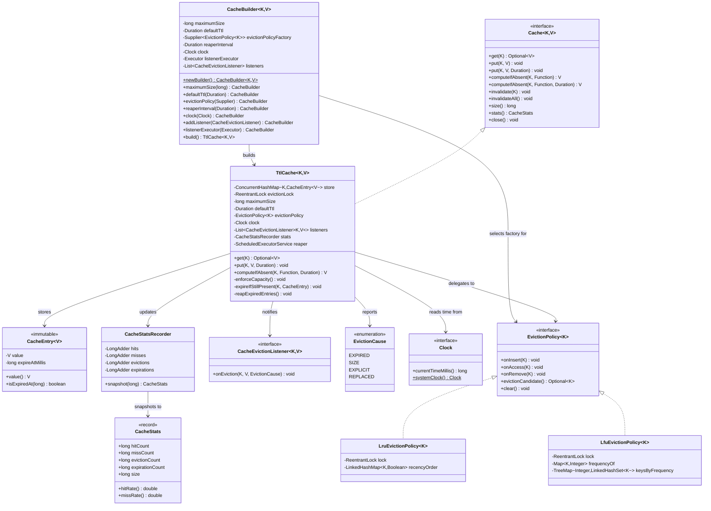
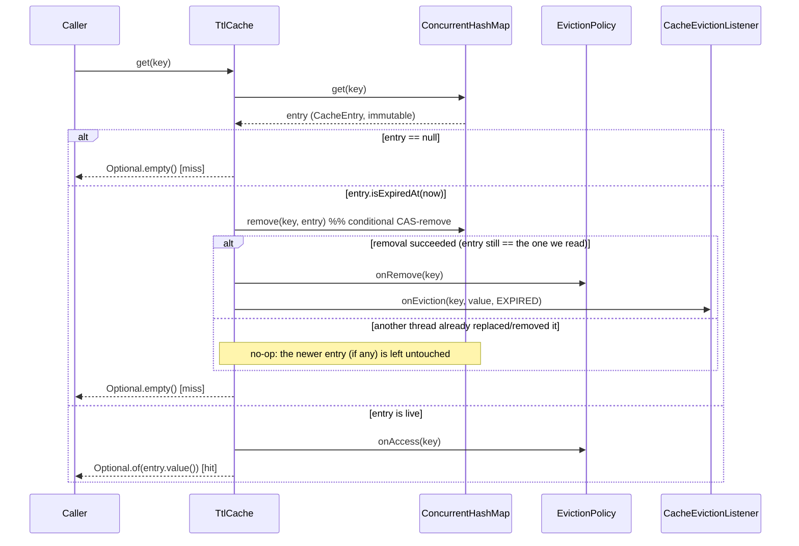

# Diagrams — TTL-based Cache Library

These Mermaid sources are the ones embedded in `README.md`. Kept here standalone so they
can be rendered independently (e.g. with the Mermaid CLI or a live editor) and so the
README stays readable as prose with diagrams inlined by reference.

## Component diagram

```mermaid
graph TB
    subgraph "Caller code"
        Client["Application code"]
    end

    subgraph "lld.ttlcache (public API)"
        CacheIfc["Cache&lt;K,V&gt; (interface)"]
        Builder["CacheBuilder&lt;K,V&gt;"]
    end

    subgraph "lld.ttlcache (implementation)"
        TtlCache["TtlCache&lt;K,V&gt;"]
        Entry["CacheEntry&lt;V&gt; (immutable)"]
        StatsRec["CacheStatsRecorder"]
        Stats["CacheStats (snapshot)"]
        ClockIfc["Clock"]
        Listener["CacheEvictionListener&lt;K,V&gt;"]
        Reaper["Background reaper\n(ScheduledExecutorService)"]
    end

    subgraph "lld.ttlcache.policy"
        PolicyIfc["EvictionPolicy&lt;K&gt; (Strategy)"]
        Lru["LruEvictionPolicy&lt;K&gt;"]
        Lfu["LfuEvictionPolicy&lt;K&gt;"]
    end

    subgraph "JDK"
        CHM["ConcurrentHashMap&lt;K, CacheEntry&lt;V&gt;&gt;"]
    end

    Client --> CacheIfc
    Client --> Builder
    Builder -- "builds" --> TtlCache
    Builder -- "selects" --> PolicyIfc
    TtlCache -. implements .-> CacheIfc
    TtlCache --> CHM
    CHM --> Entry
    TtlCache --> PolicyIfc
    PolicyIfc <|.. Lru
    PolicyIfc <|.. Lfu
    TtlCache --> StatsRec
    StatsRec --> Stats
    TtlCache --> ClockIfc
    TtlCache --> Reaper
    Reaper --> CHM
    TtlCache -. notifies .-> Listener
```

## Class diagram



## Sequence diagram: `get(key)` racing lazy expiry



## Sequence diagram: `computeIfAbsent` under a concurrent stampede

```mermaid
sequenceDiagram
    participant T1 as Thread 1
    participant T2 as Thread 2..N
    participant CHM as ConcurrentHashMap
    participant Loader as loader function
    participant Policy as EvictionPolicy

    par N threads call computeIfAbsent("k", loader) concurrently
        T1->>CHM: compute("k", remappingFn)
        T2->>CHM: compute("k", remappingFn)
    end
    Note over CHM: CHM serializes concurrent compute() calls\nfor the SAME key (bin-level lock); other keys unaffected
    CHM->>Loader: loader.apply("k")  [exactly once, by whichever thread wins]
    Loader-->>CHM: loadedValue
    CHM-->>T1: new CacheEntry(loadedValue)
    CHM-->>T2: same CacheEntry (no second load)
    T1->>Policy: onInsert("k")
    Note over T2: T2's branch saw loadedFreshValue==false -> onAccess("k") instead
```

## Sequence diagram: size-based eviction on `put`

```mermaid
sequenceDiagram
    participant Caller
    participant TtlCache
    participant CHM as ConcurrentHashMap
    participant Lock as evictionLock (tryLock)
    participant Policy as EvictionPolicy
    participant Listener

    Caller->>TtlCache: put(key, value, ttl)
    TtlCache->>CHM: put(key, newEntry)
    CHM-->>TtlCache: previous (null => new key)
    TtlCache->>Policy: onInsert(key)
    TtlCache->>TtlCache: enforceCapacity()
    alt store.mappingCount() > maximumSize
        TtlCache->>Lock: tryLock()
        alt lock acquired
            loop while over capacity
                TtlCache->>Policy: evictionCandidate()
                Policy-->>TtlCache: victim key
                TtlCache->>CHM: remove(victimKey)
                TtlCache->>Policy: onRemove(victimKey)
                TtlCache->>Listener: onEviction(victimKey, value, SIZE)
            end
            TtlCache->>Lock: unlock()
        else lock held by another thread
            Note over TtlCache: skip; the other thread's in-flight\neviction pass will restore capacity
        end
    end
    TtlCache-->>Caller: (void)
```
