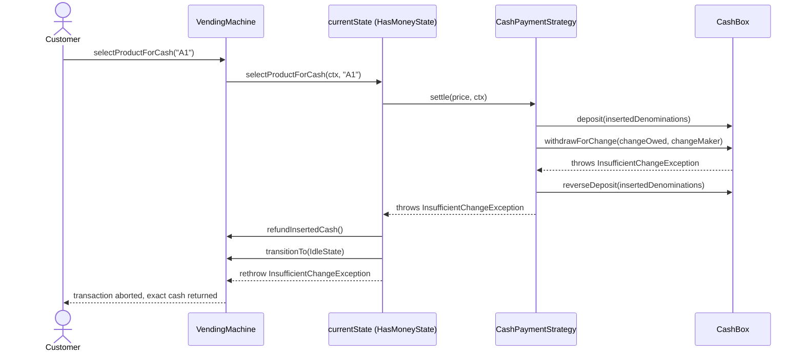

# Sequence Diagram — Card Purchase & Insufficient-Change Refund

## Card purchase (no coin-accumulation phase, no change needed)

```mermaid
sequenceDiagram
    actor Customer
    participant VM as VendingMachine
    participant S as currentState (IdleState)
    participant Slot as Inventory/Slot
    participant PS as CardPaymentStrategy
    participant GW as CardPaymentGateway
    participant Log as TransactionLog

    Customer->>VM: payByCard("A2")
    VM->>VM: machineLock.lock()
    VM->>S: payByCard(ctx, "A2")
    S->>Slot: getSlot("A2"); isEmpty()? no
    S->>PS: settle(price=$2.00, ctx)
    PS->>GW: charge($2.00)
    GW-->>PS: "AUTH-1" (approved)
    PS-->>S: PaymentOutcome(change={}, auth="AUTH-1")
    S->>Slot: dispenseOne() -> Product
    S->>VM: transitionTo(DispensingState)
    S->>VM: dispenseAndLog(product, {}, "CARD:AUTH-1")
    VM->>Log: record(Transaction)
    S->>VM: transitionTo(IdleState)
    VM->>VM: machineLock.unlock()
    VM-->>Customer: product dispensed, no change
```

## Insufficient-change abort and refund (cash flow)


