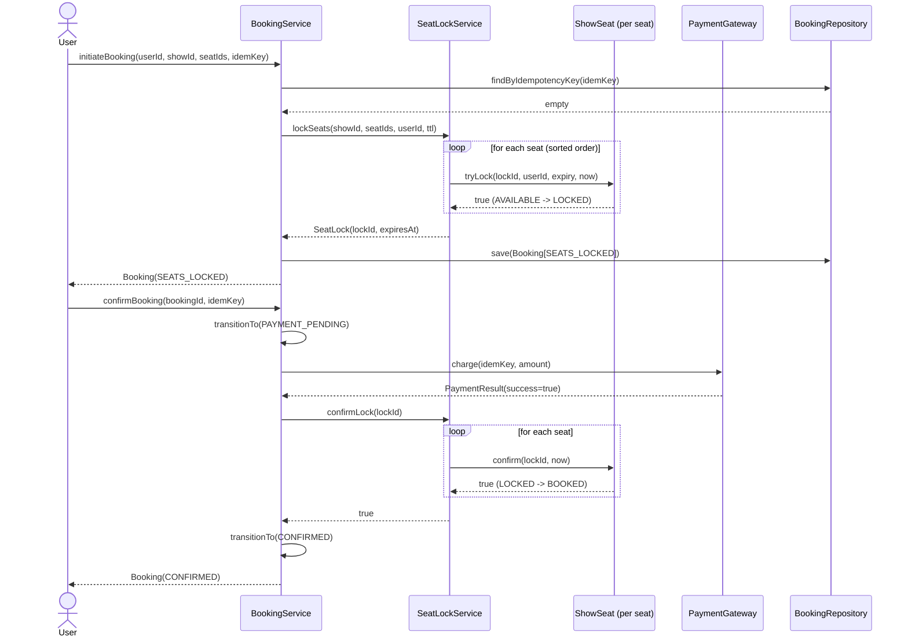
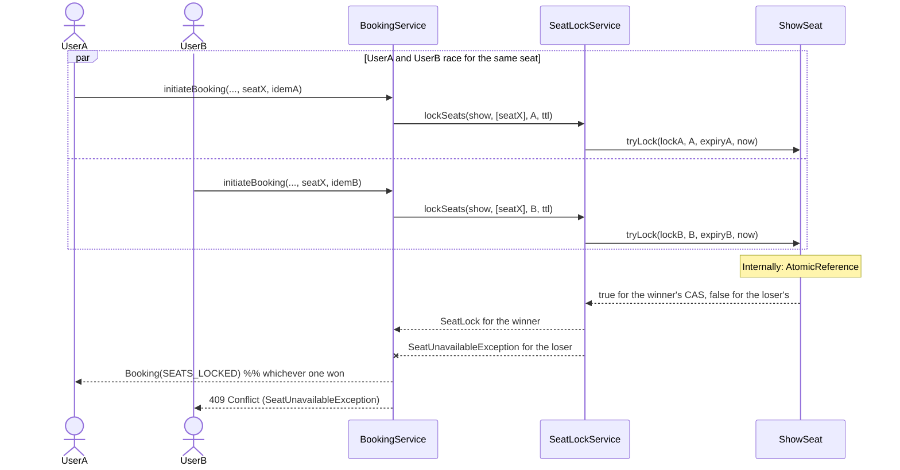
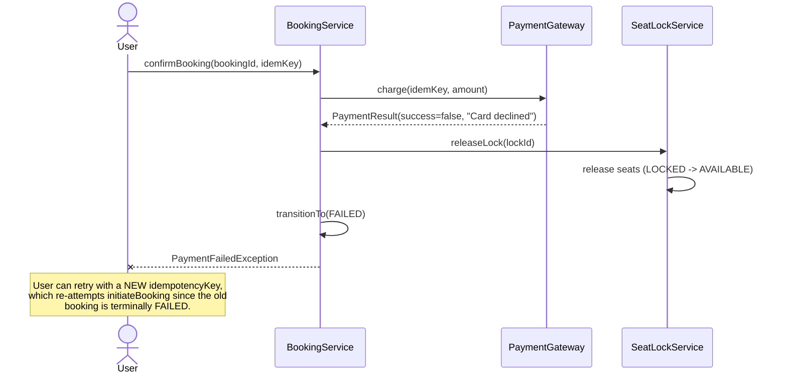
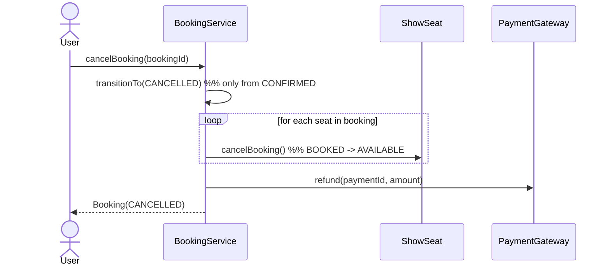

# Sequence Diagrams — Key Flows

## 1. Happy-path booking: hold → pay → confirm



## 2. Concurrent booking race on the same seat (the core invariant)



## 3. Seat hold expires before payment completes (TTL reaper)

```mermaid
sequenceDiagram
    participant User
    participant BS as BookingService
    participant SLS as InMemorySeatLockService
    participant Reaper as Reaper (ScheduledExecutorService)
    participant SS as ShowSeat

    User->>BS: initiateBooking(...)
    BS->>SLS: lockSeats(...)
    SLS->>SS: tryLock(...)
    SLS-->>BS: SeatLock(expiresAt=T+5m)
    Note over User: User abandons checkout; 5 minutes pass with no confirmBooking call.
    loop every sweepInterval
        Reaper->>SLS: sweepExpiredLocks()
        SLS->>SLS: now > lock.expiresAt?
    end
    SLS->>SS: release(lockId)  %% LOCKED -> AVAILABLE
    SLS->>BS: onLockExpired(lock) callback
    BS->>BS: booking.tryTransitionTo(EXPIRED)
    Note over BS: Seat is now bookable by someone else;<br/>booking record is marked EXPIRED for audit/history.
```

## 4. Payment failure (seats released, no charge sticks)



## 5. Cancellation and refund


