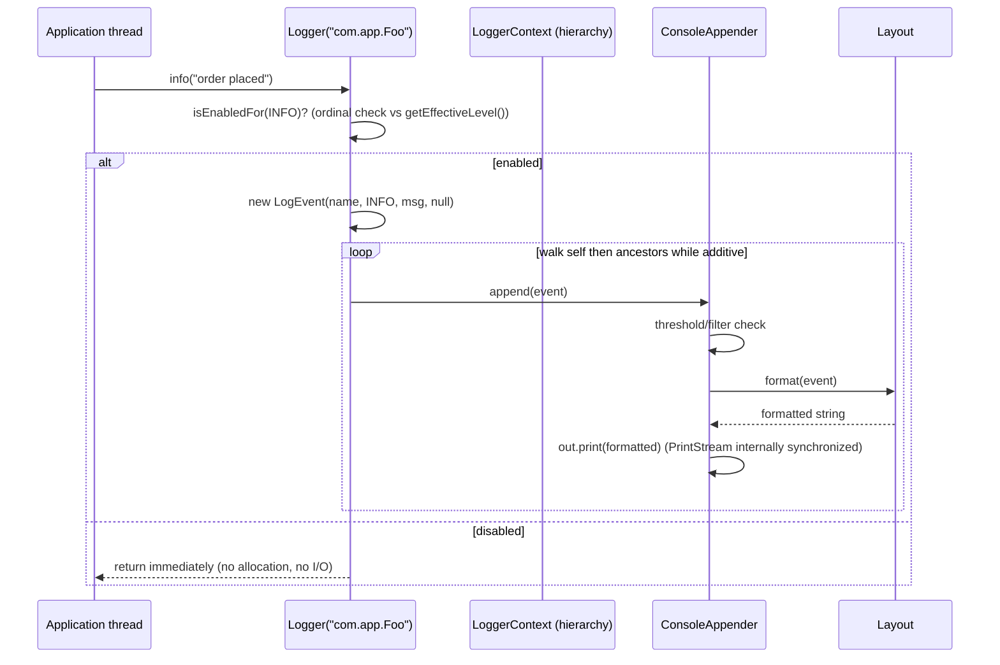
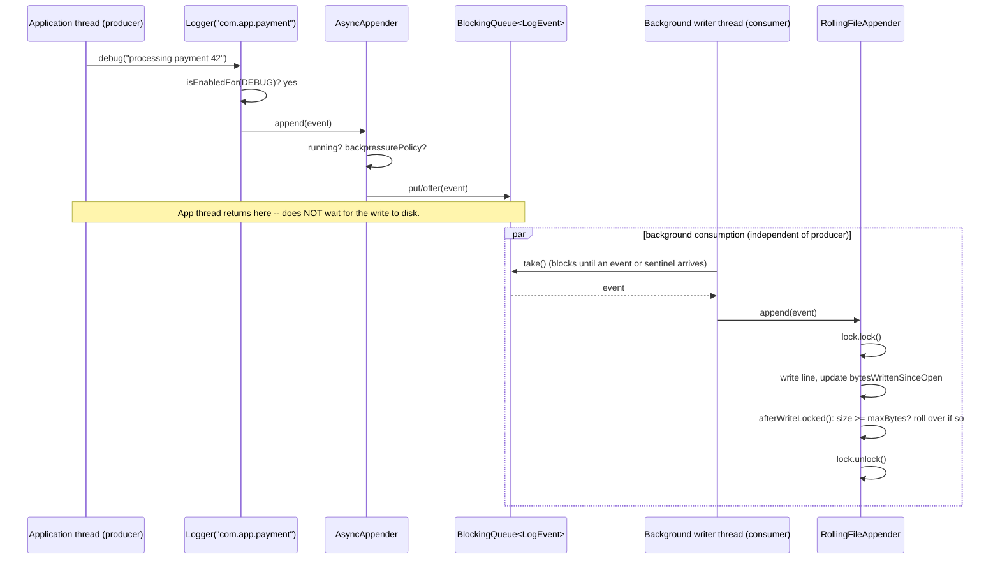
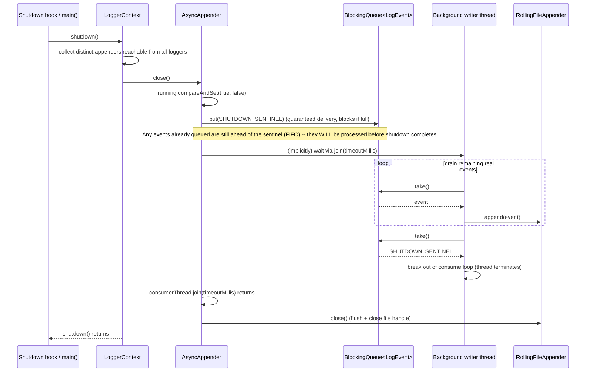

# Sequence Diagrams

## 1. Synchronous log call (ConsoleAppender)



## 2. Async log call (AsyncAppender wrapping RollingFileAppender)



## 3. Graceful shutdown (LoggerContext.shutdown())



## 4. Hierarchical configuration (Builder -> LoggerContext.configure)

```mermaid
sequenceDiagram
    participant Client as Configuring code
    participant B as LoggingConfiguration.Builder
    participant Cfg as LoggingConfiguration
    participant Ctx as LoggerContext
    participant L as Logger("com.app.payment")

    Client->>B: builder().rootLevel(INFO).addRootAppender(console)
    Client->>B: forLogger("com.app.payment").level(DEBUG).additive(false).addAppender(asyncFile).and()
    Client->>B: build()
    B-->>Cfg: new LoggingConfiguration(...)
    Client->>Ctx: configure(configuration)
    Ctx->>Ctx: root.setLevel(INFO); root.addAppender(console)
    loop for each LoggerConfig
        Ctx->>Ctx: getLogger(name) (creates hierarchy chain if absent)
        Ctx->>L: setLevel(DEBUG)
        Ctx->>L: setAdditive(false)
        Ctx->>L: addAppender(asyncFile)
    end
```
