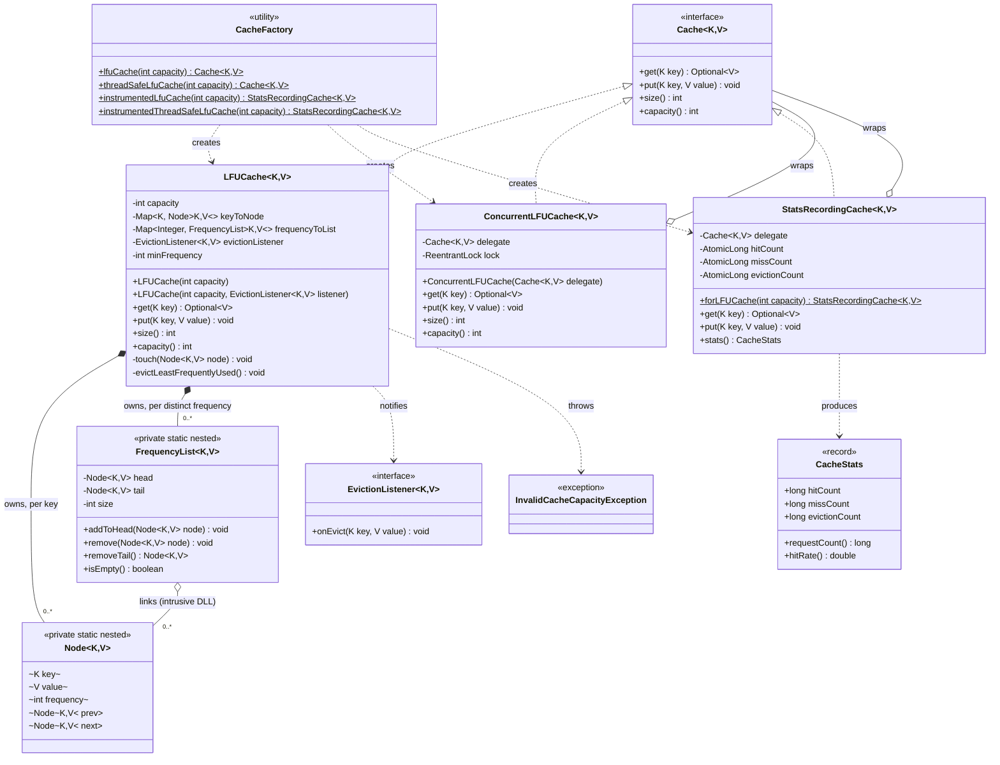

# Class Diagram

Matches the actual classes under `src/main/java/lld/lfucache/`. `Node` and
`FrequencyList` are private static nested classes of `LFUCache`; they are
shown here because they are essential to explaining the O(1) design, not
because they are part of the public API.

**Reading the composition relationships:** `LFUCache *-- Node` is a strong
composition — a `Node`'s lifecycle is entirely owned by the `LFUCache`
that created it (created on `put`, destroyed on eviction or never exposed
outside). `FrequencyList o-- Node` is a weaker aggregation: the same `Node`
object is linked into exactly one `FrequencyList` at a time, but the list
doesn't "own" the node's identity — `LFUCache.touch()` moves a node between
lists by re-linking pointers, not by copying or recreating it.
