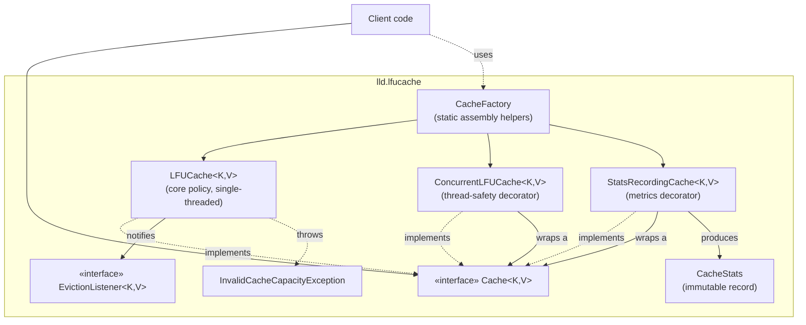

# Component Diagram

Shows how the public `Cache<K,V>` abstraction is implemented and decorated.
Arrows are "depends on / wraps".

**Why decorators, not subclasses:** `ConcurrentLFUCache` and
`StatsRecordingCache` each wrap a `Cache<K,V>` rather than extending
`LFUCache`. `LFUCache` is `final`: its correctness depends on nobody
overriding `get`/`put` and bypassing the frequency-bucket bookkeeping. Two
orthogonal concerns (locking, metrics) are composed externally instead,
so either can be added, removed, or reordered without touching the policy
implementation — this is the Decorator pattern, justified in detail in
`README.md` section 7.
