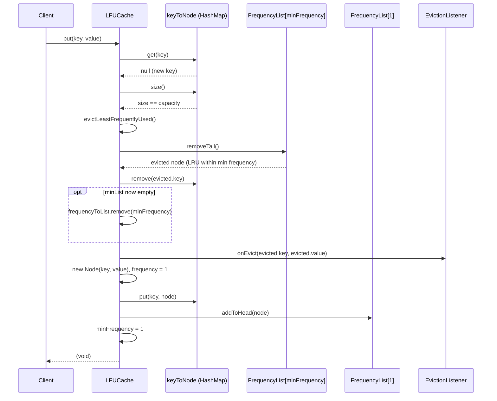

# Sequence Diagram: `put(key, value)` with eviction

Shows the path where the key is new and the cache is at capacity, forcing
an eviction before the insert.

**Why `minFrequency` resets to 1 on every insert, unconditionally:** a
brand-new node always starts at frequency 1, and frequency 1 is always
`<=` any other bucket's frequency, so it is always safe (and correct) for
the new minimum to be 1 — no comparison against the previous `minFrequency`
is needed, which keeps `put` O(1) instead of requiring a scan of existing
buckets.
