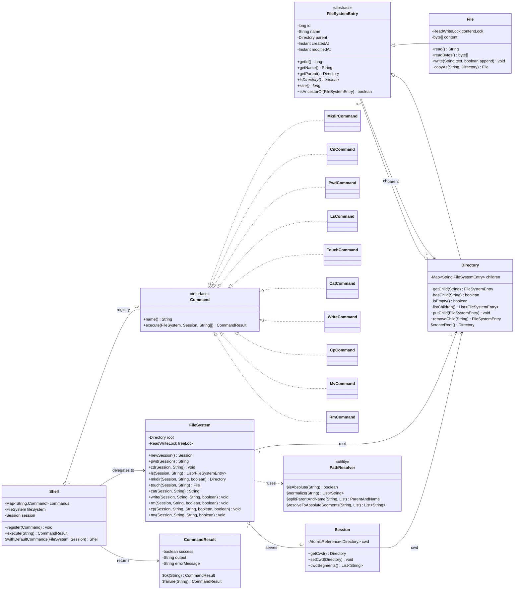

# Class Diagram

**Why this matches the implementation:** `FileSystemEntry` is the Composite base (abstract,
holds identity/name/parent); `File` is the leaf, `Directory` is the composite holding a
`LinkedHashMap<String, FileSystemEntry>`. `FileSystem` is the facade/orchestrator owning the
single `root` and the tree-structure lock; it never exposes `Directory`/`File` mutator methods
(`putChild`, `removeChild`, `setParent`, ...) outside the package -- those are package-private so
only `FileSystem` can call them under lock, which is what makes the locking policy enforceable
rather than just documented. `Session` is a pure value holder for one cwd pointer. `Command` /
`CommandResult` / `Shell` are the Command-pattern layer that sits *on top of* `FileSystem` and
never touches `Directory`/`File` directly.
