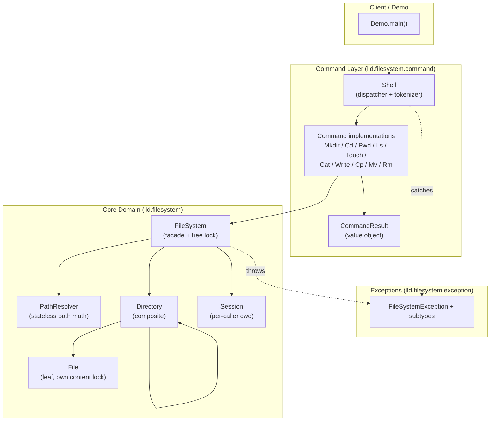

# Component Diagram

**Layering rules this enforces:**
- The Command layer depends on the Core layer, never the reverse (`FileSystem` has zero
  knowledge of `Command`/`Shell`), so the core domain is reusable from a GUI, a gRPC service, or
  a test harness without pulling in shell-parsing concerns.
- `Directory`/`File` are never referenced from the Command layer directly; all access goes
  through `FileSystem`, which is the only class allowed to acquire the tree lock. This is what
  makes "every mutation is correctly locked" a property of the architecture instead of a
  convention every command author has to remember.
