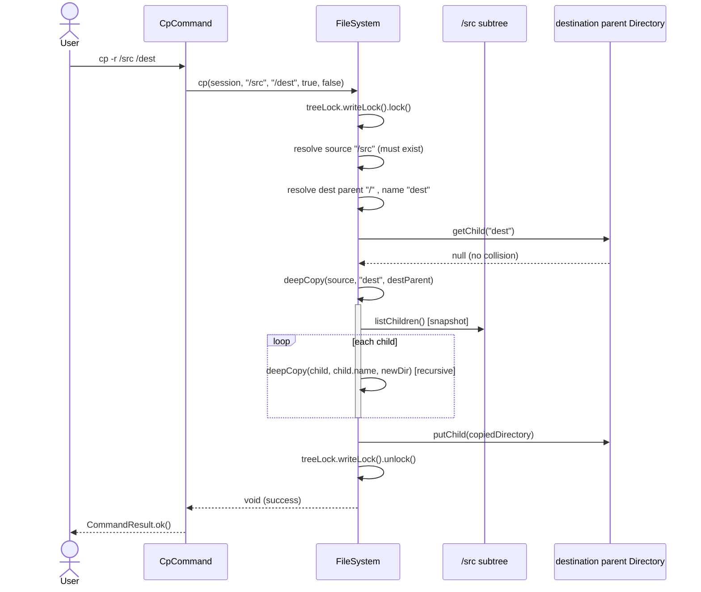
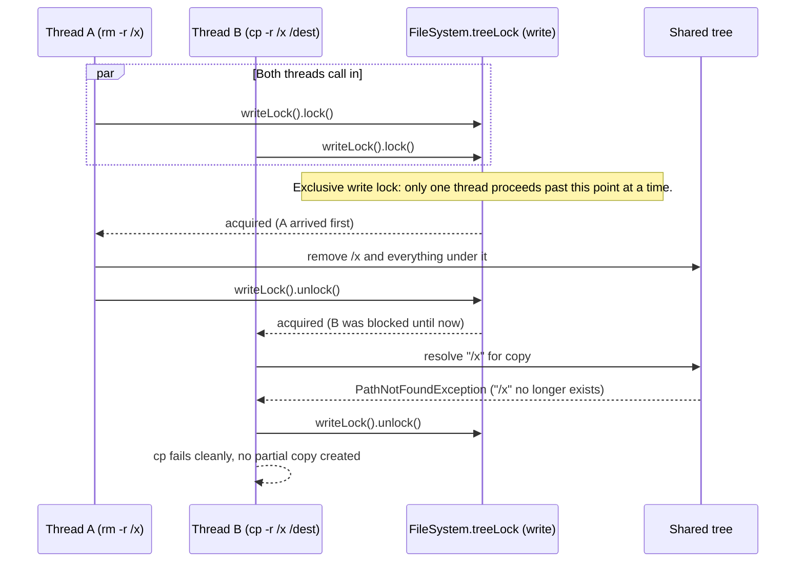

# Sequence Diagrams

## 1. `mkdir -p /home/user/docs` (path resolution + structural write lock)

```mermaid
sequenceDiagram
    actor User
    participant Shell
    participant MkdirCommand
    participant FileSystem
    participant PathResolver
    participant Directory as Directory(root..docs)

    User->>Shell: execute("mkdir -p /home/user/docs")
    Shell->>MkdirCommand: execute(fs, session, ["-p","/home/user/docs"])
    MkdirCommand->>FileSystem: mkdir(session, "/home/user/docs", true)
    FileSystem->>FileSystem: treeLock.writeLock().lock()
    FileSystem->>PathResolver: resolveToAbsoluteSegments(path, cwdSegments)
    PathResolver-->>FileSystem: [home, user, docs]
    loop for each segment
        FileSystem->>Directory: getChild(segment)
        alt missing and createParents
            FileSystem->>Directory: new Directory(segment, cursor); putChild(...)
        else exists and is a Directory
            FileSystem->>Directory: cursor = existing
        else exists and is a File
            FileSystem-->>MkdirCommand: throw NotADirectoryException
        end
    end
    FileSystem->>FileSystem: treeLock.writeLock().unlock()
    FileSystem-->>MkdirCommand: Directory(docs)
    MkdirCommand-->>Shell: CommandResult.ok()
    Shell-->>User: success
```

## 2. `cp -r /src /dest` (recursive copy, whole duration under one write lock)



## 3. Concurrent `rm -r /x` vs `cp -r /x /dest` (the motivating race)



**Why no interleaving produces corruption:** because both operations hold the *same* write lock
for their *entire* duration (not re-acquired per node), there is no point at which Thread B can
observe `/x` half-deleted, and no point at which Thread A can observe a half-created copy that it
needs to also delete. The two operations are fully serialized with respect to each other, which
is what "linearizable" means here -- see `FileSystem`'s class javadoc and
`STAFF_LEVEL_DEEP_DIVE.md` for the trade-offs of this choice versus finer-grained locking.
