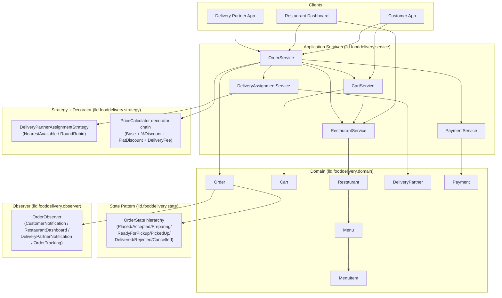

# Architecture — Component Diagram

**Reading guide:** arrows show "depends on" / "calls into", not data flow direction. `OrderService`
is the only component that talks to every other service — it is the orchestration layer. Domain
objects (`Order`, `MenuItem`, `DeliveryPartner`) own their own thread-safety; services compose
them but do not re-implement locking around them (see README §11).
