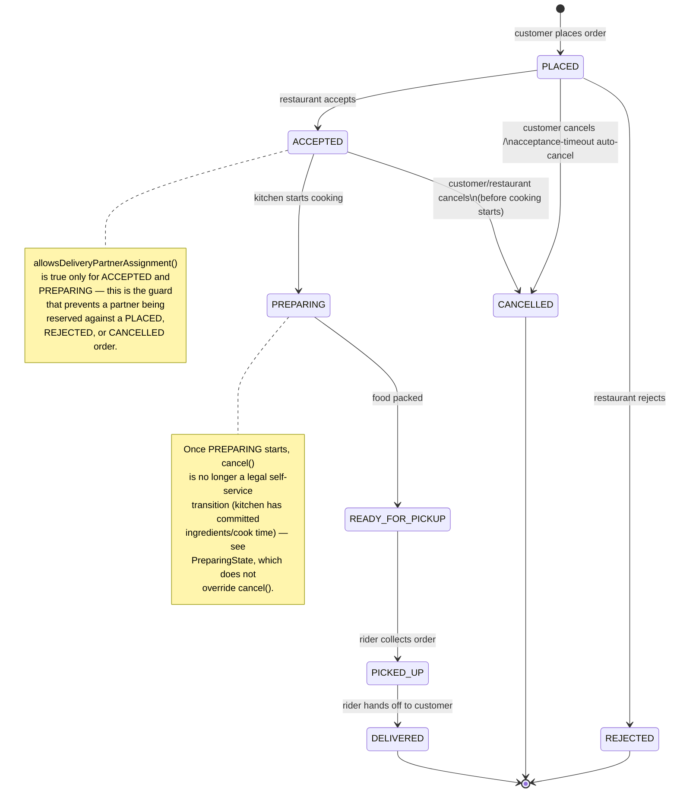

# Order Lifecycle — State Diagram

This diagram must exactly match `lld.fooddelivery.state.*` — each arrow corresponds to one
`OrderState` subclass overriding exactly that transition method; any transition not drawn here
is structurally unreachable because `OrderState`'s default methods throw
`InvalidOrderStateTransitionException`.
