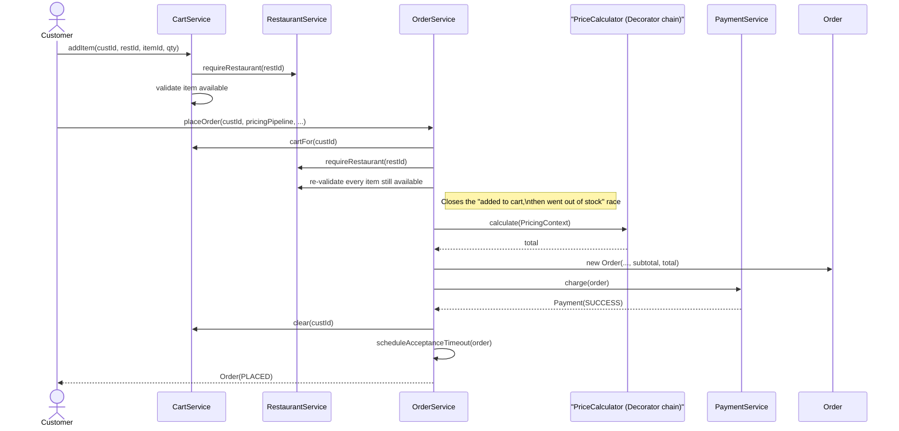
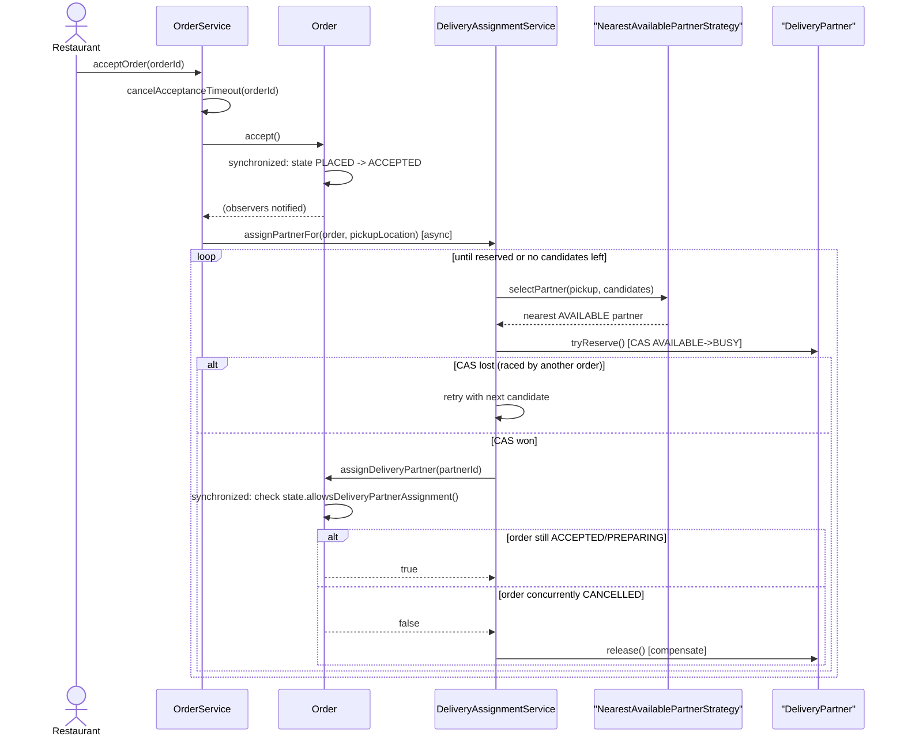
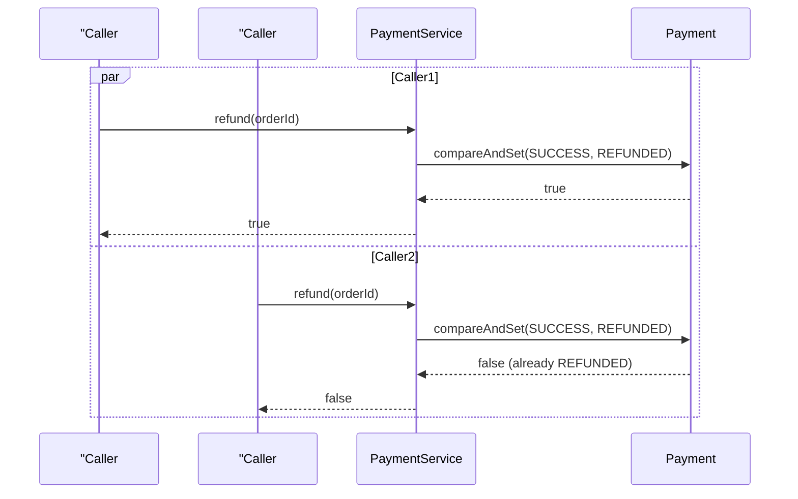

# Sequence Diagrams — Key Flows

## 1. Order placement (checkout)



## 2. Restaurant acceptance + async delivery-partner assignment



## 3. Concurrent cancellation racing delivery-partner assignment (the race this system must prevent)

```mermaid
sequenceDiagram
    participant ThreadA as "Thread A: cancelOrder()"
    participant ThreadB as "Thread B: assignPartnerFor()"
    participant Order
    participant Partner as "DeliveryPartner"

    par Thread A
        ThreadA->>Order: cancel("changed mind")
        activate Order
        Note over Order: synchronized(order) block
        Order->>Order: state ACCEPTED -> CANCELLED
        deactivate Order
    and Thread B
        ThreadB->>Partner: tryReserve() [wins CAS]
        ThreadB->>Order: assignDeliveryPartner(partnerId)
        activate Order
        Note over Order: blocks until Thread A's\nsynchronized block exits
        Order->>Order: state.allowsDeliveryPartnerAssignment()?
        Order-->>ThreadB: false (state is now CANCELLED)
        deactivate Order
        ThreadB->>Partner: release() [compensate]
    end
    Note over Order,Partner: Final state is deterministic: whichever thread\nentered the order's monitor first fully wins;\nthe partner is never left stranded as BUSY.
```

## 4. Payment refund idempotency under duplicate calls


