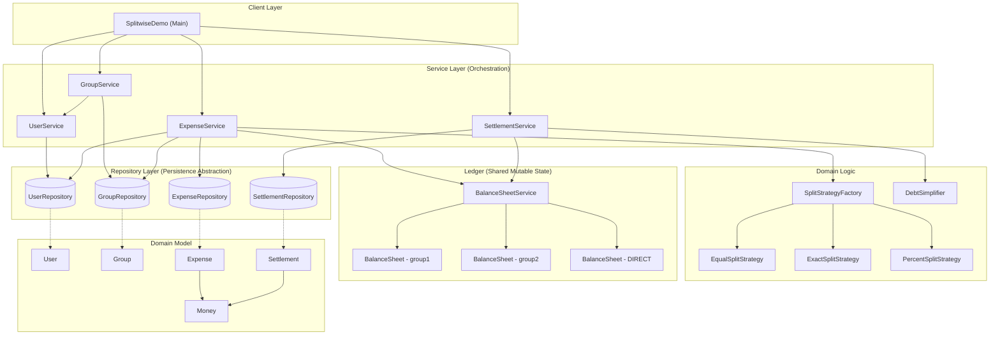

# Component Diagram

**Key boundaries:**
- **Service layer** is the only caller of repositories and the ledger; it owns transactional orchestration (validate → compute → persist → apply to ledger).
- **Split strategies** are pure functions of `(Money, SplitInput) -> List<ExpenseShare>` with no I/O, no locking, trivially unit-testable in isolation.
- **BalanceSheetService** owns all shared mutable state and all locking; every other component treats it as an opaque, thread-safe black box.
- **Repositories** are swappable (in-memory today; JDBC/NoSQL-backed tomorrow) behind interfaces — no service class depends on a concrete repository implementation.
