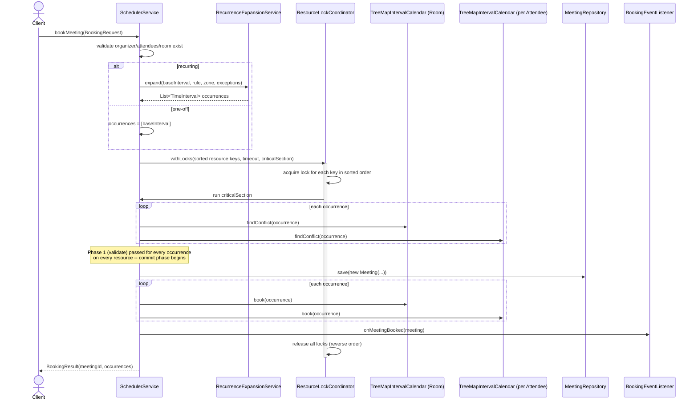
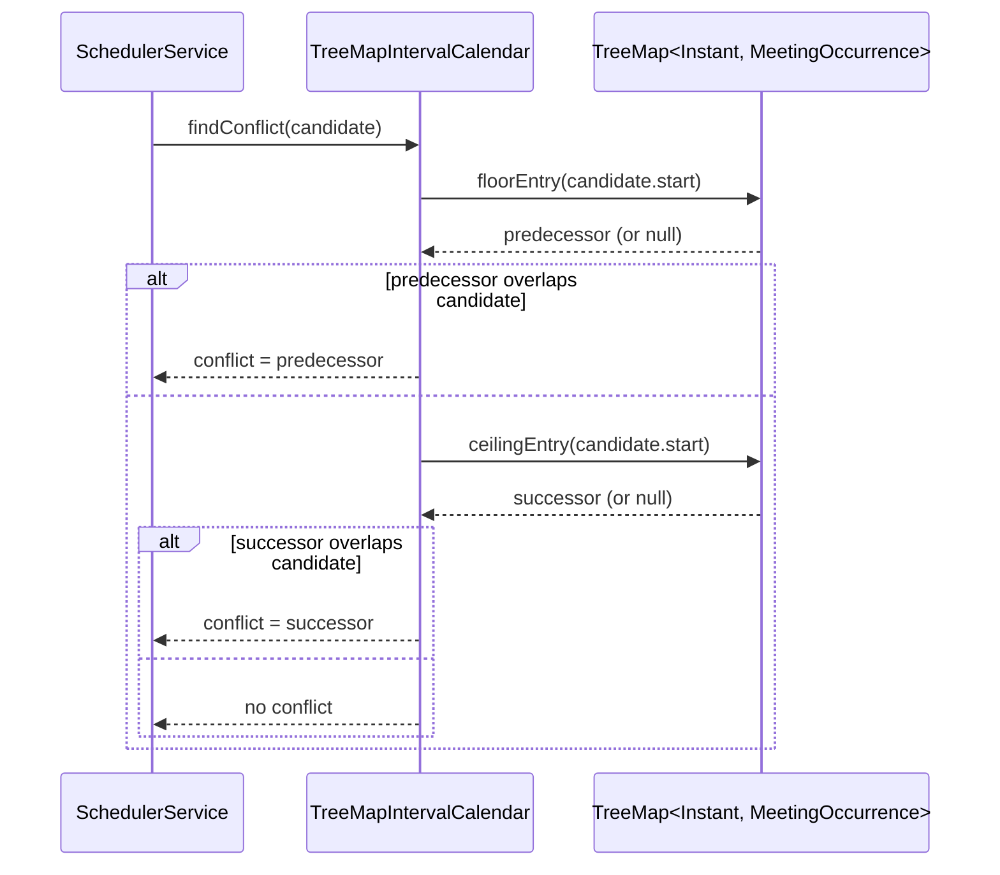
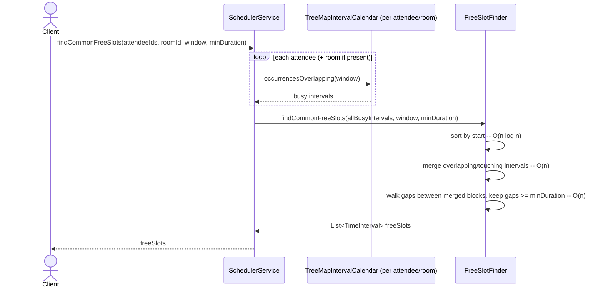
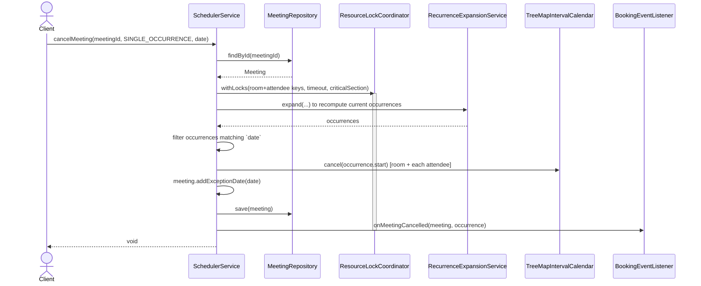

# Sequence Diagrams — Key Flows

## 1. Booking a (possibly recurring) meeting

## 2. Conflict detection on a single resource (the DSA core)

## 3. Finding common free slots across attendees

## 4. Cancelling a single occurrence of a recurring meeting

