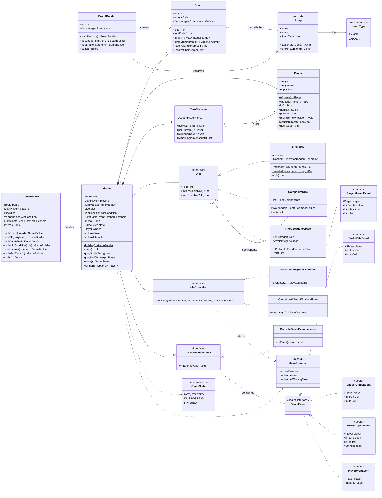

# Class Diagram — Snake and Ladder

This diagram matches the actual Java implementation in `src/main/java/lld/snakeandladder`
class-for-class and method-for-method (public API surface only; private
helpers are omitted for readability).

**Relationship notes (match `README.md §4` exactly):**
- `Game *-- Board` / `Game *-- Player` / `Game *-- TurnManager`: composition
  — these are created for and owned exclusively by one `Game` instance and
  have no independent lifecycle outside it (with the one deliberate
  exception that a `Board` instance *can* be shared across multiple `Game`s
  since it is immutable — the UML composition arrow reflects the common
  case, not a hard constraint enforced by the type system).
- `Game o-- Dice` / `Game o-- WinCondition` / `Game o-- GameEventListener`:
  aggregation — these are injected collaborators that exist independently
  of any one `Game` and may be reused across many `Game` instances (e.g. a
  single `ConsoleGameEventListener` could, in principle, listen to several
  games at once).
- `Dice <|.. SingleDie` etc. and `WinCondition <|.. ExactLandingWinCondition`
  etc.: realization of a Strategy interface — this is the crux of the
  design's extensibility story.
