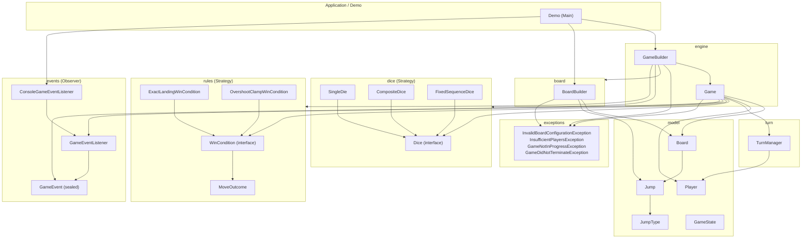

# Component Diagram — Snake and Ladder

This diagram shows the package-level component structure of
`lld.snakeandladder` and the direction of dependencies between packages.
Dependencies only point "inward" toward `model` and "sideways" toward the
pluggable strategy packages (`dice`, `rules`) — nothing in `model` depends on
`engine`, `dice`, `rules`, `turn`, or `events`, which is what makes those
strategies swappable without touching the domain model.

**Key dependency rule:** `model` has zero outgoing dependencies on any other
package in this diagram. `dice` and `rules` depend on nothing but the JDK
and (for `rules`) a tiny local record. `engine` is the only package that
depends on everything else, which is an intentional, acknowledged
concentration of coupling — see `STAFF_LEVEL_DEEP_DIVE.md` Q1 for the
trade-off discussion.
