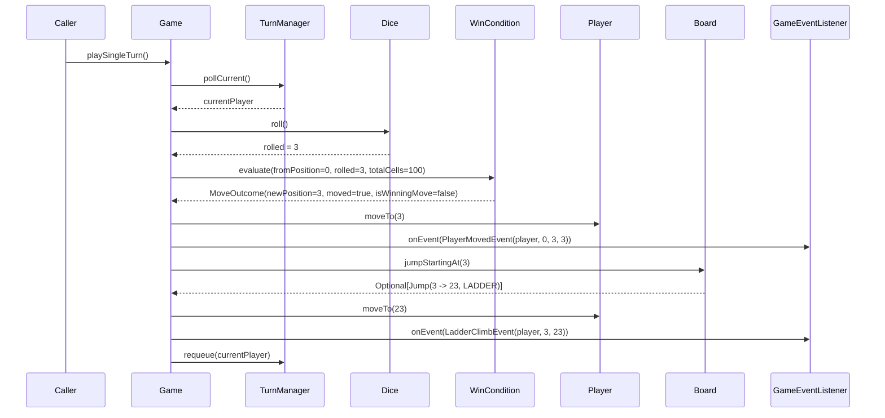
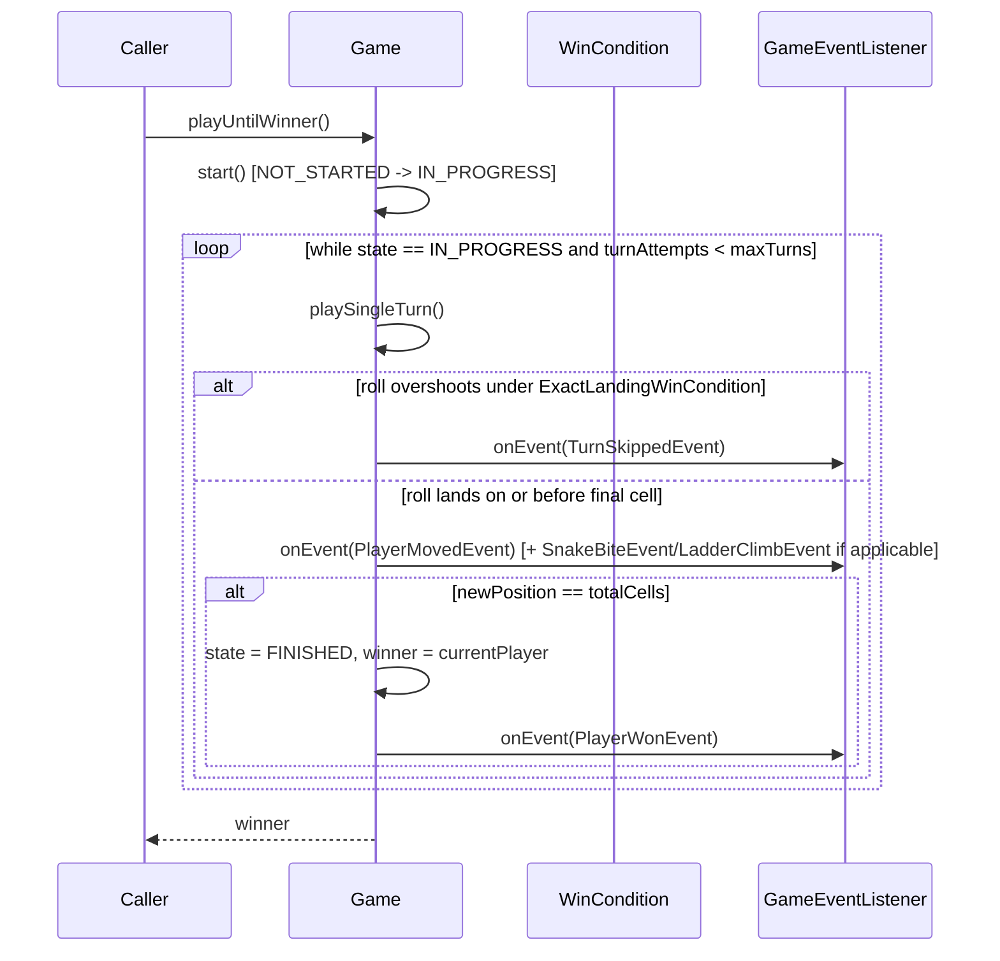
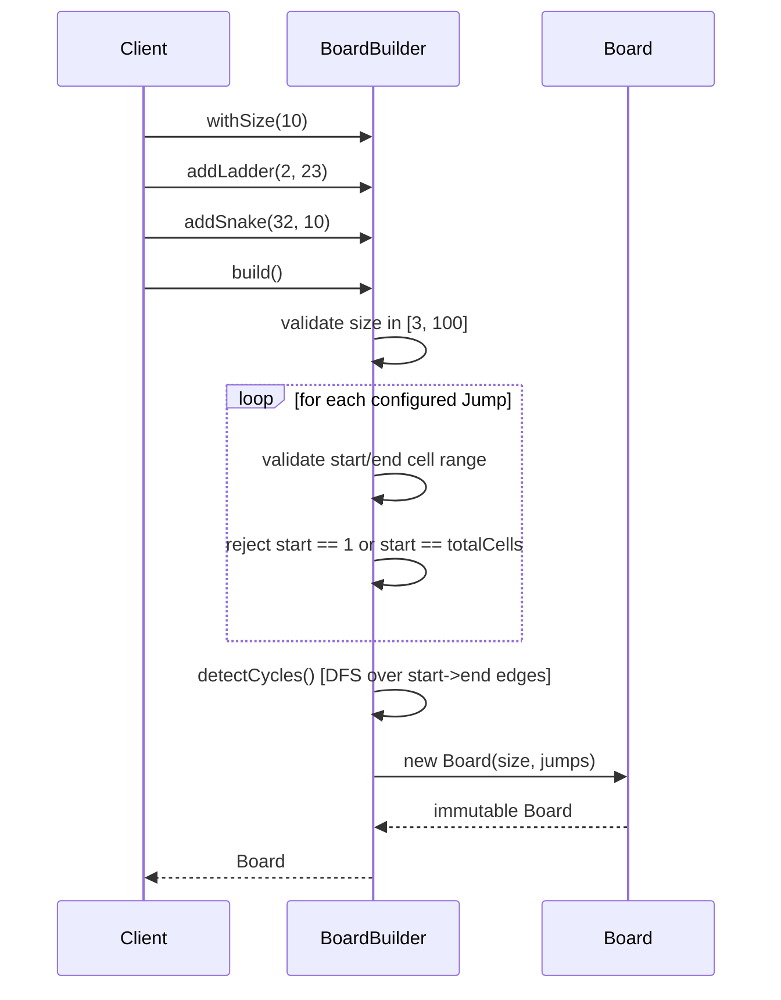
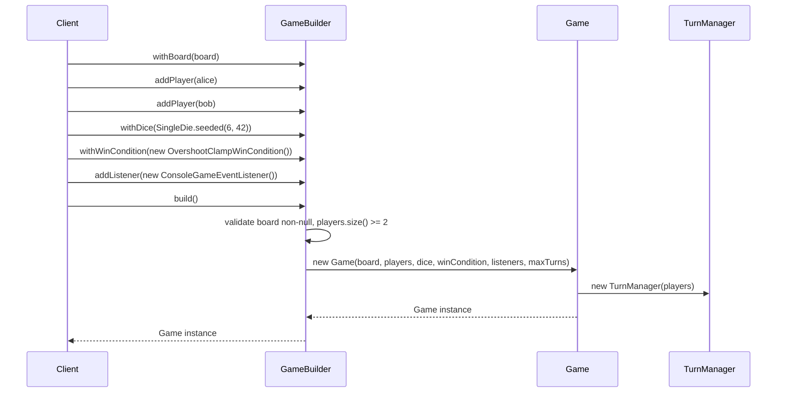

# Sequence Diagrams — Snake and Ladder

## 1. A single turn that triggers a ladder climb

Matches `Game.playSingleTurn()` exactly: dice roll → `WinCondition`
evaluation → player move → board jump resolution → event publication →
turn rotation.

## 2. A full game to completion via `playUntilWinner()`

## 3. Board construction with validation (`BoardBuilder.build()`)

## 4. Game assembly via `GameBuilder` (Builder pattern in action)

