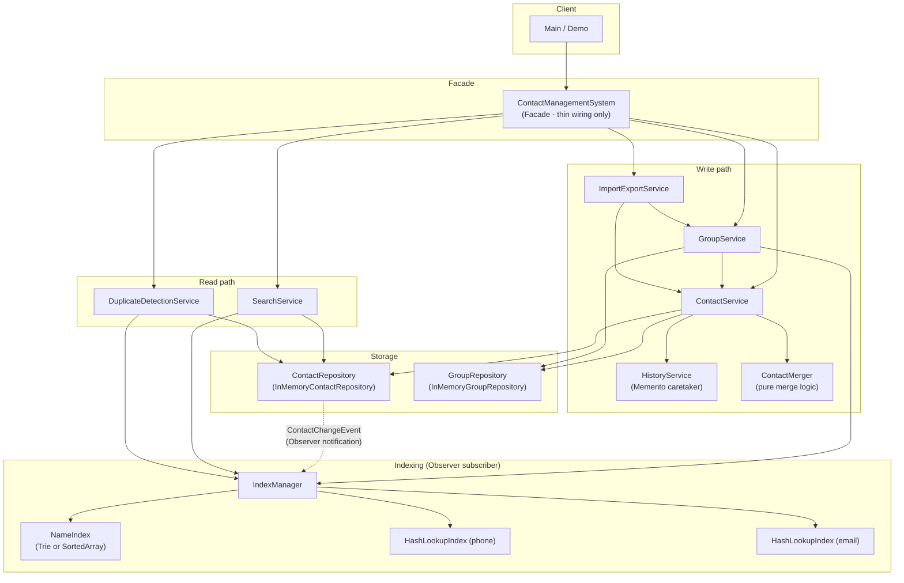
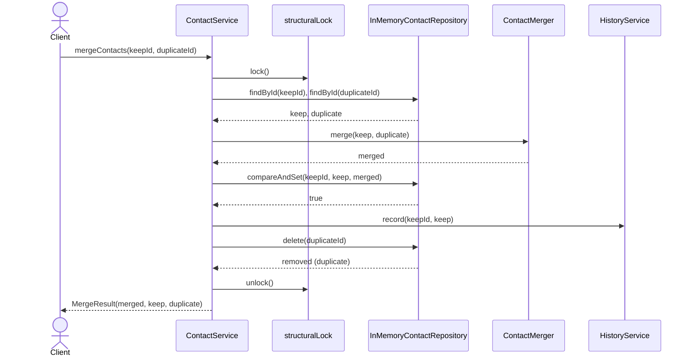

# Contact Management System — Low-Level Design

A Staff-level LLD for a contact/address-book management system: contacts
with multiple phone numbers, emails, and postal addresses; groups/labels;
prefix name search; exact phone/email lookup; duplicate detection and
merge; vCard-style import/export; favorites; and undo of edits.

Source: `src/main/java/lld/contactmanagement/` · Tests: `tests/java/lld/contactmanagement/`
Package: `lld.contactmanagement` · Java 17+.

---

## 1. Problem Understanding

**Plain explanation.** Design the backend for something like the "Contacts"
app on a phone, or a CRM's contact book: store people/organizations with
several ways to reach them, organize them into groups, find them quickly by
typing a few letters of a name or an exact phone/email, notice when the same
person was entered twice and merge the duplicates, move contacts in and out
of the system via a standard file format, mark important contacts as
favorites, and undo a mistaken edit.

**Real-world use case.** Phone/OS contact apps (iOS Contacts, Android
Contacts), CRM contact modules (Salesforce, HubSpot), email client address
books (Outlook, Gmail), and enterprise directory front-ends all solve this
exact problem at various scales.

**What the interviewer is evaluating.**
- Can you model a "rich" entity with several one-to-many value-object
  collections cleanly (phones, emails, addresses) without turning `Contact`
  into an anemic bag of public fields or, conversely, a god object?
- Can you pick the right data structure for each access pattern (prefix
  search vs exact lookup) and *justify* it with real complexity numbers,
  not just name-drop "Trie"?
- Do you reach for concurrency primitives *because the problem needs them*
  (concurrent edits to the same contact) rather than sprinkling
  `synchronized` everywhere out of anxiety?
- Do you know when a pattern (Memento, Observer, Strategy, Facade) earns its
  keep, and can you articulate the alternative you rejected?
- Do you separate interview-necessary behavior from production concerns
  (persistence, metrics, distributed coordination) instead of trying to
  build a distributed system in 45 minutes?

**In scope.**
- Contacts with multiple phones (typed: mobile/home/work/other), emails
  (typed), postal addresses (typed).
- Groups/labels with many-to-many contact membership.
- Prefix (autocomplete-style) search by name; exact lookup by phone/email.
- Duplicate detection (via shared contact points and/or matching names) and
  merge, with the ability to reverse a merge.
- vCard-style text import/export.
- Favorites.
- Undo of the most recent edit per contact (Memento pattern).
- In-process thread safety for concurrent reads/writes against the same
  in-memory store.

**Out of scope (named, not silently ignored).**
- Real telephony-grade phone number parsing (country codes, extensions,
  carrier validation) - a pragmatic digits-only normalizer is used instead;
  upgrading to a library like libphonenumber is a one-class swap (see
  section 17).
- True fuzzy/phonetic name matching (Soundex, edit distance) for duplicate
  detection - the `DuplicateMatchStrategy` abstraction is explicitly built
  to add this later without touching existing code (Open/Closed).
- A full RFC 6350 vCard parser (line folding, every standard property,
  character-set declarations) - a readable, round-trippable subset is
  implemented instead.
- Persistent storage, authentication/authorization, multi-tenant isolation,
  distributed replication - addressed as named production extensions in
  section 17, not implemented here.
- Pagination cursors / streaming APIs for very large result sets - `limit`
  parameters are supported but no cursor-based pagination.

---

## 2. Requirement Gathering

### Functional — essential (interview-necessary)
1. Create, read, update, delete a contact with: a display name; zero or
   more typed phone numbers; zero or more typed emails; zero or more typed
   postal addresses; free-form notes; a favorite flag.
2. A contact must be reachable somehow: at least one phone or email is
   required (business rule, enforced at the service layer).
3. Create/rename/delete groups; add/remove a contact to/from a group;
   list a group's members; deleting a group removes the membership from
   every contact that had it.
4. Search contacts by name prefix (first or last name).
5. Look up a contact by exact phone number or exact email address,
   regardless of how the number/email was originally formatted.
6. Detect potential duplicate contacts and merge two contacts into one,
   unioning their phones/emails/addresses/groups; support reversing the
   most recent merge.
7. Mark/unmark a contact as a favorite; list favorites.
8. Undo the most recent edit to a given contact (Memento).
9. Export one or all contacts to a vCard-style text format; import one or
   many such records back in, re-attaching groups by name.

### Functional — optional / stretch (acknowledged, partly stubbed)
- Redo (the inverse of undo) - not implemented; the `HistoryService` API
  is shaped so it could be added as a second stack without touching
  `ContactService`'s call sites.
- Fuzzy (edit-distance/phonetic) duplicate matching - see
  `NormalizedNameMatchStrategy` javadoc for why it's named as a strategy
  slot rather than implemented.
- Contact photos/avatars - omitted entirely (binary asset storage is a
  solved, orthogonal problem not interesting to re-derive here).
- Multi-value "primary" flags (e.g. "primary phone") - omitted; first
  entry in each list is the de facto primary, which is enough for an
  interview-scope system.

### Non-functional
- **Performance.** Name-prefix search must not be O(total contacts) per
  query; exact phone/email lookup must be O(1) average. See section 10 for
  the exact complexity analysis and trade-offs.
- **Scalability.** The design must behave sensibly from tens of contacts
  (a personal phone) to low millions (a mid-size CRM) on a single process;
  true horizontal distribution is explicitly a named extension (section
  17), not attempted here - over-distributing an LLD answer is a common
  mistake this design avoids.
- **Availability.** Single-process, in-memory: availability is "the JVM is
  up". Not meaningfully distinguishable from consistency at this scope.
- **Consistency.** Every read observes a value some writer actually
  committed (no torn reads of a half-updated `Contact`, guaranteed by
  immutability); concurrent edits to the *same* contact are linearized via
  optimistic concurrency control, not silently lost.
- **Extensibility.** New duplicate-matching heuristics, new name-index
  algorithms, new import/export formats must be addable as new classes
  implementing an existing interface, not by modifying core services
  (Open/Closed Principle - verified against each pattern in section 7).
- **Reliability.** No operation should leave the store in a state where a
  contact exists in storage but not in the indexes (or vice versa) under
  concurrent load; see section 11 and 13.
- **Thread-safety.** Every public method on every service class must be
  safely callable from multiple threads without external synchronization
  by the caller; every such claim is justified, not asserted (section 11).

### Interview-necessary vs. production-extension split
| Interview-necessary (implemented here) | Production extension (named, section 17) |
|---|---|
| In-memory storage with CAS-based updates | Persistent storage (RDBMS/NoSQL) with real transactions |
| Single-process locking (CAS + one coarse lock for cross-aggregate ops) | Distributed locking/coordination (e.g. per-shard leader) |
| Digits-only phone normalization | Full E.164 parsing via a telephony library |
| In-memory Trie/sorted-array/hash indexes | Durable search index (e.g. Elasticsearch) for very large datasets |
| Bounded in-memory undo history | Durable audit log with unlimited retention/compliance export |
| Synchronous method calls | Async/event-driven pipeline, retries, dead-letter handling |

---

## 3. Clarifying Questions

These are the questions a candidate should ask in the first five minutes;
the answer assumed for this implementation is given, along with how a
different answer would have changed the design.

1. **"Is this single-user (a phone's address book) or multi-tenant (a CRM
   shared across a sales team)?"** *Assumed: single-tenant, single address
   book, but built so multi-tenant is additive.* A multi-tenant answer would
   push a `tenantId`/`ownerId` into every repository key and index key - a
   real but mechanical change, not a redesign, because every lookup already
   goes through a repository/index abstraction.
2. **"Must a contact always have a phone or email, or can a 'name-only'
   contact exist?"** *Assumed: at least one contact point is required* (a
   common real-app rule - an unreachable contact is low value and often a
   data-entry mistake). This is enforced one layer above the entity
   (`ContactService`, not `Contact.build()`) - see section 5 for why that
   split matters.
3. **"When two contacts look like duplicates, should the system auto-merge,
   or only suggest and let a human confirm?"** *Assumed: suggest-only;
   merge is an explicit, separate operation the caller invokes.*
   Auto-merging would need a much higher-precision strategy (the `ALL`
   composite mode, or a stricter/weighted match) to avoid silently
   corrupting unrelated contacts - a correctness-critical decision that
   should not default to "on".
4. **"Is 'undo' a per-field undo, or 'go back one whole edit'?"** *Assumed:
   whole-edit undo (go back to the contact's state just before the most
   recent save).* A per-field undo would require per-field version history
   (far more storage/complexity) for marginal real-world benefit over
   whole-snapshot undo.
5. **"Should name search match only the start of the full name, or any
   token (first name OR last name)?"** *Assumed: any whitespace-delimited
   token* - "smi" must find "John Smith" even though the display name
   starts with "John". This directly shaped the indexing strategy (index
   per-token, not per-full-name).
6. **"How exact does phone/email matching need to be - is '(555) 123-4567'
   the same as '555-123-4567'?"** *Assumed: yes, normalize before comparing/
   indexing.* Answering "no, exact string match only" would simplify
   `ContactNormalizer` away but would make phone/email search and duplicate
   detection far less useful in practice.
7. **"What should happen to a contact's group memberships when a group is
   deleted?"** *Assumed: cascade - remove the membership from every
   contact, but do not delete the contacts themselves.* The alternative
   (block deletion while members exist) is a one-line change in
   `GroupService.deleteGroup` if a different policy is required.
8. **"Is multi-threaded access actually required, or is this a
   single-threaded CLI/demo?"** *Assumed: yes, must be thread-safe* -
   most real contact-management backends serve concurrent requests, and
   staff-level interviews specifically probe this; building it in from the
   start (immutable entities + CAS) is far cheaper than retrofitting it.
9. **"Should deleted contacts be hard-deleted or soft-deleted
   (tombstoned) for audit purposes?"** *Assumed: hard delete*, with the one
   deliberate exception that a merge's deleted-duplicate is retained in the
   returned `MergeResult` just long enough to support a single undo. A
   compliance/audit requirement would change this to soft-delete
   everywhere - named as a production extension, not built by default.
10. **"Is there a size limit on the address book that changes the right
    data structure (hundreds vs. tens of millions of contacts)?"**
    *Assumed: realistic single-user/small-team scale (thousands to low
    millions)*, which is exactly why this design chooses in-memory
    hash/trie structures instead of jumping to a distributed search
    cluster - see section 14 for where that assumption would need to be
    revisited.

---

## 4. Domain Modelling

### Entities
- **`Contact`** (aggregate root, `src/.../model/Contact.java`) - the only
  entity with its own identity and lifecycle. Immutable; every "edit"
  produces a new instance via `toBuilder()`. Owns its phone/email/address
  value objects and references group identities by id (not by object), so
  `Contact` and `Group` can evolve independently.
- **`Group`** (`model/Group.java`) - an independently-addressable, small
  value-entity (has an id, but no complex lifecycle of its own beyond
  create/rename/delete).

### Value objects (immutable, equality by value)
- **`PhoneNumber`** (record) - raw display value + type; normalization is
  computed on demand via `normalized()`, not stored, so raw formatting is
  never lost (see its javadoc for why phones and emails are normalized
  differently).
- **`EmailAddress`** (record) - normalized eagerly in its canonical
  constructor (trim + lowercase), since that normalization is lossless for
  email.
- **`PostalAddress`** (record) - street/city/state/zip/country + type.

### Enums
- `PhoneType` (MOBILE, HOME, WORK, OTHER)
- `EmailType` (PERSONAL, WORK, OTHER)
- `AddressType` (HOME, WORK, OTHER)
- `ContactChangeEvent.EventType` (CREATED, UPDATED, DELETED)

### Interfaces (contracts/abstractions)
- `ContactRepository` / `GroupRepository` - storage abstraction (Dependency
  Inversion); `ContactService`/`GroupService` depend on these, not on the
  in-memory implementations.
- `ContactChangeListener` - Observer callback for repository change events.
- `NameIndex` - Strategy abstraction for prefix search (`TrieNameIndex`,
  `SortedArrayNameIndex`).
- `DuplicateMatchStrategy` - Strategy abstraction for duplicate matching
  rules (`ExactContactPointMatchStrategy`, `NormalizedNameMatchStrategy`,
  `CompositeDuplicateMatchStrategy`).
- `ContactCodec` - Strategy abstraction for import/export wire format
  (`VCardContactCodec`).

### Domain services (stateless/orchestrating logic, not entities)
- **`ContactService`** - the single mutation entry point for contacts:
  create/update/delete, favorites, group membership edits, merge, undo.
- **`GroupService`** - group lifecycle, including cascading membership
  cleanup on delete.
- **`SearchService`** - read-only queries, resolving index hits to full
  `Contact` objects.
- **`DuplicateDetectionService`** - finds likely-duplicate contacts using
  indexed candidate generation + pluggable matching strategy.
- **`ImportExportService`** - orchestrates `ContactCodec` with
  `ContactService`/`GroupService` for vCard-style import/export.
- **`HistoryService`** - Memento caretaker for undo.
- **`IndexManager`** - the Observer subscriber that keeps every secondary
  index synchronized with repository state.
- **`ContactMerger`** - stateless pure function for combining two
  contacts' field values (kept separate from `ContactService` so the merge
  *rules* are independently unit-testable from the merge *orchestration*).

### Repositories / factories
- `InMemoryContactRepository`, `InMemoryGroupRepository` - the concrete
  storage. `Contact.builder()` / `Contact.Builder` is the factory for
  constructing `Contact` instances (no separate `ContactFactory` class is
  warranted - the builder already *is* the factory, and introducing a
  second indirection would be unjustified ceremony).

### Composition / association / ownership
- `Contact` *owns* (composition) its `PhoneNumber`/`EmailAddress`/
  `PostalAddress` value objects - they have no existence or identity
  outside their containing `Contact`; deleting the contact deletes them
  implicitly (they're just fields).
- `Contact` *associates with* (not owns) `Group` via `groupIds: Set<UUID>`
  - a `Group` has independent lifecycle and identity; many contacts
  reference the same group (true many-to-many), so ownership would be
  wrong here.
- `IndexManager` *observes* `ContactRepository` - an association with no
  ownership in either direction; the repository doesn't know
  `IndexManager` exists beyond the generic `ContactChangeListener`
  interface it's registered under.
- `ContactManagementSystem` (facade) *wires* every other component but
  *owns* none of their behavior - pure composition root.

---

## 5. Domain Invariants

| Invariant | Enforced where | How |
|---|---|---|
| A contact's display name is never blank. | `Contact.Builder.build()` | Structural, entity-level check; thrown as `InvalidContactException`. |
| A persisted contact has at least one phone number or email address. | `ContactService.validateBusinessInvariants` (called from `create` and every `update`) | Deliberately *not* in `Contact.build()` - see rationale below. |
| No two phone numbers on the same contact share both a normalized value and a type. | `Contact.Builder.build()` (via `dedupePhones`) | De-duplication on `normalized()+"#"+type` at build time, not left to callers. |
| No two email addresses on the same contact are identical after normalization. | `EmailAddress`'s eager normalization + `Contact`'s use of `LinkedHashSet` for emails | Normalization happens in the value object itself, so equal emails are structurally equal before `Contact` even sees them. |
| `addToGroup` only succeeds for a group id that actually exists. | `ContactService.addToGroup` | Checks `GroupRepository.findById` before delegating to `update`; throws `GroupNotFoundException` otherwise. |
| A concurrent update to a contact never silently discards another thread's concurrent update (no lost updates). | `InMemoryContactRepository.compareAndSet` + `ContactService.update`'s retry loop | Reference-identity CAS (see section 11) + bounded retry. |
| A deleted contact's undo history cannot be used to resurrect it through `undo()`. | `ContactService.delete` calls `HistoryService.forget` | Explicit cleanup, not reliance on GC/weak references. |
| A merge's "keep" contact retains its original identity (`id`) after merging. | `ContactMerger.merge` always builds from `primary.toBuilder()` | By construction - the merged result's id can never differ from the primary's. |

**Why the "must have a phone or email" rule lives in `ContactService`, not
`Contact.build()`:** `Contact.build()` enforces only what makes an instance
*structurally* well-formed (a name). The "must be reachable" rule is a
*business policy* that a different deployment of this same domain model
might reasonably relax (e.g. an admin tool that pre-creates placeholder
contact records to be filled in later). Keeping it in the service layer
means `Contact` stays usable in tests and other contexts without dragging
in that policy, while the policy is still enforced at the one and only
place contacts are actually persisted.

---

## 6. Architecture and Class Diagram

Full diagrams also live under `diagrams/` as standalone files
(`component-diagram.md`, `class-diagram.md`, `sequence-diagrams.md`);
embedded here for a single-document read-through. Every class/method name
below matches `src/main/java/lld/contactmanagement/` exactly.

### Component diagram



### Class diagram

```mermaid
classDiagram
    class Contact {
        -UUID id
        -String displayName
        -List~PhoneNumber~ phoneNumbers
        -List~EmailAddress~ emailAddresses
        -List~PostalAddress~ addresses
        -Set~UUID~ groupIds
        -boolean favorite
        -String notes
        -Instant createdAt
        -Instant updatedAt
        +builder() Builder
        +toBuilder() Builder
        +nameTokens() String[]
        +hasPhone(String) boolean
        +hasEmail(String) boolean
    }
    class PhoneNumber { <<record>> +rawValue +type +normalized() }
    class EmailAddress { <<record>> +value +type }
    class PostalAddress { <<record>> +street +city +state +zip +country +type }
    class Group { <<record>> +id +name }
    class ContactChangeEvent { <<record>> +type +before +after }

    Contact "1" o-- "0..*" PhoneNumber
    Contact "1" o-- "0..*" EmailAddress
    Contact "1" o-- "0..*" PostalAddress
    Contact "1" --> "0..*" Group : groupIds (by id)

    class ContactRepository {
        <<interface>>
        +save(Contact)
        +findById(UUID) Optional~Contact~
        +compareAndSet(UUID, Contact, Contact) boolean
        +addChangeListener(ContactChangeListener)
    }
    class InMemoryContactRepository
    ContactRepository <|.. InMemoryContactRepository

    class ContactChangeListener { <<interface>> +onChange(ContactChangeEvent) }

    class ContactService {
        -ContactRepository repository
        -HistoryService historyService
        -ReentrantLock structuralLock
        +create(Builder) Contact
        +update(UUID, Consumer~Builder~) Contact
        +mergeContacts(UUID, UUID) MergeResult
        +undo(UUID) Optional~Contact~
    }
    class HistoryService { +record(UUID, Contact) +undo(UUID) Optional~Contact~ }
    class ContactMerger { <<utility>> +merge(Contact, Contact)$ Contact }
    ContactService --> ContactRepository
    ContactService --> HistoryService
    ContactService --> ContactMerger

    class GroupRepository { <<interface>> }
    class InMemoryGroupRepository
    GroupRepository <|.. InMemoryGroupRepository

    class GroupService {
        +createGroup(String) Group
        +deleteGroup(UUID)
        +findOrCreateByName(String) Group
    }
    GroupService --> GroupRepository
    GroupService --> ContactService
    GroupService --> IndexManager

    class NameIndex { <<interface>> +add +remove +searchByPrefix(String) Set~UUID~ }
    class TrieNameIndex
    class SortedArrayNameIndex
    NameIndex <|.. TrieNameIndex
    NameIndex <|.. SortedArrayNameIndex

    class HashLookupIndex { +add +remove +lookup(String) Set~UUID~ }

    class IndexManager {
        +onChange(ContactChangeEvent)
        +searchByNamePrefix(String) Set~UUID~
        +findByNormalizedPhone(String) Set~UUID~
        +groupMemberIds(UUID) Set~UUID~
    }
    ContactChangeListener <|.. IndexManager
    IndexManager --> NameIndex
    IndexManager --> HashLookupIndex

    class SearchService {
        +searchByNamePrefix(String, int) List~Contact~
        +searchByPhone(String) List~Contact~
        +listFavorites() List~Contact~
    }
    SearchService --> IndexManager
    SearchService --> ContactRepository

    class DuplicateMatchStrategy { <<interface>> +isDuplicate(Contact, Contact) boolean }
    class ExactContactPointMatchStrategy
    class NormalizedNameMatchStrategy
    class CompositeDuplicateMatchStrategy
    DuplicateMatchStrategy <|.. ExactContactPointMatchStrategy
    DuplicateMatchStrategy <|.. NormalizedNameMatchStrategy
    DuplicateMatchStrategy <|.. CompositeDuplicateMatchStrategy
    CompositeDuplicateMatchStrategy o-- DuplicateMatchStrategy

    class DuplicateDetectionService { +findPotentialDuplicates(Contact) List~Contact~ }
    DuplicateDetectionService --> IndexManager
    DuplicateDetectionService --> DuplicateMatchStrategy

    class ContactCodec { <<interface>> +encode +decode }
    class VCardContactCodec
    ContactCodec <|.. VCardContactCodec

    class ImportExportService { +exportContact(Contact) String +importContact(String) Contact }
    ImportExportService --> ContactCodec
    ImportExportService --> ContactService
    ImportExportService --> GroupService

    class ContactManagementSystem {
        <<facade>>
        +contacts() ContactService
        +groups() GroupService
        +search() SearchService
        +duplicates() DuplicateDetectionService
        +importExport() ImportExportService
    }
    ContactManagementSystem --> ContactService
    ContactManagementSystem --> GroupService
    ContactManagementSystem --> SearchService
    ContactManagementSystem --> DuplicateDetectionService
    ContactManagementSystem --> ImportExportService
```



### Sequence: update with optimistic-concurrency retry

```mermaid
sequenceDiagram
    actor Client
    participant CS as ContactService
    participant Repo as InMemoryContactRepository
    participant HS as HistoryService

    Client->>CS: update(id, mutator)
    loop up to MAX_CAS_RETRIES
        CS->>Repo: findById(id)
        Repo-->>CS: current (immutable snapshot)
        CS->>CS: builder = current.toBuilder();\nmutator.accept(builder);\nupdated = builder.build()
        CS->>Repo: compareAndSet(id, current, updated)
        alt current is still the mapped value (reference ==)
            Repo-->>CS: true
            CS->>HS: record(id, current)
            CS-->>Client: updated
        else another writer swapped it first
            Repo-->>CS: false
            Note over CS: retry with fresh current
        end
    end
```

### Sequence: merge two duplicate contacts



More sequence diagrams (create-contact, duplicate candidate generation,
undo) are in `diagrams/sequence-diagrams.md`.

---

## 7. Design Patterns

| Pattern | Why needed | Where applied | Alternative considered | Why rejected |
|---|---|---|---|---|
| **Memento** | Undo requires restoring a prior state without exposing `Contact`'s internals to the thing storing the history. | `HistoryService` is the caretaker; `Contact`'s own immutability means a prior `Contact` instance *is* the memento - no separate snapshot type needed. | A classic Memento with a dedicated `ContactMemento` class copying fields. | Pure duplication: since `Contact` is already immutable, a separate memento type would just re-copy fields `Contact` already holds, with no additional encapsulation benefit. |
| **Observer** | Indexes must stay in sync with storage without storage (or the write-path service) knowing indexes exist. | `ContactRepository.addChangeListener` / `ContactChangeListener`; `IndexManager` is the subscriber. | Have `ContactService` call `IndexManager` directly after every write. | Would couple write-path business logic to indexing details and make adding a second index consumer (e.g. a metrics listener) require touching `ContactService` again - violates Open/Closed. |
| **Strategy** | Two independent axes need to vary independently of the code that uses them: (a) prefix-search algorithm, (b) duplicate-match rule, (c) import/export format. | `NameIndex` (`TrieNameIndex`/`SortedArrayNameIndex`); `DuplicateMatchStrategy` (`ExactContactPointMatchStrategy`/`NormalizedNameMatchStrategy`/`CompositeDuplicateMatchStrategy`); `ContactCodec` (`VCardContactCodec`). | Hard-code one algorithm/rule/format per concern. | Would make the trade-off (the whole point of sections 10's DSA comparison) invisible in the code and impossible to swap for a benchmark or a different deployment without editing core service classes. |
| **Builder** | `Contact` has many optional fields (0+ phones/emails/addresses, groups, notes, favorite) plus derived defaults (id, timestamps); a telescoping constructor would be unreadable and error-prone (easy to swap two `String` params). | `Contact.Builder`, also doubling as the copy-on-write mechanism via `toBuilder()`. | Multiple overloaded constructors, or a mutable JavaBean with setters. | Overloaded constructors don't scale past ~3 optional fields; a mutable bean would break the immutability the whole concurrency model depends on. |
| **Facade** | Give callers (the demo, tests) one place to construct the whole object graph without hand-wiring nine collaborator classes every time. | `ContactManagementSystem` - exposes sub-services via getters; contains no business logic itself. | Make `ContactManagementSystem` do the work itself (a "God" `ContactManager` with every method). | Explicitly rejected - see section 4's ownership note and the Staff-Level Deep Dive's "why isn't this a god class" discussion; a fat facade would hide SRP violations behind a friendly name. |
| **Dependency Inversion (via interfaces, not a GoF pattern but a core principle)** | Lets `ContactService`/`GroupService` be tested and reasoned about without committing to a specific storage technology. | `ContactRepository`/`GroupRepository` interfaces, `InMemory*` implementations. | Have services depend directly on `ConcurrentHashMap`. | Would make a future persistent-storage swap (section 17) require touching every service, and would make the CAS-correctness subtlety (section 11) harder to unit test in isolation. |

**Patterns deliberately NOT used (and why):**
- **Singleton** - nothing in this design needs exactly one instance enforced
  by the type itself; `ContactManagementSystem` is a plain object the caller
  constructs and owns, so multiple independent address books (e.g. in
  tests) can coexist trivially.
- **Visitor** - there is no open-ended family of unrelated operations over
  `Contact`'s structure that would benefit from double-dispatch; the
  handful of read operations are naturally expressed as plain methods.
- **Decorator** - no requirement to dynamically layer behavior onto a
  `Contact` or service at runtime; would be speculative generality here.
- **Command** - undo is implemented via Memento (snapshot-based), which is
  simpler than Command (action-object-based) given that every mutation here
  is already expressible as "replace the whole immutable value" - adding
  Command on top would duplicate that mechanism for no benefit.

---

## 8. API and Method Design

(Signatures exactly as implemented; see `src/main/java/lld/contactmanagement/service/`.)

### `ContactService`
```java
Contact create(Contact.Builder builder);                         // throws InvalidContactException
Optional<Contact> get(UUID id);
Collection<Contact> getAll();
Contact update(UUID id, Consumer<Contact.Builder> mutator);        // throws ContactNotFoundException, InvalidContactException, OptimisticLockException
void delete(UUID id);                                              // throws ContactNotFoundException
Contact setFavorite(UUID id, boolean favorite);
Contact addPhone(UUID id, PhoneNumber phone);
Contact removePhone(UUID id, String normalizedPhone);
Contact addEmail(UUID id, EmailAddress email);
Contact removeEmail(UUID id, String normalizedEmail);
Contact addToGroup(UUID contactId, UUID groupId);                  // throws GroupNotFoundException
Contact removeFromGroup(UUID contactId, UUID groupId);
Optional<Contact> undo(UUID id);
MergeResult mergeContacts(UUID keepId, UUID duplicateId);           // throws ContactNotFoundException, OptimisticLockException
void undoMerge(MergeResult result);
```

### `GroupService`
```java
Group createGroup(String name);
Group renameGroup(UUID groupId, String newName);                   // throws GroupNotFoundException
Group findOrCreateByName(String name);
Optional<Group> get(UUID groupId);
Collection<Group> getAll();
void deleteGroup(UUID groupId);                                     // throws GroupNotFoundException
```

### `SearchService`
```java
List<Contact> searchByNamePrefix(String prefix, int limit);
List<Contact> searchByPhone(String rawPhone);
List<Contact> searchByEmail(String rawEmail);
List<Contact> listFavorites();
List<Contact> listGroupMembers(UUID groupId);
```

### `DuplicateDetectionService`
```java
List<Contact> findPotentialDuplicates(Contact target);
```

### `ImportExportService`
```java
String exportContact(Contact contact);
String exportAll();
Contact importContact(String vCardText);
List<Contact> importAll(String multiVCardText);
```

### Request/response objects
- No separate DTO layer is introduced for an in-process LLD: `Contact`,
  `Contact.Builder`, `Group`, and `ContactService.MergeResult` serve as
  both the "request" (via the builder) and "response" shapes. A real HTTP
  boundary would add thin request/response records around these - named as
  a production concern (section 17), not fabricated here for its own sake.

### Exceptions and who's responsible for what
- **`InvalidContactException`** - thrown by `Contact.Builder.build()` for
  structural violations (blank name) and by `ContactService` for business
  violations (no contact point). *Validation responsibility*: structural
  rules belong to the entity; business rules belong to the service - see
  section 5.
- **`ContactNotFoundException` / `GroupNotFoundException`** - thrown by the
  service layer when an id-based lookup fails; repositories themselves
  return `Optional`/`boolean`, never throw for "not found" (that's a
  storage-layer non-event, not an error).
- **`OptimisticLockException`** - thrown by `ContactService` after
  exhausting CAS retries; *validation responsibility*: entirely the
  service's concurrency-control concern, repositories are unaware this
  exception exists.

---

## 9. Core Implementation

The full, compiling implementation lives in `src/main/java/lld/contactmanagement/`.
Key files, by concern:

- **Domain model:** `model/Contact.java` (aggregate root + builder),
  `model/PhoneNumber.java`, `model/EmailAddress.java`,
  `model/PostalAddress.java`, `model/Group.java`,
  `model/ContactChangeEvent.java`, `model/PhoneType.java`,
  `model/EmailType.java`, `model/AddressType.java`.
- **Normalization:** `util/ContactNormalizer.java`.
- **Indexing:** `index/NameIndex.java`, `index/TrieNameIndex.java`,
  `index/SortedArrayNameIndex.java`, `index/HashLookupIndex.java`,
  `index/IndexManager.java`.
- **Core services:** `service/ContactRepository.java`,
  `service/InMemoryContactRepository.java`, `service/GroupRepository.java`,
  `service/InMemoryGroupRepository.java`, `service/ContactService.java`,
  `service/GroupService.java`, `service/HistoryService.java`,
  `service/ContactMerger.java`, `service/SearchService.java`,
  `service/DuplicateDetectionService.java`,
  `service/ImportExportService.java`,
  `service/ContactManagementSystem.java` (facade).
- **Strategies:** `pattern/DuplicateMatchStrategy.java`,
  `pattern/ExactContactPointMatchStrategy.java`,
  `pattern/NormalizedNameMatchStrategy.java`,
  `pattern/CompositeDuplicateMatchStrategy.java`,
  `pattern/ContactCodec.java`, `pattern/VCardContactCodec.java`.
- **Exceptions:** `exception/InvalidContactException.java`,
  `exception/ContactNotFoundException.java`,
  `exception/GroupNotFoundException.java`,
  `exception/OptimisticLockException.java`.
- **Runnable demo:** `demo/Main.java` - exercises every capability listed in
  section 2 end-to-end; run with
  `java -cp build/out lld.contactmanagement.demo.Main` after compiling.

Below are the two pieces most worth reading in full inline (the rest is
linked above rather than duplicated, per the "reference `src/`, don't
paste everything" guidance):

**`InMemoryContactRepository.compareAndSet` - the correctness-critical method:**
```java
@Override
public boolean compareAndSet(UUID id, Contact expected, Contact updated) {
    AtomicBoolean success = new AtomicBoolean(false);
    store.computeIfPresent(id, (key, current) -> {
        if (current == expected) { // reference identity - see class javadoc
            success.set(true);
            return updated;
        }
        return current; // no change; caller's expected snapshot is stale
    });
    if (success.get()) {
        notifyListeners(ContactChangeEvent.updated(expected, updated));
    }
    return success.get();
}
```

**`ContactService.update` - the CAS retry loop every mutating method funnels through:**
```java
public Contact update(UUID id, Consumer<Contact.Builder> mutator) {
    for (int attempt = 0; attempt < MAX_CAS_RETRIES; attempt++) {
        Contact current = repository.findById(id)
                .orElseThrow(() -> new ContactNotFoundException(id));
        Contact.Builder builder = current.toBuilder();
        mutator.accept(builder);
        builder.updatedAt(Instant.now());
        Contact updated = builder.build();
        validateBusinessInvariants(updated);

        if (repository.compareAndSet(id, current, updated)) {
            historyService.record(id, current);
            return updated;
        }
    }
    throw new OptimisticLockException(id, MAX_CAS_RETRIES);
}
```

---

## 10. Data Structures and Algorithms

This is the heart of the problem's DSA scope: **Trie vs. sorted-array +
binary search vs. hash index**, for two genuinely different access
patterns that must not be conflated.

### Access pattern 1: name prefix search ("smi" -> "Smith", "Smithson", ...)

| Approach | Insert | Delete | Prefix query (P = prefix length, k = result count, n = total tokens) | Space | Notes |
|---|---|---|---|---|---|
| **Trie (this repo: `TrieNameIndex`)** | O(L) (L = token length) | O(L) | **O(P)** to locate the node + O(k) to copy the result set - no subtree traversal needed | O(sum of token lengths x average fan-in) - a node near the root accumulates ids for every token passing through it | Eager aggregation: every node on a token's insertion path stores the full set of contact ids for that token, not just the leaf. This trades memory for the fastest possible query. |
| **Trie, leaf-only variant (not implemented, discussed)** | O(L) | O(L) | O(P) to reach the prefix node + O(M) to DFS the subtree and collect leaf sets (M = nodes in subtree) | O(sum of token lengths) - much lower than the eager variant | Classic trade-off: cheaper to insert/store, costs a traversal per query. Worth naming as the alternative even though not built, to show you understand the choice you made. |
| **Sorted array + binary search (this repo: `SortedArrayNameIndex`)** | **O(n)** (array shift on insert) | **O(n)** (array shift on delete) | O(log n) binary search for the first matching entry + O(k) linear scan while the prefix still matches | O(n) total entries, no per-character overhead | Much lower constant-factor memory per entry (no node/map objects); the right choice when writes are rare and memory is at a premium, or when a language/runtime makes trie node overhead expensive. |
| **Hash map keyed by full name (not useful here, discussed to rule out)** | O(1) | O(1) | **Does not support prefix queries at all** - a hash function destroys the ordering/prefix relationship between keys | O(n) | Named explicitly because it's the most common wrong answer: a hash map is excellent for *exact* lookup (see pattern 2 below) but fundamentally cannot do "starts with" without degrading to a full scan. |

**Why `TrieNameIndex` is this repo's default, but `SortedArrayNameIndex` is
kept as a real, equally-correct alternative (see `NameIndexContractTest`,
which runs identical scenarios against both):** an address book is
read-heavy relative to writes (you search far more often than you add a
contact), so paying O(L) insert / O(P) query (Trie) beats O(n) insert /
O(log n + k) query (sorted array) for the common case. The sorted-array
version is what you'd pick if memory per entry mattered more than query
latency, or in an environment where implementing/debugging a trie
correctly is itself a risk you'd rather avoid. Both are wired behind the
same `NameIndex` interface specifically so this is a config-time choice
(see `ContactManagementSystem`'s constructor parameter), not a rewrite.

### Access pattern 2: exact phone/email lookup

| Approach | Insert | Delete | Lookup | Space | Notes |
|---|---|---|---|---|---|
| **Hash index (this repo: `HashLookupIndex`, backed by `ConcurrentHashMap`)** | O(1) average | O(1) average | **O(1) average** | O(n) | The correct and, practically, only sensible choice for exact-match lookup - there is no asymptotically-better alternative for "is this exact key present", so no genuine trade-off table is needed here (unlike prefix search). |

This is precisely the "by phone/email - hash index" half of the problem's
DSA scoping requirement, and it is deliberately *not* over-engineered with
a second alternative implementation, because unlike prefix search there's
no interesting trade-off to demonstrate for exact-match lookup.

### Duplicate-detection complexity (why blocking/candidate-generation matters)

Naive duplicate detection (compare the target against every other contact)
is **O(n) strategy evaluations per check**, and **O(n^2) to de-duplicate an
entire address book of n contacts**. `DuplicateDetectionService` instead
uses the existing hash/name indexes as a *blocking* step (a standard
record-linkage technique): it only evaluates the `DuplicateMatchStrategy`
against contacts that already share a normalized phone (O(1) index lookup),
a normalized email (O(1)), or a name token (O(P)) with the target -
typically a handful of candidates, not the whole repository. Checking one
target against the whole address book becomes **O(1) + O(1) + O(P) index
lookups plus O(c) strategy evaluations**, where c is the (small) candidate
count, instead of O(n).

### Other notable choices
- **`Set` for phone/email dedup inside `Contact.Builder.build()`**: a
  `LinkedHashMap`/`LinkedHashSet` keyed on the normalized value preserves
  insertion order (so export/display order is stable and predictable)
  while giving O(1) membership checks during de-duplication, an O(n)
  one-time cost at build time rather than O(n^2) pairwise comparison.
- **`ConcurrentLinkedDeque` for per-contact undo history** (`HistoryService`):
  O(1) push/pop at both ends, safe for concurrent access without external
  locking, at the cost of only an approximate (not exactly enforced) size
  bound under concurrent trim - an explicitly accepted trade-off (see its
  javadoc) since an undo stack's exact capacity is not a correctness
  property.

---

## 11. Concurrency and Thread Safety

**Shared mutable state in this system:** the `ConcurrentHashMap` inside
`InMemoryContactRepository`/`InMemoryGroupRepository`; the node graphs
inside `TrieNameIndex`/`SortedArrayNameIndex`; the maps/sets inside
`HashLookupIndex`/`IndexManager`; the `Deque`s inside `HistoryService`.
Every one of these is reachable from multiple threads in a realistic
deployment (multiple concurrent requests touching the same address book).

### The central design decision: `Contact` is immutable
Every field is `final`; every exposed collection is defensively copied to
an unmodifiable view at construction (`List.copyOf`, `Set.copyOf`). A
published `Contact` reference can be read by any number of threads with
**zero synchronization and zero risk of a torn/partial read** - there is no
field any reader could observe mid-mutation, because mutation never
happens; only replacement does. This single decision is what makes most of
the rest of the concurrency story simple instead of defensive.

### `InMemoryContactRepository.compareAndSet` - why not `ConcurrentHashMap#replace`
This is the single most important correctness subtlety in the whole
system, so it's worth stating precisely (full reasoning in the class's
javadoc). `ConcurrentHashMap.replace(key, oldValue, newValue)` succeeds
when the *currently mapped value's `.equals(oldValue)`* - not reference
identity. `Contact.equals()` is intentionally **id-based entity equality**
(two snapshots of the same contact, with completely different field
values, are `.equals()`-equal - this is correct entity semantics, matching
how `Contact` needs to behave in `Set`s/`Map`s elsewhere). If
`compareAndSet` used `map.replace(id, expected, updated)` directly, it
would succeed even when the currently-stored value had already been
changed by someone else since `expected` was read - a **lost update**,
exactly the bug optimistic concurrency control exists to prevent. The fix:
`compareAndSet` uses `computeIfPresent` and an explicit `current ==
expected` reference-identity check - and because every edit produces a
*brand-new* `Contact` instance (immutability again), reference identity
correctly means "nobody has swapped this out since I read it." This
subtlety is directly exercised by
`InMemoryContactRepositoryTest.compareAndSetFailsIfExpectedReferenceIsStale`,
which asserts the CAS fails even though the stale `expected` value is
still `.equals()` to a later, different-field-state version.

### `ContactService.update` - the retry loop and why it's lock-free
Every single-contact mutation (`update`, and everything built on it:
`setFavorite`, `addPhone`, `addToGroup`, etc.) is: read current snapshot ->
build new snapshot -> attempt atomic swap -> retry on failure. This is
**optimistic, not pessimistic**, concurrency control: no thread ever blocks
waiting for another thread's lock on a specific contact. It scales well
because (a) unrelated contacts never contend at all (the CAS key is the
contact id, and `ConcurrentHashMap` shards internally by key), and (b) even
contention on the *same* contact is rare in a realistic address-book
workload (one user or a small team editing one record). The bounded retry
count (`MAX_CAS_RETRIES = 100`) exists so a pathological, sustained-write
storm against one contact fails loudly (`OptimisticLockException`) instead
of looping forever (livelock) - see
`ContactServiceTest.concurrentUpdatesToTheSameContactAreNotLost`, which
drives 16 threads at the same contact simultaneously and asserts every
single concurrent addition survives. (This retry count was deliberately
tuned up from an initial value of 8 after that exact test intermittently
failed under genuine 16-way contention - not because of a correctness
bug, but because 8 retries was an insufficiently generous budget for that
much simultaneous contention on one key; this is itself a small real-world
instance of the "bounded retries trade liveness for correctness" trade-off
this section describes.)

### `ContactService.mergeContacts` - the one coarse lock, and its honest limits
`mergeContacts` spans two aggregate roots (update one, delete another)
atomically from the *caller's* point of view - something a per-key CAS
alone cannot guarantee, because there are two keys involved. A single
`ReentrantLock` (`structuralLock`) serializes all merges (and the merge
undo) against each other, which is enough to prevent two concurrent merges
from racing over the same pair of contacts or double-deleting the same
duplicate. **What it does NOT close**: a concurrent single-field
`ContactService.update(keepId, ...)` call does *not* take `structuralLock`
(by design - forcing every single-field edit to contend on one global lock
would be a severe throughput regression for the overwhelmingly common
case). This means, in a narrow window, a plain edit to the "keep" contact
that races with a merge of that same contact could be lost (the merge's
own CAS would simply fail and surface as `OptimisticLockException`, which
is a safe failure mode - not silent corruption - but is still a liveness
cost under that specific race). This is named explicitly here, not
glossed over: it is a deliberate granularity trade-off (see section 16),
and the Staff-Level Deep Dive document discusses when you would tighten it
and at what cost.

### `undo` / `undoMerge` - deliberately last-writer-wins
`ContactService.undo` and `undoMerge` perform an *unconditional*
`repository.save(...)`, not a CAS. This is intentional: undo is an
explicit, user-initiated override of "whatever the current state is right
now" - if another edit happened concurrently with the undo click, the
accepted semantics are that the undo wins (last-writer-wins), matching how
undo behaves in virtually every real editing tool. This is a conscious,
documented trade-off, not an oversight.

### `TrieNameIndex` / `SortedArrayNameIndex` - coarse read/write lock
Both use a single `ReentrantReadWriteLock`: concurrent reads (prefix
searches) proceed in parallel with each other; writes (add/remove) are
fully serialized against reads and each other. This is coarse-grained but
provably correct and simple to reason about - the alternative (a
lock-free or finely-sharded trie) is real engineering effort with a real
bug-surface, unjustified at the scale this problem targets (an address
book is not a per-microsecond-write workload). Named as a production
extension in section 17 for genuinely massive write throughput.

### `HistoryService` - lock-free, approximate bound
`ConcurrentLinkedDeque` gives lock-free, thread-safe push/pop at both ends.
The size-bound trim (`while (deque.size() > MAX_HISTORY_PER_CONTACT)
deque.pollFirst()`) can, under concurrent access to the *same* contact's
history, leave the deque transiently one entry above or below the exact
cap - explicitly accepted, since an undo stack's size cap is a memory-
hygiene mechanism, not a correctness property any caller observes or
depends on.

### `IndexManager` - no additional locking needed
Every field inside `IndexManager` is itself a concurrent collection
(`ConcurrentHashMap`, the already-locked `NameIndex` implementations,
`ConcurrentHashMap.newKeySet()`). `onChange` performs a bounded, small
number of independent operations on independent concurrent structures; no
cross-structure atomicity is required (a reader momentarily seeing "the
phone index updated but the name index not yet" during a single `onChange`
call is, at worst, a transient miss on one query, self-correcting on the
very next read - acceptable for a derived, rebuildable index, unlike the
primary store).

### Deadlock analysis
Lock acquisition order in this system: `structuralLock` (in
`ContactService`) is never acquired while holding any index lock, and
index locks (`ReentrantReadWriteLock` in `TrieNameIndex`/
`SortedArrayNameIndex`) are never acquired while holding `structuralLock`
or any `ConcurrentHashMap` bucket lock. There is exactly one lock type a
caller can block on at a time in any given call path, so no cyclic
wait-for graph can form - no deadlock is possible by construction, not
merely by observation.

---

## 12. Persistence and Database Design

**This system is intentionally pure in-memory, and that is the right
default for this problem's scope** - not a shortcut. The reasoning:

- An address book's data volume (thousands to low millions of small
  records) comfortably fits in a single process's heap; the "why do we
  need a database" bar (data larger than memory, need for durability across
  process restarts, need for multi-process/multi-host sharing) is not met
  by the interview-scope problem as stated.
- Every storage access already goes through a narrow interface
  (`ContactRepository`/`GroupRepository`), so swapping in a real database
  later is a new class implementing that interface, not a redesign - the
  in-memory choice does not paint the design into a corner.

**If this were made persistent (named here, not built):**
- **Tables**: `contacts` (id PK, display_name, favorite, notes, created_at,
  updated_at, version); `contact_phones` (contact_id FK, raw_value,
  normalized_value, type) with an index on `(normalized_value)`;
  `contact_emails` (contact_id FK, value, type) with a unique-ish index on
  `(value)`; `contact_addresses` (contact_id FK, street, city, state, zip,
  country, type); `groups` (id PK, name); `contact_groups` (contact_id FK,
  group_id FK, composite PK) - a standard many-to-many join table.
- **Indexes**: a B-tree index on `contact_phones.normalized_value` and
  `contact_emails.value` gives the SQL equivalent of this design's hash
  indexes (O(log n) instead of O(1), but durable and queryable); a
  trigram or full-text index on `contacts.display_name` (e.g. PostgreSQL
  `pg_trgm`) is the durable equivalent of the in-memory Trie/sorted-array
  for prefix search.
- **Transactions/isolation**: the `ContactService.update` CAS loop maps
  directly onto optimistic locking via a `version` column (`UPDATE
  contacts SET ..., version = version + 1 WHERE id = ? AND version = ?`,
  checking the affected-row count) - the *exact same algorithm* this
  in-memory design already uses, just expressed in SQL instead of
  `ConcurrentHashMap.computeIfPresent`. `mergeContacts`'s two-aggregate
  operation maps onto a single SQL transaction (`SERIALIZABLE` or at least
  `REPEATABLE READ` isolation) wrapping the update-primary +
  delete-duplicate pair, replacing `structuralLock` with the database's own
  concurrency control.
- **Why not build this now**: adding a real schema/ORM/transaction manager
  to an interview-scope LLD answer is the textbook over-engineering
  mistake this design explicitly avoids (see section 1's "what the
  interviewer evaluates").

---

## 13. Failure Scenarios

| Scenario | Behavior | Why |
|---|---|---|
| Two threads concurrently edit the *same* contact's different fields. | Both edits are applied; the later CAS attempt retries against the first's result and re-applies its own mutator on top of the now-current state. No update is lost. | `ContactService.update`'s CAS retry loop (section 11); verified by `concurrentUpdatesToTheSameContactAreNotLost`. |
| A write storm (many threads, sustained) keeps colliding on one contact past the retry budget. | `OptimisticLockException` is thrown to the caller - a loud, typed failure, not a silent drop or an infinite loop. | Bounded `MAX_CAS_RETRIES`; see section 11. |
| Caller tries to update/delete/merge a contact id that doesn't exist. | `ContactNotFoundException`, with the id in the message. | Every service entry point resolves via `Optional` and fails fast with a typed exception rather than returning `null`/silently no-op'ing. |
| Caller tries to add a contact to a nonexistent group. | `GroupNotFoundException` *before* any mutation happens. | `ContactService.addToGroup` checks existence first; no partial state (contact referencing a dangling group id) is ever possible. |
| A `Contact` would end up with zero phones and zero emails (e.g. removing the only phone from an email-less contact). | `InvalidContactException` - the `update` call is rejected and the contact's prior state is untouched. | `validateBusinessInvariants` runs on the *built* candidate state before any CAS is attempted; verified by `removingTheLastContactPointIsRejectedByTheBusinessInvariant`. |
| Crash/process restart mid-`mergeContacts` (e.g. between the CAS success and the `repository.delete(duplicateId)` call). | Given the in-memory scope, a process restart loses *everything*, including any partially-applied merge - there is nothing to recover, because there is nothing durable. In a persistent implementation, this exact window is why `mergeContacts` would be wrapped in one database transaction (section 12) so the two writes commit atomically or not at all. | Named honestly rather than claimed as "handled" - partial-failure recovery requires durable storage, which is explicitly out of scope here (section 1). |
| A caller passes a malformed vCard line during import. | The single unparseable line is skipped (logged conceptually as ignorable); the rest of the record still imports with whatever fields *did* parse. | `VCardContactCodec.decode` treats "no colon in this line" and "unrecognized property name" as skip-not-fail, so one bad line doesn't sink an entire import batch. |
| Importing a vCard whose contact ends up with no phone or email (e.g. only a `FN` line). | `ImportExportService.importContact` -> `ContactService.create` -> `InvalidContactException`, surfaced to the caller for that one record. | Same business invariant as any other creation path - import does not get a special exemption. |
| Resource exhaustion: an address book with an unbounded undo history per contact. | Bounded at `HistoryService.MAX_HISTORY_PER_CONTACT = 20` per contact; oldest entries are evicted. | Prevents a single, repeatedly-edited contact from growing its history unboundedly and exhausting heap over the life of the process. |
| Caller double-deletes the same contact. | Second `delete` call throws `ContactNotFoundException` rather than silently succeeding. | `ContactRepository.delete` returns `Optional.empty()` for an absent id; `ContactService.delete` turns that into an explicit exception so callers can't mistake "already gone" for "just deleted". |
| Timeout/retry at the network layer. | Not applicable at this scope (no network boundary exists in-process); named as a production concern - see section 17 (idempotency keys would be needed once an HTTP layer is added, so that a client's retried "create" doesn't silently create a duplicate). | Honest scoping rather than fabricating a timeout story for a problem that currently has no I/O. |

---

## 14. Performance and Scalability

**Single-process bottlenecks and fixes.**
- *Prefix search on a huge name index*: the `TrieNameIndex`'s eager
  per-node aggregation (section 10) means memory, not query time, is the
  first thing to watch at scale - a fix (if it became a real bottleneck)
  is switching to the leaf-only Trie variant (named, not built) or to
  `SortedArrayNameIndex`, trading some query latency for materially less
  memory.
- *`SortedArrayNameIndex` under heavy write load*: O(n) insert/delete
  (array shift) becomes the dominant cost once the address book is large
  and frequently edited - the fix is simply picking `TrieNameIndex`
  instead (both implement `NameIndex`, so this is a one-line constructor
  change, not a rewrite - exactly the payoff of the Strategy pattern used
  here).
- *`DuplicateDetectionService` without blocking*: would be O(n^2) to
  de-duplicate a whole address book - already addressed by indexed
  candidate generation (section 10), not a future fix.
- *`IndexManager`'s re-index-everything-on-update strategy*: for a contact
  with, say, 10 phones/emails/tokens, an update does ~20 remove/add index
  operations regardless of which single field changed - cheap in absolute
  terms (bounded by the fields on *one* contact, not by address book size)
  but a real constant-factor cost; a fix if profiling showed this mattering
  would be a proper before/after diff instead of blanket
  deindex-then-reindex (named trade-off in `IndexManager`'s javadoc).

**Multi-threaded optimizations (still single process).**
- The CAS-based update path (section 11) already scales near-linearly with
  core count for edits to *different* contacts, since `ConcurrentHashMap`
  shards its internal locking by key and no single global lock is on the
  hot path.
- The one deliberately coarse lock (`structuralLock` for merges) would
  become a bottleneck only if merges themselves were extremely frequent
  and concurrent - unlikely for a human-driven "merge duplicates" workflow,
  plausible for a bulk automated de-duplication job; if that became real,
  the fix is sharding `structuralLock` by a hash of the contact ids
  involved (a lock-striping scheme), not switching away from locking
  entirely.

**Distributed-extension optimizations (explicitly NOT attempted here,
named only).** Deliberately **not over-distributing an LLD problem**:
- Horizontal partitioning of the contact store by a tenant/owner id or a
  hash of contact id, once data no longer fits one process's memory or
  durability requires it - at that point `ContactRepository` would be
  backed by a sharded database, and the single in-process
  `ReentrantLock`-based merge coordination would need to become a
  distributed lock (e.g. backed by the database row lock on the primary
  contact) or be redesigned as a saga.
- A durable search index (e.g. Elasticsearch) replacing the in-memory Trie/
  sorted-array for prefix search at a scale where rebuilding the index on
  every process restart becomes unacceptable.
- An async event bus replacing the synchronous `ContactChangeListener`
  notification, if indexing needed to happen out-of-process or be
  independently scaled from the write path.

---

## 15. Testing Strategy

Representative tests live under `tests/java/lld/contactmanagement/`,
mirroring the `src` package structure. Categories covered, with the file
that demonstrates each:

- **Unit - value objects**: `model/ContactTest.java` (builder validation,
  phone de-dup by normalized value, id-based equality, immutability of
  exposed collections), `model/PhoneNumberEmailAddressTest.java`
  (normalization edge cases).
- **Unit - data structures**: `index/NameIndexContractTest.java` runs the
  *same* parameterized scenarios against both `TrieNameIndex` and
  `SortedArrayNameIndex` (`@ParameterizedTest` + `@MethodSource`),
  asserting the Strategy pattern's promise - identical behavior, different
  internals; `index/HashLookupIndexTest.java` covers the exact-match index.
- **Unit - pattern implementations**: `pattern/VCardContactCodecTest.java`,
  `pattern/CompositeDuplicateMatchStrategyTest.java` (ANY vs ALL mode).
- **Integration - service orchestration**: `service/ContactServiceTest.java`
  (create/update/merge/undo/group-membership, wired against the real
  `InMemoryContactRepository`, not a mock - because the correctness being
  tested, like the CAS protocol, is a property of the real interaction
  between service and repository); `service/GroupServiceTest.java` (cascade
  delete via the real `IndexManager` reverse index);
  `service/ImportExportServiceTest.java` (full export -> import round trip
  through the real codec and group resolution);
  `service/DuplicateDetectionServiceTest.java` (indexed candidate
  generation end-to-end).
- **Boundary/edge cases**: empty prefix search (`NameIndexContractTest`),
  unknown property/type fallback during vCard decode
  (`VCardContactCodecTest.unknownPhoneOrEmailTypeFallsBackToOtherRatherThanFailing`),
  malformed-line tolerance during import.
- **Negative cases**: blank display name
  (`ContactTest.buildFailsOnBlankDisplayName`), missing contact point on
  create and on remove-last-phone
  (`ContactServiceTest.createRejectsContactWithNoPhoneOrEmail`,
  `removingTheLastContactPointIsRejectedByTheBusinessInvariant`), unknown
  group/contact ids (`addToGroupRequiresAnExistingGroup`,
  `updateThrowsContactNotFoundForUnknownId`).
- **Concurrency**: `InMemoryContactRepositoryTest
  .compareAndSetFailsIfExpectedReferenceIsStale` is a genuine negative
  control - it specifically exercises the scenario
  (`Contact.equals`-equal but reference-different) that would make a naive
  `Map#replace`-based CAS silently wrong, and asserts the real
  implementation rejects it.
  `ContactServiceTest.concurrentUpdatesToTheSameContactAreNotLost` drives 16
  threads at the same contact through a `CountDownLatch`-synchronized start
  and asserts all 16 concurrent additions survive - a real race, not a
  sequential simulation of one.
- **Failure-injection style**: `ContactServiceTest
  .deleteForgetsHistorySoUndoAfterDeleteReturnsEmpty` and
  `undoOnContactWithNoHistoryReturnsEmpty` probe the "what if the thing you
  expect isn't there" paths explicitly, rather than only testing the happy
  path.

Example (the CAS negative control, reproduced from
`InMemoryContactRepositoryTest`):
```java
@Test
void compareAndSetFailsIfExpectedReferenceIsStale() {
    InMemoryContactRepository repository = new InMemoryContactRepository();
    Contact original = sample("Carl");
    repository.save(original);

    Contact firstUpdate = original.toBuilder().notes("first").build();
    assertTrue(repository.compareAndSet(original.id(), original, firstUpdate));

    // 'original' is now stale - a second CAS against it must fail even
    // though original.equals(firstUpdate) is true (id-based equality).
    Contact secondUpdate = original.toBuilder().notes("second").build();
    assertFalse(repository.compareAndSet(original.id(), original, secondUpdate));
    assertEquals(Optional.of(firstUpdate), repository.findById(original.id()));
}
```

**Verified run**: all tests compile and pass against JUnit 5 (via the
standalone console launcher) - see this repository's top-level summary for
the exact test counts from the most recent run.

---

## 16. Trade-offs and Alternatives

| Decision | Chosen approach | Alternative | Pros/cons | When the alternative wins |
|---|---|---|---|---|
| Entity mutability | Immutable `Contact` + copy-on-write | Mutable `Contact` with field setters + explicit locking per instance | Immutable: thread-safety and Memento "for free", simpler reasoning; costs an allocation per edit. Mutable: no allocation per edit, but needs per-instance locking and loses the free Memento. | A workload with extremely high edit frequency per contact (e.g. a live collaborative cursor-tracking feature) where per-edit allocation becomes measurable - not this problem's realistic workload. |
| Concurrency control for single-contact edits | Optimistic (CAS retry) | Pessimistic (a `ReentrantLock` per contact, or one striped lock table) | Optimistic: no blocking, scales with core count, handles the common low-contention case with zero waiting. Pessimistic: simpler to reason about under *high* contention (no retry storms), but every edit pays lock acquisition even when uncontended, and needs careful lock lifecycle management (when do you evict a per-contact lock object?). | Workloads with consistently high contention on the *same* keys (e.g. a shared "company directory" record edited by many admins simultaneously) where repeated CAS failures would waste more work than blocking would. |
| Cross-aggregate (merge) coordination | One coarse `ReentrantLock` serializing all merges | Per-pair fine-grained locking (e.g. lock both contact ids in a canonical order) | Coarse: trivially deadlock-free (one lock, see section 11), simple to audit; costs merge throughput under heavy concurrent merging. Fine-grained: higher merge throughput; needs careful canonical lock-ordering to avoid deadlock between two merges touching overlapping pairs. | A bulk, automated de-duplication job merging thousands of pairs concurrently, where serializing all of them on one lock would dominate wall-clock time. |
| Name index algorithm | `NameIndex` Strategy with `TrieNameIndex` as default | Hard-code one algorithm | Strategy: the trade-off (section 10) becomes a real, swappable, testable choice (`NameIndexContractTest` proves both are behaviorally identical). Hard-coding: less code, but hides a decision that staff-level review explicitly wants surfaced. | Never, for an interview-scope answer - the whole point of this section of the problem is to demonstrate the trade-off exists. |
| Group membership storage | `Set<UUID>` on `Contact`, plus a *derived* reverse index in `IndexManager` | Store membership only on `Group` (a `Set<UUID> memberIds`) | Chosen: `Contact` stays the single source of truth for its own memberships (no risk of a `Group` and a `Contact` disagreeing about membership); the reverse index is rebuildable/derived, not authoritative. Alternative: natural "list members of a group" without a derived index, but now two places can get out of sync if not updated together. | A system where group membership itself has rich attributes (e.g. "joined group on date X with role Y") - at that point membership becomes its own entity/aggregate, and neither simple option is right. |
| Duplicate detection | Indexed candidate generation (blocking) + pluggable `DuplicateMatchStrategy` | Full O(n^2) pairwise comparison across the whole address book | Chosen: scales with candidate count, not address book size (section 10). Alternative: simpler code, fine for a tiny address book, falls over past a few thousand contacts. | A one-off batch job on a dataset small enough that O(n^2) is still fast in absolute terms and the engineering time to build blocking isn't worth it. |
| Import/export format | A pragmatic vCard-*inspired* subset, hand-rolled | A certified RFC 6350 parser (via a vetted library) | Chosen: fully under this system's control, easy to extend with custom `X-` properties (e.g. `X-FAVORITE`); not standards-compliant, would not correctly round-trip a vCard exported by a different real application. Library: standards-compliant interop with real phones/email clients; a new dependency and more code to wire through `ContactCodec`. | Any real product requirement to interoperate with actual phone/email-client exports - this is named explicitly as the production path (section 17). |

---

## 17. Production Evolution

Kept separate from the core interview solution on purpose - these are the
things you'd add *after* the interview-scope design above is agreed on, not
things to half-build during the interview itself.

- **Persistence**: replace `InMemoryContactRepository`/
  `InMemoryGroupRepository` with implementations backed by a real
  database per section 12's schema sketch; the CAS protocol maps directly
  onto a `version` column + conditional `UPDATE`.
- **Monitoring/metrics**: counters for create/update/delete/merge rates,
  CAS retry counts (a rising retry rate is an early signal of contention
  hotspots), duplicate-detection candidate-set sizes (a growing average
  candidate count per check signals the blocking strategy is losing
  precision as the address book grows), index rebuild/warm time on
  restart.
- **Logging**: structured audit logging of merges (who merged what into
  what, and the pre-merge state of both sides) - valuable precisely because
  merges are the one operation that's hard to perfectly reverse once the
  in-memory `MergeResult` handle is gone.
- **Distributed coordination**: once sharded across multiple processes,
  `structuralLock` becomes a distributed lock (or the merge becomes a saga
  with compensating actions instead of a single locked critical section);
  the Trie/sorted-array indexes would need either per-shard local indexes
  with a scatter-gather query layer, or a dedicated search service
  (Elasticsearch/OpenSearch) as the system of record for search.
- **Fault tolerance**: idempotency keys on create (so a client's retried
  request after a timeout doesn't create a duplicate contact - distinct
  from, and complementary to, the duplicate-*detection* feature, which
  catches duplicates after the fact rather than preventing them at the
  API boundary); durable, replayable event log for the
  `ContactChangeEvent` stream so indexes can be rebuilt from history after
  a crash instead of only from a live snapshot.
- **Ops concerns**: schema migrations for the phone-normalization rules
  (upgrading to a real telephony library would need a backfill job to
  renormalize every stored phone number); capacity planning around the
  Trie's eager-aggregation memory profile (section 10) as the address book
  grows; a feature flag to switch `NameIndex` implementations at runtime
  for a live A/B comparison of the two algorithms' real production latency
  profiles.
