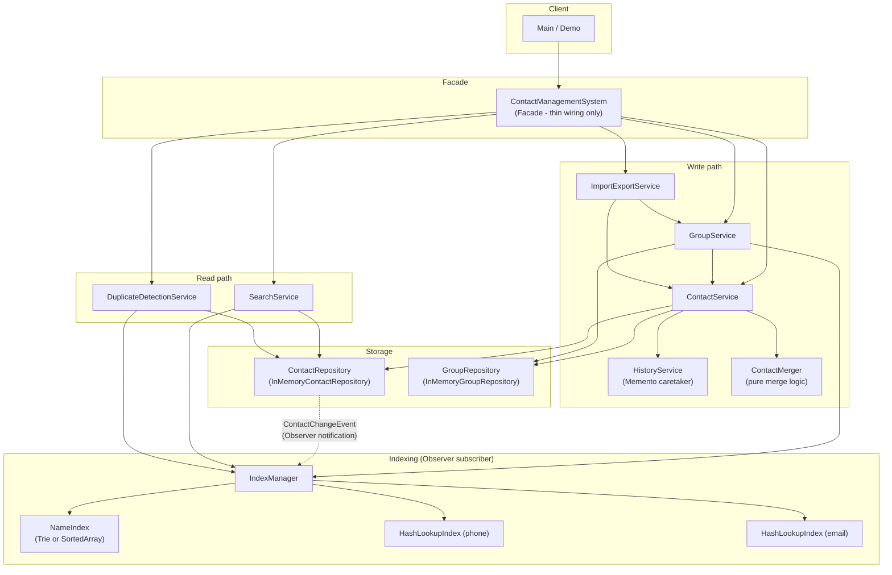

# Component Diagram

Shows the major runtime components and their dependency direction. The
read path (search, duplicate detection) and the write path (service layer)
are intentionally decoupled through the Observer-pattern `IndexManager`:
neither `ContactService` nor `ContactRepository` has any compile-time
knowledge that indexes exist.

