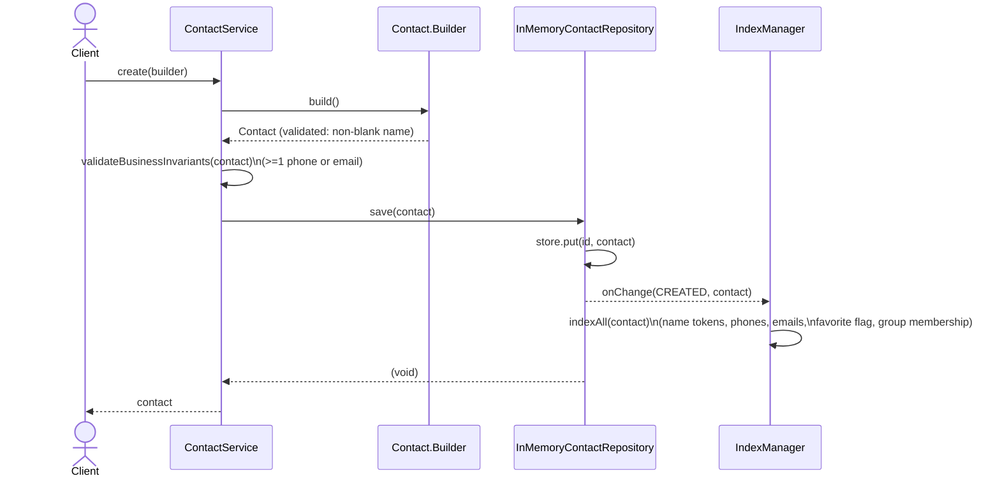
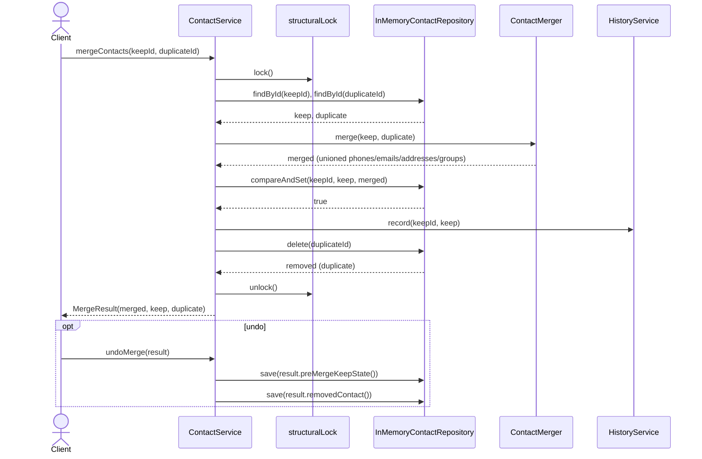
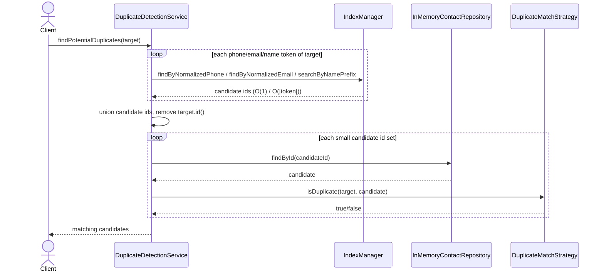
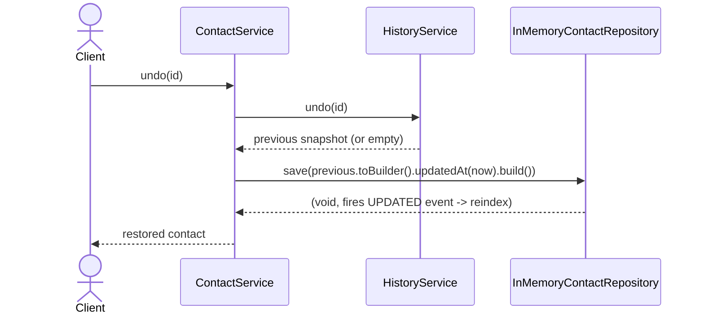

# Sequence Diagrams

## 1. Create a contact



## 2. Update a contact (optimistic concurrency / CAS retry loop)

```mermaid
sequenceDiagram
    actor Client
    participant CS as ContactService
    participant Repo as InMemoryContactRepository
    participant HS as HistoryService

    Client->>CS: update(id, mutator)
    loop up to MAX_CAS_RETRIES
        CS->>Repo: findById(id)
        Repo-->>CS: current (immutable snapshot)
        CS->>CS: builder = current.toBuilder();\nmutator.accept(builder);\nupdated = builder.build()
        CS->>Repo: compareAndSet(id, current, updated)
        alt current is still the mapped value (reference ==)
            Repo-->>CS: true
            CS->>HS: record(id, current)\n(memento = old snapshot)
            CS-->>Client: updated
        else another writer swapped it first
            Repo-->>CS: false
            Note over CS: retry with fresh current
        end
    end
```

## 3. Merge two duplicate contacts (+ undo)



## 4. Duplicate candidate generation (indexed blocking, not O(n^2))



## 5. Undo the most recent edit (Memento)


