# Class Diagram

This mirrors the actual classes/interfaces under `src/main/java/lld/stockmanagement`.
Only the members relevant to understanding responsibilities and relationships are
shown (full signatures are in the Javadoc / source).

```mermaid
classDiagram
    class Sku {
        -String skuCode
        -String name
        -String unitOfMeasure
        +getSkuCode() String
        +equals(Object) boolean
        +hashCode() int
    }

    class Warehouse {
        -String warehouseCode
        -String name
        -String region
    }

    class InventoryKey {
        -String skuCode
        -String warehouseCode
        +of(Sku, Warehouse)$ InventoryKey
    }

    class InventoryLevel {
        -int available
        -int reserved
        -long version
        +getAvailable() int
        +getReserved() int
        +getOnHand() int
    }

    class ReorderPolicy {
        -int reorderPoint
        -int reorderQuantity
        +shouldReorder(int) boolean
    }

    class MovementType {
        <<enumeration>>
        STOCK_IN
        STOCK_OUT
        RESERVE
        RELEASE_RESERVATION
        FULFILL_RESERVATION
        ADJUSTMENT
    }

    class StockMovement {
        -String movementId
        -InventoryKey inventoryKey
        -MovementType type
        -int quantity
        -int resultingAvailable
        -int resultingReserved
        -String referenceId
        -Instant occurredAt
    }

    class InventoryLedger {
        <<interface>>
        +initialize(InventoryKey, int) void
        +snapshot(InventoryKey) InventoryLevel
        +stockIn(InventoryKey, int) InventoryLevel
        +reserve(InventoryKey, int) InventoryLevel
        +releaseReservation(InventoryKey, int) InventoryLevel
        +fulfillReservation(InventoryKey, int) InventoryLevel
        +adjust(InventoryKey, int) InventoryLevel
    }

    class OptimisticVersionedInventoryLedger {
        -Map~InventoryKey, AtomicReference~InventoryLevel~~ rows
        -int maxRetries
    }

    class PessimisticLockInventoryLedger {
        -Map~InventoryKey, Row~ rows
    }

    class AtomicCasInventoryLedger {
        -Map~InventoryKey, AtomicLong~ rows
    }

    InventoryLedger <|.. OptimisticVersionedInventoryLedger
    InventoryLedger <|.. PessimisticLockInventoryLedger
    InventoryLedger <|.. AtomicCasInventoryLedger

    class SkuRepository {
        <<interface>>
        +register(Sku) void
        +findByCode(String) Optional~Sku~
        +exists(String) boolean
    }
    class WarehouseRepository {
        <<interface>>
        +register(Warehouse) void
        +findByCode(String) Optional~Warehouse~
        +exists(String) boolean
    }
    class InMemorySkuRepository
    class InMemoryWarehouseRepository
    SkuRepository <|.. InMemorySkuRepository
    WarehouseRepository <|.. InMemoryWarehouseRepository

    class AuditTrail {
        <<interface>>
        +record(StockMovement) void
        +history(InventoryKey) List~StockMovement~
        +all() List~StockMovement~
    }
    class InMemoryAuditTrail
    AuditTrail <|.. InMemoryAuditTrail
    AuditTrail --> StockMovement

    class StockEventListener {
        <<interface>>
        +onStockEvent(StockEvent) void
    }
    class StockEvent {
        -InventoryKey inventoryKey
        -MovementType type
        -InventoryLevel levelAfter
    }
    class LowStockAlertListener {
        -int lowStockThreshold
    }
    class ReorderAutomationListener {
        -Map~InventoryKey, ReorderPolicy~ policies
    }
    StockEventListener <|.. LowStockAlertListener
    StockEventListener <|.. ReorderAutomationListener
    StockEventListener --> StockEvent
    ReorderAutomationListener --> ReorderPolicy
    ReorderAutomationListener --> ReorderRequest

    class ReorderRequest {
        -InventoryKey inventoryKey
        -int suggestedQuantity
    }

    class InventoryService {
        -SkuRepository skuRepository
        -WarehouseRepository warehouseRepository
        -InventoryLedger ledger
        -AuditTrail auditTrail
        -List~StockEventListener~ listeners
        +registerSku(Sku) void
        +registerWarehouse(Warehouse) void
        +initializeInventory(String, String, int) void
        +stockIn(String, String, int, String) InventoryLevel
        +reserveForOrder(String, String, int, String) InventoryLevel
        +releaseReservation(String, String, int, String) InventoryLevel
        +fulfillOrder(String, String, int, String) InventoryLevel
        +adjustStock(String, String, int, String) InventoryLevel
        +auditHistory(String, String) List~StockMovement~
    }

    InventoryService --> SkuRepository
    InventoryService --> WarehouseRepository
    InventoryService --> InventoryLedger : strategy
    InventoryService --> AuditTrail
    InventoryService --> "many" StockEventListener : subject-observer

    InventoryLedger --> InventoryKey
    InventoryLedger --> InventoryLevel
    InventoryKey --> Sku : "derived from (skuCode)"
    InventoryKey --> Warehouse : "derived from (warehouseCode)"

    class Lot {
        -String lotId
        -String skuCode
        -LocalDate expiryDate
        -int quantity
        +deduct(int) int
        +isExpired(LocalDate) boolean
    }
    class LotAllocationStrategy {
        <<interface>>
        +allocate(List~Lot~, int, LocalDate) List~LotAllocation~
    }
    class FefoLotAllocationStrategy
    class LotManager {
        -Map~InventoryKey, List~Lot~~ lotsByKey
    }
    LotAllocationStrategy <|.. FefoLotAllocationStrategy
    LotManager --> LotAllocationStrategy : strategy
    LotManager --> Lot
```

