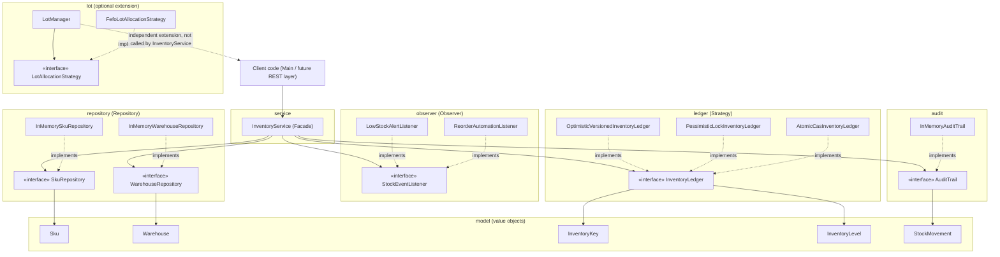

# Component Diagram

High-level module boundaries and dependency direction. Arrows point from a
dependent module to the thing it depends on. `InventoryService` is the only class
application code (`Main`, or a future REST layer) needs to know about; everything
else is reached indirectly through interfaces it holds.

