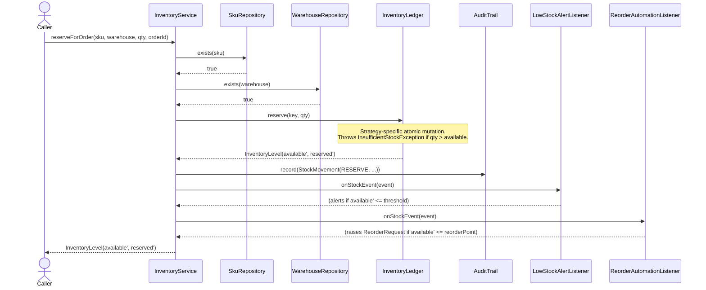
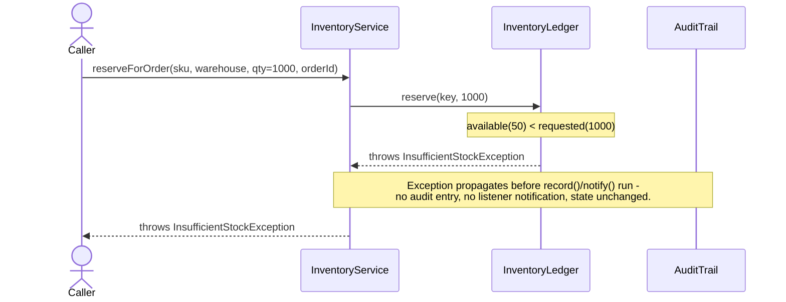
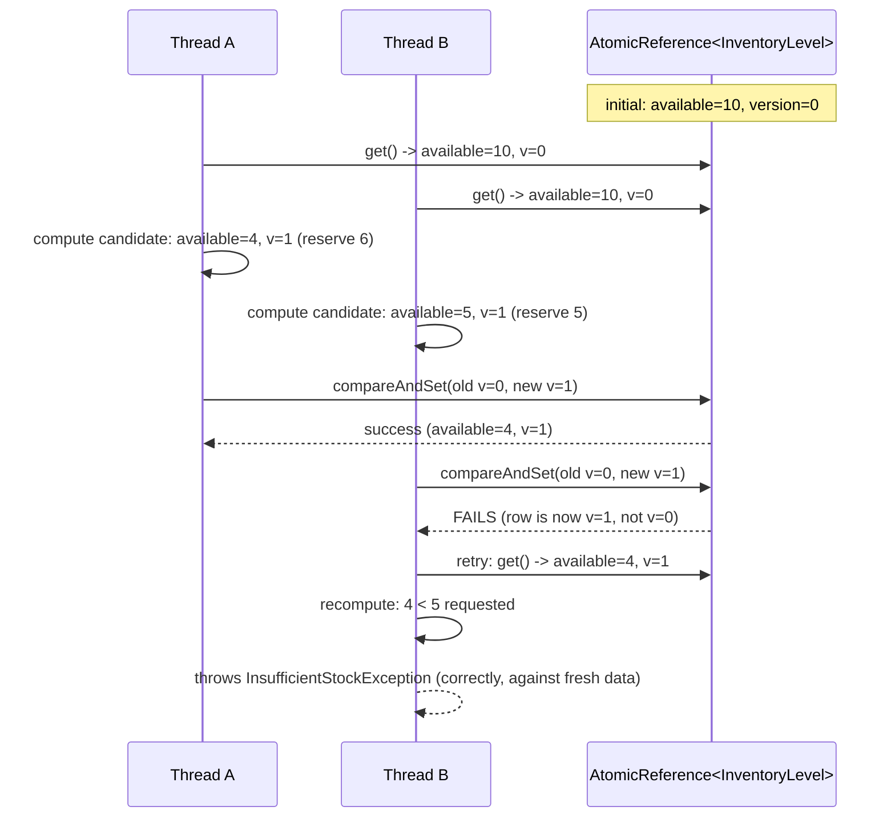
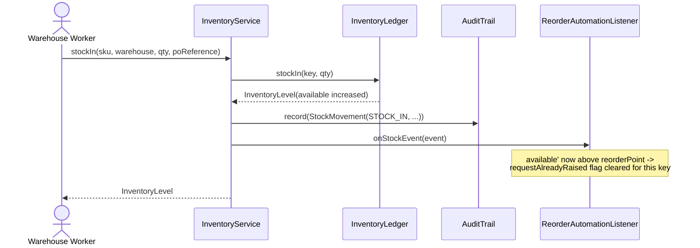

# Sequence Diagrams

## 1. Reserve stock for an order (happy path + low-stock alert)

## 2. Reserve stock — insufficient stock (no overselling)

## 3. Concurrent reservations on the same SKU (optimistic strategy)

## 4. Stock-in / replenishment (restocking after a low-stock alert)

