# Class Diagram

This diagram matches the actual classes under `src/main/java/lld/digitalwallet/`.

```mermaid
classDiagram
    class Money {
        -long minorUnits
        -Currency currency
        +ofMinorUnits(long, Currency) Money
        +ofMajorUnits(BigDecimal, Currency) Money
        +add(Money) Money
        +subtract(Money) Money
        +compareTo(Money) int
        +isNegative() boolean
        +isPositive() boolean
    }

    class AccountStatus {
        <<enumeration>>
        ACTIVE
        FROZEN
        CLOSED
    }

    class KycTier {
        <<enumeration>>
        TIER_0_UNVERIFIED
        TIER_1_BASIC
        TIER_2_FULL
        +dailyTransferLimitMinorUnits() long
    }

    class Account {
        -String accountId
        -String ownerId
        -Currency currency
        -ReentrantLock lock
        -volatile long balanceMinorUnits
        -volatile AccountStatus status
        -volatile KycTier kycTier
        -long version
        -long dailyTransferredMinorUnits
        +lock() ReentrantLock
        +getBalanceSnapshot() Money
        +applyDebit(Money, boolean) void
        +applyCredit(Money) void
        +freeze() void
        +unfreeze() void
        +releaseDailyLimitReservation(Money) void
    }

    class TransactionType {
        <<enumeration>>
        DEPOSIT
        WITHDRAWAL
        TRANSFER
        REVERSAL
    }

    class TransactionStatus {
        <<enumeration>>
        COMPLETED
        FAILED
        REVERSED
    }

    class Transaction {
        -String transactionId
        -TransactionType type
        -String sourceAccountId
        -String destinationAccountId
        -Money amount
        -TransactionStatus status
        -Instant createdAt
        -String idempotencyKey
        -String reversalOfTransactionId
        +withStatus(TransactionStatus) Transaction
    }

    class EntryDirection {
        <<enumeration>>
        DEBIT
        CREDIT
    }

    class LedgerEntry {
        -String entryId
        -String transactionId
        -String accountId
        -EntryDirection direction
        -Money amount
        -long balanceAfterMinorUnits
        +signedAmountMinorUnits() long
    }

    class AccountRepository {
        <<interface>>
        +save(Account) Account
        +findById(String) Optional~Account~
        +getOrThrow(String) Account
    }

    class TransactionRepository {
        <<interface>>
        +save(Transaction) Transaction
        +findById(String) Optional~Transaction~
        +findByIdempotencyKey(String) Optional~Transaction~
    }

    class LedgerRepository {
        <<interface>>
        +append(LedgerEntry) void
        +findByAccountId(String, Instant, Instant) List~LedgerEntry~
    }

    class IdempotencyStore {
        <<interface>>
        +computeIfAbsent(String, Supplier~Transaction~) Transaction
    }

    class InMemoryAccountRepository
    class InMemoryTransactionRepository
    class InMemoryLedgerRepository
    class InMemoryIdempotencyStore

    class WalletService {
        <<interface>>
        +openAccount(String, Currency, KycTier) Account
        +getBalance(String) Money
        +deposit(String, Money, String, String) TransferResult
        +withdraw(String, Money, String, String) TransferResult
        +transfer(TransferRequest) TransferResult
        +reverse(String, String) TransferResult
        +getStatement(String, Instant, Instant) List~LedgerEntry~
    }

    class WalletServiceImpl {
        -AccountRepository accountRepository
        -TransactionRepository transactionRepository
        -LedgerRepository ledgerRepository
        -IdempotencyStore idempotencyStore
        -Clock clock
        -doSingleEntryMovement(...) Transaction
        -postTwoEntryMovement(...) Transaction
        -doReverse(String, String) Transaction
    }

    class TransferRequest {
        -String sourceAccountId
        -String destinationAccountId
        -Money amount
        -String idempotencyKey
    }

    class TransferResult {
        -Transaction transaction
        -boolean replayedFromIdempotencyCache
    }

    WalletService <|.. WalletServiceImpl
    AccountRepository <|.. InMemoryAccountRepository
    TransactionRepository <|.. InMemoryTransactionRepository
    LedgerRepository <|.. InMemoryLedgerRepository
    IdempotencyStore <|.. InMemoryIdempotencyStore

    WalletServiceImpl --> AccountRepository
    WalletServiceImpl --> TransactionRepository
    WalletServiceImpl --> LedgerRepository
    WalletServiceImpl --> IdempotencyStore
    WalletServiceImpl ..> TransferRequest : consumes
    WalletServiceImpl ..> TransferResult : produces

    Account "1" *-- "1" AccountStatus
    Account "1" *-- "1" KycTier
    Account "1" --> "1" Money : balance
    Transaction "1" *-- "1" TransactionType
    Transaction "1" *-- "1" TransactionStatus
    Transaction "1" --> "1" Money : amount
    LedgerEntry "1" *-- "1" EntryDirection
    LedgerEntry "1" --> "1" Money : amount
    Transaction "1" --> "2" LedgerEntry : backed by (transfer)
```

**Composition vs association notes:**
- `Account *-- AccountStatus/KycTier`: composition - an account's status/tier has
  no independent lifecycle outside the account.
- `Account --> Money`: association - `Money` is an immutable value object freely
  shared/copied, not owned.
- `Transaction --> LedgerEntry` (1-to-2 for transfers): a transaction's ledger
  entries are created and persisted alongside it inside the same critical
  section, but the `LedgerEntry` rows live independently in their own
  append-only store (they outlive any particular in-memory `Transaction`
  object reference) - hence association with a documented multiplicity, not
  composition.
