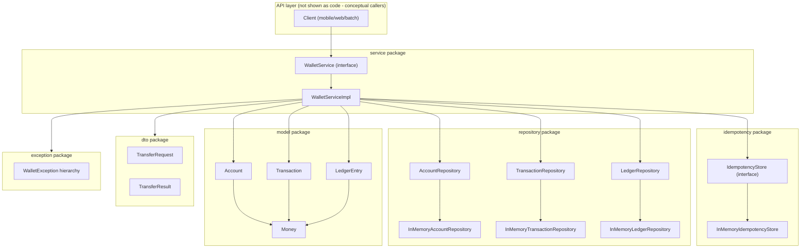

# Component / Package Diagram

**Why this layering:** `WalletService` is the only public surface a caller (REST
controller, gRPC handler, CLI, batch job) depends on. `WalletServiceImpl` is the
sole place that knows about locking order, idempotency, and ledger writes - every
other package is either a pure data holder (`model`, `dto`) or a swappable
storage/idempotency backend (`repository`, `idempotency`) reachable only through
an interface, so an in-memory demo and a future JDBC-backed production
implementation share the exact same service code.
