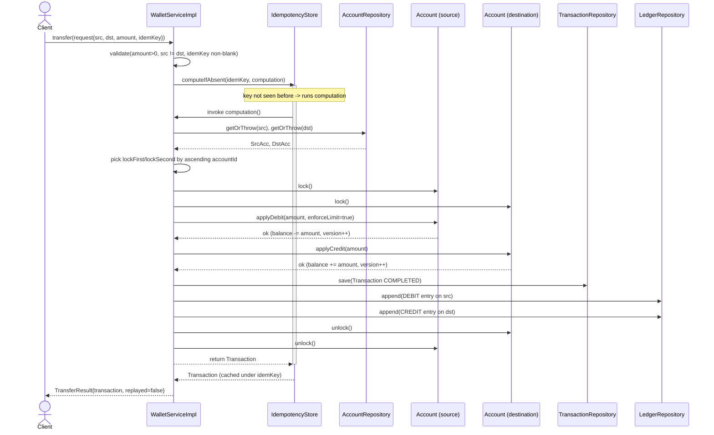
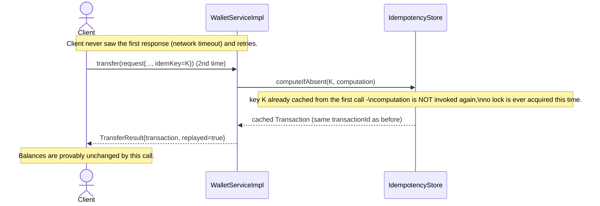
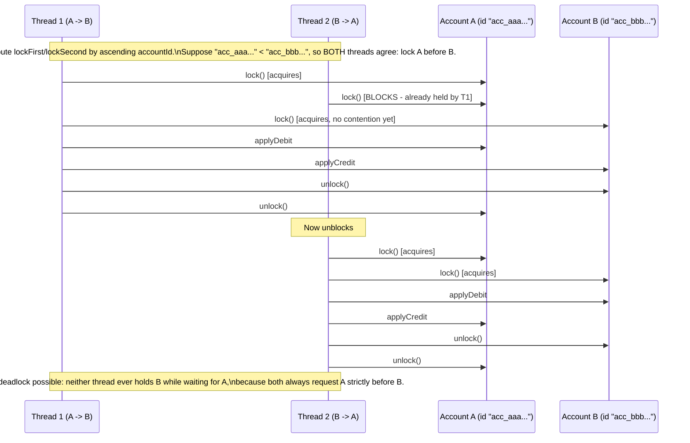

# Sequence Diagrams

## 1. Successful wallet-to-wallet transfer (first attempt)



## 2. Duplicate request with the same idempotency key (client retry after timeout)



## 3. Concurrent opposite-direction transfers (deadlock-avoidance in action)



## 4. Reversal of a completed transfer

```mermaid
sequenceDiagram
    actor Client
    participant WS as WalletServiceImpl
    participant TR as TransactionRepository
    participant SrcAcc as Account (originally debited)
    participant DstAcc as Account (originally credited)
    participant LR as LedgerRepository

    Client->>WS: reverse(originalTxnId, reversalIdemKey)
    WS->>TR: findById(originalTxnId)
    TR-->>WS: original Transaction (status=COMPLETED, type=TRANSFER)
    WS->>WS: postTwoEntryMovement(REVERSAL, debit=DstAcc, credit=SrcAcc, amount)
    Note over WS: Direction is flipped: the account that was credited is now debited, and vice versa.
    WS->>DstAcc: lock(), applyDebit(amount, enforceLimit=false)
    WS->>SrcAcc: lock(), applyCredit(amount)
    WS->>TR: save(reversal Transaction, reversalOf=originalTxnId)
    WS->>LR: append(DEBIT on DstAcc), append(CREDIT on SrcAcc)
    WS->>SrcAcc: releaseDailyLimitReservation(amount)
    WS->>TR: save(original.withStatus(REVERSED))
    Note over TR: original row is never mutated in place - a NEW immutable Transaction\nobject with status=REVERSED replaces it; the reversal is its own\nfirst-class Transaction, fully auditable.
    WS-->>Client: TransferResult{reversal, replayed=false}
```
