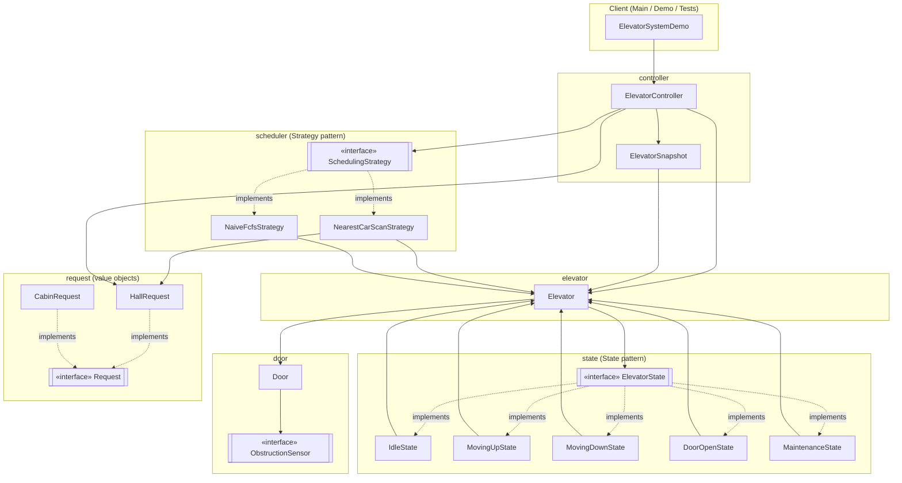

# Component / Architecture Diagram

High-level module boundaries and the direction of dependency arrows (an arrow
from A to B means "A depends on / calls B"). Notice the `state` and `elevator`
packages depend on each other only through the narrow `ElevatorState` /
`Elevator` interface surface — this is the State pattern boundary — and that
`scheduler` depends only on read-only accessors of `Elevator`, never on its
mutation methods, enforcing "the scheduler decides, the elevator executes."

