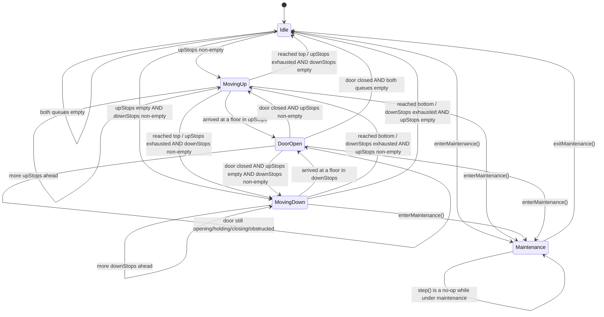
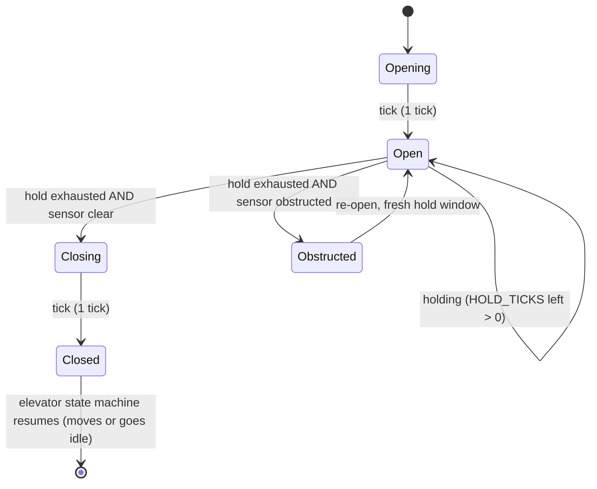

# Elevator State Machine (per car)

This is the State pattern transition graph implemented by
`IdleState` / `MovingUpState` / `MovingDownState` / `DoorOpenState` /
`MaintenanceState`. It is the SCAN/LOOK algorithm expressed as states: a car
only reverses when its current-direction queue is empty.

## Door sub-state machine (nested inside `DoorOpen`)

