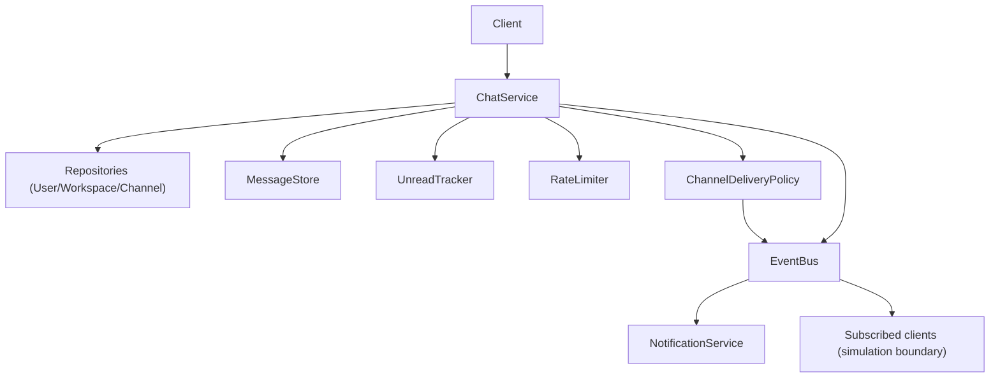

# Slack / Workplace Chat System — Low-Level Design

A staff-level LLD for a Slack-like workplace chat system: workspaces, public/private channels,
direct messages, real-time delivery, presence, mentions/notifications, message
edit/delete with audit, read-receipts/unread counts, rate limiting, and the
fan-out-on-write vs fan-out-on-read trade-off for channel message delivery.

---

## 1. Problem Understanding

**Plain explanation.** Design the backend data model and core services for a team chat
product like Slack or Microsoft Teams: users belong to a workspace; inside a workspace they
communicate through public channels (open to anyone in the workspace), private channels
(invite-only), and direct messages (1:1). Messages are ordered, paginated, editable (with
audit trail), and soft-deletable. Users see who's online, get notified when mentioned, and see
unread counts per channel. A single noisy sender must not be able to flood a channel.

**Real-world use case.** This is the backend for the "conversations" surface of any
Slack/Teams/Discord-style product: company-internal engineering communication, incident
channels, DM-based 1:1s, and broadcast/announcement channels with very large membership.

**What the interviewer is evaluating.**
- Can you decompose a feature-rich, ambiguous prompt into a small number of orthogonal
  responsibilities (membership, ordering/pagination, delivery, presence, rate limiting) instead
  of one god-class?
- Do you recognize and correctly model the *real-time delivery* problem as an application of
  Observer/Pub-Sub, and are you explicit about what is simulated vs what a real system does?
- Can you reason concretely about concurrency: what state is shared, what can race, and what
  the actual lock/atomic-operation granularity is — not just "I'd use a `ConcurrentHashMap`".
- Do you proactively raise the fan-out-on-write vs fan-out-on-read trade-off, or do you need to
  be prompted? (This is the single highest-signal follow-up for this problem.)
- Do you keep the implementation an *LLD* — in-memory, single-process — rather than
  prematurely designing a distributed system, while still being able to discuss how it would
  evolve into one.

**In scope.**
- Workspace / channel (public, private) / direct-message / user model and membership rules.
- Sending messages, chronological ordering, paginated history retrieval.
- Real-time delivery via an in-process Observer/Pub-Sub event bus (explicit simulation
  boundary for WebSockets/a message broker).
- Presence/online-status tracking.
- @mentions and a notification inbox.
- Message edit/delete with a retained audit trail (soft delete).
- Read receipts and per-user-per-channel unread counts.
- Rate limiting a single sender via Token Bucket.
- The fan-out-on-write vs fan-out-on-read delivery trade-off, implemented as a pluggable
  Strategy and picked per channel by a simple size-based policy.

**Out of scope** (see §17 for how each would be added).
- Actual network transport (WebSocket servers, mobile push, long-polling).
- Multi-node/distributed consistency, replication, partitioning, sharding.
- Message search/full-text indexing, threads/replies, reactions, file attachments.
- Authentication/authorization beyond simple membership checks; encryption at rest/in transit.
- Persistent storage (a real database) — see §12 for why in-memory is the right scope here.
- Admin/ownership roles beyond "channel creator"; message edit/delete is sender-only in this
  LLD (no "channel admin can delete anyone's message" — documented as a clarifying assumption).

---

## 2. Requirement Gathering

### Functional — essential
1. Create users, workspaces; add a user to a workspace.
2. Create public and private channels within a workspace; join/leave a public channel.
3. Create (lazily, on first contact) a direct-message channel between two users.
4. Send a message to a channel; only channel members may send.
5. Retrieve channel message history, paginated, in both directions (older/newer).
6. Edit a message (sender-only), retaining an auditable history of prior content.
7. Delete a message (sender-only), soft-deleted with a tombstone, not physically removed.
8. Track, per user per channel, the last-read position and derive an unread count.
9. Deliver new messages to channel members in real time (simulated).
10. Parse `@mentions` out of message content and notify mentioned users who can see the message.
11. Track user presence (online/away/offline).
12. Rate-limit how fast a single user can send messages.

### Functional — optional / explicitly deferred
- Threaded replies, emoji reactions, file/image attachments.
- Typing indicators, read-by-multiple-people receipts ("seen by 5").
- Message search, channel topic/description, starred/pinned messages.
- Slash commands, bots/integrations, channel admin roles beyond creator.

### Non-functional
| Dimension | Requirement (interview scope) | Production extension (§17) |
|---|---|---|
| Performance | O(log n) or better paginated reads; O(1) unread-count reads | horizontal read replicas, caching |
| Scalability | correct behavior up to "thousands of members per channel" in a single process | sharded message store, distributed pub/sub |
| Availability | N/A (single process, no HA requirement for the LLD) | multi-AZ deployment, broker replication |
| Consistency | strict per-channel ordering (monotonic sequence numbers); read-your-own-writes | eventual consistency across regions is acceptable for delivery, not for ordering |
| Extensibility | new channel types / delivery strategies addable without modifying `ChatService` | plugin/extension points for bots, slash commands |
| Reliability | no lost messages under concurrent senders (verified by test) | at-least-once delivery with idempotent consumers, durable broker |
| Thread-safety | every shared mutable structure has a stated, justified synchronization strategy | same guarantees, enforced across processes instead of within one JVM |

**Interview-necessary vs production-extension split:** the essential functional list above,
plus thread-safety and consistency for ordering, are what an interviewer will actually probe in
a 45–60 minute round. Availability/horizontal-scalability specifics are "tell me about it,
don't build it" — see §17.

---

## 3. Clarifying Questions

Asking these first signals that you understand what changes the design, not just that you
can enumerate features. For each: why it matters and how the answer changes the design.

1. **Can a channel have an unbounded number of members (e.g. a 50,000-person company-wide
   channel)?** — If yes, naive push-to-everyone delivery on every message becomes a
   bottleneck; you need the fan-out-on-read alternative (§14). If channels are always small
   (teams of <100), fan-out-on-write alone is sufficient and simpler.
2. **Who can edit/delete a message — only the sender, or also channel admins/workspace
   admins?** — Changes the authorization check in `Message.edit/delete` and whether you need
   a role model at all. I assumed sender-only for this LLD (documented below) because it keeps
   the authorization model simple while still exercising the real design question (ownership
   checks + state machine), and admin override is a straightforward additive extension.
3. **Is message ordering required to be globally consistent across channels, or only within a
   single channel?** — Only within a channel is the realistic requirement (and what Slack
   does); this lets you use independent per-channel sequence counters instead of one global
   clock/counter, removing a contention point.
4. **Do private channels support an invite flow, or is membership fixed at creation?** — I
   assumed existing members (in practice, the creator) can add members at creation time, and
   `joinChannel` self-service is public-channel-only; private-channel invite-after-creation is
   a thin additive method, not modeled as full workflow (no invite tokens/approval).
5. **Is "last read" tracked per device or per user?** — Per user, which is the Slack behavior
   (reading on your phone marks a channel read on your laptop too) and the simpler, more common
   interview answer. Per-device would require an extra dimension in `UnreadTracker`'s key.
6. **Should deleted/edited messages be visible in history with a "(edited)"/"(deleted)" marker,
   or fully hidden?** — I assumed visible with a tombstone (soft delete), because audit and
   "others saw this message before it was edited/removed" are explicit requirements; a hard
   delete would be simpler but loses the audit trail the problem explicitly asks for.
7. **Is the rate limiter per-user-global, or per-user-per-channel?** — I assumed per-user,
   global across channels, matching "a noisy sender" framing (a user spamming is a user
   problem, not a channel problem); per-channel would require keying the bucket map by
   `(userId, channelId)` instead of `userId` — a one-line change, called out in §16.
8. **Do mentions need to work for users not in the channel (e.g. mentioning someone to invite
   them)?** — I assumed mentions only notify users who are already channel members (mentioning
   an outsider is silently a no-op notification-wise, though the text still renders), since
   "notify someone who can't see the message" is a meaningless/undefined notification target.

---

## 4. Domain Modelling

| Type | Kind | Responsibility |
|---|---|---|
| `UserId`, `WorkspaceId`, `ChannelId`, `MessageId` | Value objects (records) | Type-safe identifiers; prevent passing the wrong kind of id where another is expected. |
| `User` | Entity | Identity (`id`, `username`) + mutable display name. |
| `Workspace` | Entity | Owns workspace-level membership; the authority for "can join a public channel / be found". |
| `Channel` | Entity | Owns channel-level membership + type (`PUBLIC`/`PRIVATE`/`DIRECT_MESSAGE`). |
| `ChannelType` | Enum | Discriminates join/visibility rules enforced by `ChatServiceImpl`. |
| `Message` | Entity, self-encapsulated | Content, lifecycle state, audit trail; the only class that mutates its own state under its own lock. |
| `MessageState` | Enum | `ACTIVE → EDITED → DELETED` lifecycle. |
| `MessageEdit` | Value object | One audit-trail entry (previous content + timestamp). |
| `MessageStore` / `InMemoryMessageStore` | Domain service + repository-like store | Per-channel ordered append-only log; owns sequence-number allocation. |
| `UnreadTracker` | Domain service | Per-(channel,user) last-read position and derived unread count. |
| `PresenceService` | Domain service | Per-user current presence; publishes changes. |
| `NotificationService` | Domain service, Observer | Subscribes to mention events; maintains per-user notification inboxes. |
| `MentionParser` | Stateless utility | Extracts `@handles` from content and resolves to `UserId`s. |
| `EventBus` / `InMemoryEventBus` | Infrastructure service | Topic-based publish/subscribe; the Observer pattern applied system-wide. |
| `ChatEvent` (sealed) + subtypes | Value objects | Everything that can be published on the bus. |
| `ChannelDeliveryStrategy` + 2 impls | Strategy | How a sent message is fanned out to members. |
| `ChannelDeliveryPolicy` | Domain service | Picks a delivery strategy per channel (by member count). |
| `RateLimiter` / `TokenBucketRateLimiter` | Domain service | Per-key send-rate throttling. |
| `ChannelFactory` | Factory | Validated construction of each channel type. |
| `UserRepository`, `WorkspaceRepository`, `ChannelRepository` (+ in-memory impls) | Repositories | Persistence abstraction (in-memory here; see §12). |
| `ChatService` / `ChatServiceImpl` | Facade | The single entry point orchestrating all of the above. |

**Composition / association / ownership.**
- `Workspace` 1—* `Channel`: association by `WorkspaceId` (foreign-key style), not object
  composition — a `Channel` does not hold a `Workspace` reference, avoiding a bidirectional
  graph that would need synchronized updates on both sides.
- `MessageStore` 1—* `Message`: composition — messages have no existence or identity outside
  the store; the store allocates their sequence numbers at creation.
- `Message` 1—* `MessageEdit`: composition — edit history is owned by and private to the
  message it documents.
- `ChatServiceImpl` *has-a* (not *is-a*) every domain service it orchestrates — composition
  over inheritance throughout; there is no class hierarchy of "service base classes".

**Lifecycle.** `User`/`Workspace`/`Channel` are created once and live for the process
lifetime (no deletion modeled — a reasonable interview-time omission, noted here rather than
silently skipped). `Message` has the only non-trivial lifecycle
(`ACTIVE → EDITED* → DELETED`, terminal), encoded as `MessageState` and enforced inside
`Message` itself so the invariant cannot be bypassed by a caller going around the state checks.

---

## 5. Domain Invariants

Business rules that must always hold, and where they are enforced:

1. **A message belongs to exactly one channel, forever.** Enforced by `Message` being
   immutable w.r.t. `channelId` (no setter) and `ChatServiceImpl.requireMessage` double-checking
   the channel on every edit/delete lookup.
2. **Only a channel member may send/read/mark-read in that channel.** Enforced centrally in
   `ChatServiceImpl` (`requireChannelMember`) before any mutation — never relies on the caller
   having checked first.
3. **A direct-message channel has exactly two distinct members, is never renamed, and cannot
   be left.** Enforced in `ChannelFactory.createDirectMessage` (constructor-time validation)
   and in `Channel.renameTo`/`removeMember` (runtime guards that throw for `DIRECT_MESSAGE`).
4. **Only the original sender may edit or delete a message.** Enforced inside
   `Message.edit`/`delete` themselves (not in the service layer), so the invariant holds
   regardless of which caller reaches the message.
5. **A deleted message can never be edited, and cannot be deleted twice.** Enforced by the
   `MessageState` check inside `Message.edit`/`delete` under the instance's intrinsic lock —
   see §11 for why this must be atomic.
6. **Per-channel message sequence numbers are strictly increasing, dense (no gaps), and unique.**
   Enforced by `InMemoryMessageStore` allocating from a single `AtomicLong` per channel before
   any message becomes visible — see §11 for the concurrency argument.
7. **A user's last-read position in a channel never regresses.** Enforced by
   `UnreadTracker.markRead` using `AtomicLong.updateAndGet(Math::max, ...)`.
8. **Unread count is never negative and never exceeds the channel's current message count.**
   Follows algebraically from invariants 6 and 7 (`unread = latest - lastRead`, and
   `0 <= lastRead <= latest` is maintained by them).
9. **A workspace's owner can never be removed from the workspace.** Enforced in
   `Workspace.removeMember` (explicit guard, throws `IllegalStateException`).
10. **Rate limiting is per-sender; one user's sends never consume or block another user's
    budget.** Enforced structurally — `TokenBucketRateLimiter` keys its bucket map by sender,
    and each `Bucket` instance is independently locked.

---

## 6. Architecture and Class Diagram

See `diagrams/component-diagram.md` for the component view, `diagrams/class-diagram.md` for
the full class diagram, and `diagrams/sequence-send-message.md`,
`diagrams/sequence-fanout-tradeoff.md`, `diagrams/sequence-edit-delete.md` for the key flows.
All diagrams are kept in lock-step with the actual classes under `src/main/java/lld/slackchat`
— class/method names in the diagrams match the source exactly.

Condensed component view (full version in `diagrams/component-diagram.md`):



---

## 7. Design Patterns

| Pattern | Why needed | Where applied | Alternative considered | Why rejected |
|---|---|---|---|---|
| **Observer / Pub-Sub** | Real-time delivery requires decoupling "something happened" from "who needs to know", and the same mechanism serves message delivery, presence, and mentions uniformly. | `EventBus`/`InMemoryEventBus`, `ChatEvent` hierarchy, `NotificationService` (an observer), subscribed demo/test listeners. | Direct method calls from `ChatService` to every interested component. | Would hard-wire `ChatService` to know about every current and future consumer (notifications, presence broadcast, future analytics listener), violating open/closed; also cannot model "a client subscribes/unsubscribes dynamically" without it. |
| **Strategy** | Fan-out-on-write vs fan-out-on-read is a genuine, data-dependent choice with no universally-better option (§14). | `ChannelDeliveryStrategy` + `FanOutOnWriteStrategy`/`FanOutOnReadStrategy`, selected by `ChannelDeliveryPolicy`. | A single `if (channel.memberCount() > threshold)` branch inlined in `ChatServiceImpl`. | Works short-term but couples delivery-algorithm detail into the facade and makes it harder to add a third strategy (e.g. hybrid) or unit-test each independently — the explicit interface pays for itself given this is a named interview topic. |
| **Facade** | Callers need one coherent entry point; without it they'd need to correctly sequence calls across 7+ subsystems themselves (and could skip validation). | `ChatService`/`ChatServiceImpl`. | Expose each subsystem (repositories, store, rate limiter, ...) directly to callers. | Pushes cross-cutting validation (membership, rate limiting) out to every caller, duplicating logic and risking it being forgotten — exactly the failure mode Facade exists to prevent. |
| **Factory (static, not Abstract Factory)** | Each `ChannelType` has different construction-time validation (DM needs exactly 2 distinct members; public/private don't). | `ChannelFactory`. | Put `if/else` branching for channel-type validation directly in `ChatServiceImpl`. | Would scatter type-specific invariants across the facade instead of in one place that can be unit-tested in isolation; still rejected a full Abstract-Factory *hierarchy* since there's only one product type (`Channel`), not a product family. |
| **Value Object** | Type safety for identifiers and small immutable concepts (an edit's prior content + timestamp, a page request). | `UserId`/`ChannelId`/`WorkspaceId`/`MessageId` (records), `MessageEdit`, `PageRequest`, `MessagePage`, `Notification`. | Plain `String`/`UUID` ids and ad-hoc tuples/arrays. | Loses compile-time protection against swapping, e.g., a `ChannelId` and `UserId` of the same underlying `String` type — a one-line fix (a record) that prevents a real class of bugs. |
| **Repository** | Decouple domain/service logic from how entities are stored and looked up. | `UserRepository`, `WorkspaceRepository`, `ChannelRepository` (+ in-memory implementations). | Have `ChatServiceImpl` hold `Map`s directly. | Works for the LLD but makes swapping to a real datastore (§12/§17) a larger refactor instead of an implementation swap behind an existing interface. |

**Explicitly not used, and why:** no Singleton (dependency injection via constructors is
sufficient and more testable), no Builder (no type here has enough optional/combinatorial
construction parameters to justify one — `Channel`/`Message` constructors are a handful of
required fields), no full State-pattern class hierarchy for `MessageState` (a 3-value enum
with validation inside `Message` is simpler and equally clear for only two guarded
transitions), no Command pattern (no undo/redo or queued-command requirement exists here).

---

## 8. API and Method Design

Public surface is `ChatService` (see `src/main/java/lld/slackchat/service/ChatService.java`).
Request/response shapes are the domain's own value types (no separate DTO layer, since this is
an in-process LLD, not a wire API — see §17 for how a real HTTP/gRPC layer would wrap this).

```java
public interface ChatService {
    User createUser(String username, String displayName);
    Workspace createWorkspace(String name, UserId ownerId);
    void addUserToWorkspace(WorkspaceId workspaceId, UserId userId);

    Channel createPublicChannel(WorkspaceId workspaceId, String name, UserId creatorId);
    Channel createPrivateChannel(WorkspaceId workspaceId, String name, UserId creatorId, Set<UserId> initialMembers);
    Channel getOrCreateDirectMessage(WorkspaceId workspaceId, UserId userA, UserId userB);
    void joinChannel(ChannelId channelId, UserId userId);
    void leaveChannel(ChannelId channelId, UserId userId);

    Message sendMessage(ChannelId channelId, UserId senderId, String content);
    Message editMessage(ChannelId channelId, MessageId messageId, UserId editorId, String newContent);
    void deleteMessage(ChannelId channelId, MessageId messageId, UserId requesterId);
    MessagePage getHistory(ChannelId channelId, UserId requesterId, PageRequest pageRequest);

    void markRead(ChannelId channelId, UserId userId, long uptoSequence);
    long getUnreadCount(ChannelId channelId, UserId userId);

    void setPresence(UserId userId, PresenceStatus status);
}
```

**Exceptions and who raises what validation:**

| Exception | Raised when | Raised by |
|---|---|---|
| `UserNotFoundException` | Referenced `UserId` does not exist | `ChatServiceImpl.requireUser` |
| `WorkspaceNotFoundException` | Referenced `WorkspaceId` does not exist | `ChatServiceImpl.requireWorkspace` |
| `ChannelNotFoundException` | Referenced `ChannelId` does not exist | `ChatServiceImpl.requireChannel` |
| `MessageNotFoundException` | Referenced `MessageId` doesn't exist or belongs to a different channel | `ChatServiceImpl.requireMessage` |
| `NotAChannelMemberException` | Caller is not a member of the channel/workspace being acted on | `ChatServiceImpl` membership guards |
| `InvalidChannelOperationException` | Structurally invalid channel op (e.g. joining a private channel, DM with 1 user) | `ChannelFactory`, `ChatServiceImpl.joinChannel` |
| `UnauthorizedMessageActionException` | Non-sender tries to edit/delete a message | `Message.edit`/`delete` |
| `InvalidMessageStateException` | Edit-after-delete or delete-after-delete | `Message.edit`/`delete` |
| `RateLimitExceededException` | Sender exceeds their token bucket | `ChatServiceImpl.sendMessage` |
| `IllegalArgumentException` | Low-level input validation (blank content, bad `markRead` sequence, bad `PageRequest`) | value-object/record constructors, `ChatServiceImpl.markRead` |

All are unchecked (`RuntimeException` subclasses via `ChatException`): forcing every caller to
declare/catch a long `throws` list for domain errors that are, in practice, either
(a) programmer errors (bad ids) caught in testing, or (b) legitimate business outcomes
(rate-limited, not a member) that calling code chooses whether to handle — checked exceptions
would not meaningfully improve either case here and would pollute every signature.

---

## 9. Core Implementation

The full, compiling implementation lives under `src/main/java/lld/slackchat/`. Key files to
read in this order to understand the system:

1. `model/` — `UserId`/`WorkspaceId`/`ChannelId`/`MessageId`, `User`, `Workspace`, `Channel`,
   `ChannelType`, `Message`, `MessageState`, `MessageEdit`.
2. `exception/` — the full exception hierarchy from §8.
3. `events/` — `ChatEvent` (sealed), `EventListener`, `Subscription`, `EventBus`,
   `InMemoryEventBus`.
4. `store/` — `MessageStore`, `InMemoryMessageStore`, `UnreadTracker`.
5. `pagination/` — `Direction`, `PageRequest`, `MessagePage`.
6. `delivery/` — `ChannelDeliveryStrategy`, `FanOutOnWriteStrategy`, `FanOutOnReadStrategy`,
   `ChannelDeliveryPolicy`.
7. `presence/PresenceService.java`, `notification/` (`MentionParser`, `NotificationService`,
   `Notification`), `ratelimit/` (`RateLimiter`, `TokenBucketRateLimiter`).
8. `repository/` — repository interfaces + in-memory implementations.
9. `factory/ChannelFactory.java`.
10. `service/ChatService.java`, `service/ChatServiceImpl.java` — the Facade tying everything
    together.
11. `Demo.java` — a runnable `main` exercising the whole system end to end.

Two of the most concurrency-sensitive/interesting classes, reproduced here (trimmed javadoc;
see source for the full version):

```java
// Message.java — the only class that mutates its own lifecycle state, under its own lock.
public synchronized void edit(UserId editorId, String newContent, Set<UserId> newMentionedIds) {
    if (!senderId.equals(editorId)) {
        throw new UnauthorizedMessageActionException(/* ... */);
    }
    if (state == MessageState.DELETED) {
        throw new InvalidMessageStateException(/* ... */);
    }
    editHistory.add(new MessageEdit(this.content, Instant.now()));
    this.content = validateContent(newContent);
    this.mentionedUserIds = Set.copyOf(newMentionedIds);
    this.state = MessageState.EDITED;
}
```

```java
// InMemoryMessageStore.java — sequence allocation is the sole coordination point.
public Message append(ChannelId channelId, UserId senderId, String content, Set<UserId> mentionedUserIds) {
    ConcurrentSkipListMap<Long, Message> log =
            channelLogs.computeIfAbsent(channelId, c -> new ConcurrentSkipListMap<>());
    AtomicLong seqGen = sequenceGenerators.computeIfAbsent(channelId, c -> new AtomicLong(0L));
    long sequence = seqGen.incrementAndGet();
    Message message = new Message(MessageId.generate(), channelId, senderId, sequence, content,
            mentionedUserIds, Instant.now());
    log.put(sequence, message);
    globalIndex.put(message.id(), message);
    return message;
}
```

Run it: `Demo.main` creates a workspace, a public channel and a DM, subscribes a simulated
client, sends/edits/deletes messages (including a mention), paginates history, tracks unread
counts, and demonstrates the Token Bucket rejecting a burst.

---

## 10. Data Structures and Algorithms

| Use case | Structure | Why | Alternative | Why rejected |
|---|---|---|---|---|
| Per-channel ordered message log | `ConcurrentSkipListMap<Long, Message>` | O(log n) insert, O(log n) to obtain a `headMap`/`tailMap` range view for pagination, lock-free reads, naturally sorted by sequence | `ArrayList` + external lock | O(n) worst case under lock contention for concurrent readers/writers; a skip list gives sorted + concurrent for free |
| Sequence allocation | `AtomicLong` per channel | O(1) lock-free unique id allocation; the *only* coordination point needed (see §11) | `synchronized` counter | Strictly more contention for no correctness benefit — CAS already gives atomicity |
| Channel/workspace membership | `ConcurrentHashMap.newKeySet()` | O(1) average membership check; read-heavy (every send checks it), write-rare (join/leave) access pattern | `CopyOnWriteArraySet` | CoW pays an O(n) copy on every join/leave; with channels that can have thousands of members this is worse than CHM's segment-level locking for writes, while reads are equally fast |
| Event listeners per topic | `CopyOnWriteArrayList` | Publish (frequent) iterates a lock-free snapshot; subscribe/unsubscribe (rare) pays the copy cost | `synchronized List` | Would serialize every publish against every subscribe, and publishes vastly outnumber subscribes in this workload |
| Per-user-per-channel read position | nested `ConcurrentHashMap<ChannelId, ConcurrentHashMap<UserId, AtomicLong>>` | O(1) read/update; `AtomicLong.updateAndGet(Math::max, ...)` gives monotonicity without a separate lock | A single `ConcurrentHashMap<Pair, AtomicLong>` | Functionally equivalent; nested maps were chosen for readability/debuggability (can inspect "all readers of channel X") — a defensible either-way call, noted explicitly rather than silently picked |
| Message edit history | `CopyOnWriteArrayList<MessageEdit>` | Edits are rare relative to reads of the audit trail (if ever read at all); append-mostly | `ArrayList` + lock | Would need external synchronization reachable from `edit()`'s `synchronized` block anyway — CoW is simpler and correct without relying on the caller already holding the lock |
| Rate limiting | Token Bucket (lazy refill via elapsed wall-clock time) | O(1) per check, tolerates legitimate bursts up to capacity, no background thread needed | Fixed window counter | Allows up to `2x` the intended rate at window boundaries (burst at the end of one window + burst at the start of the next) |
| | | | Sliding window log (timestamps of every request) | O(n) memory per key and O(n) eviction work per check — unnecessary precision for this requirement |
| | | | Leaky bucket (queue + fixed drain rate) | Smooths bursts into a constant output rate, which is actually undesirable here — we want to *allow* a legitimate burst, just cap sustained rate |
| Keyset pagination cursor | `long` sequence number | O(1) cursor value, stable under concurrent inserts (headMap/tailMap views are consistent snapshots at read time) | Offset (`OFFSET n LIMIT m`) | O(n) per page as history grows; produces skipped/duplicated rows if new messages are inserted mid-scroll |
| Mention extraction | Single-pass regex (`@[A-Za-z0-9._-]+`) + `Matcher.find()` loop | O(n) in message length, no backtracking blowup for this pattern | Full NLP/tokenizer | Massive overkill for a fixed-format handle syntax |

---

## 11. Concurrency and Thread Safety

This system is not single-threaded in practice (many users send/read concurrently against the
same channel), so every shared mutable structure below has an explicit, justified strategy —
"I'd just synchronize everything" is explicitly avoided because it would serialize unrelated
operations (e.g. editing message A blocking editing message B) for no correctness benefit.

| Shared state | Race if unguarded | Guarantee | Mechanism | Granularity |
|---|---|---|---|---|
| Per-channel message sequence counter | Two senders get the same sequence number → duplicate/overwritten messages | Unique, strictly increasing sequence numbers | `AtomicLong.incrementAndGet()` | Per channel (not global — sends to different channels never contend) |
| Channel/workspace membership set | Lost membership update; reading a torn/partial set mid-mutation | A membership check always sees a consistent (if possibly stale) snapshot | `ConcurrentHashMap.newKeySet()` | Per channel / per workspace |
| `Message.content`/`state`/`mentionedUserIds` | Concurrent edit+edit or edit+delete interleave, leaving inconsistent state (e.g. new content with `DELETED` state but no tombstone text) | Edits/deletes are serialized per message; a message can never be edited after being deleted even under a race | `synchronized` instance methods (`edit`, `delete`) — compound "check state, then mutate 3 fields" requires a lock, not just `volatile` | Per message (editing message A never blocks editing message B) |
| `UnreadTracker` last-read position | A late/out-of-order "mark read" call regresses a user's progress | Monotonic: `lastRead` only ever increases | `AtomicLong.updateAndGet(prev -> Math.max(prev, newValue))` | Per (channel, user) |
| `TokenBucketRateLimiter` bucket state (`availableTokens`, `lastRefillNanos`) | Two concurrent sends from the same user both read stale `availableTokens`, both succeed when only one token was available ("double withdrawal") | At most one token consumed per logical refill-then-check | `synchronized` method on the per-key `Bucket` object | Per sender key (two different senders never contend) |
| `EventBus` topic → listener list | Publishing while a listener subscribes/unsubscribes sees an inconsistent iteration | Publish always iterates a consistent snapshot; subscribe/unsubscribe is immediately visible to subsequent publishes | `CopyOnWriteArrayList` per topic, topics map is a `ConcurrentHashMap` | Per topic |
| `PresenceService` status map | Lost presence update | Last-writer-wins is *acceptable* here (presence is inherently best-effort), so plain `ConcurrentHashMap.put` suffices | `ConcurrentHashMap` | Per user |
| Repositories (`byId`, `byUsername`, DM index) | Inconsistent two-map state after `save` | Both maps always reflect the same `User`/`Channel`, because both are derived from the same immutable `id`/`username` fields that never change post-construction | `ConcurrentHashMap` | Per repository |

**Deadlock analysis.** The only intrinsic locks taken anywhere are the per-`Message` locks in
`edit`/`delete`. No code path ever holds two `Message` locks simultaneously (each operation
touches exactly one message), and no code path acquires a `Message` lock while holding any
other lock — so there is no lock-ordering cycle and therefore no possibility of deadlock.

**Visibility.** `Message.content`, `.state`, `.mentionedUserIds`, `.deletedAt` are `volatile`
so that readers on other threads observe the latest value immediately after a `synchronized`
writer releases the lock, without themselves needing to synchronize just to read.

**Optimistic vs pessimistic locking.** `Message.edit`/`delete` use pessimistic locking
(`synchronized`) rather than optimistic (e.g. a version-number CAS retry loop) because: (a)
contention on a single message is realistically near-zero (one human rarely edits the same
message from two threads simultaneously), so the lock is essentially uncontended in practice;
and (b) the compound invariant ("3 fields change together, and only if the *current* state
passes validation") is awkward to express as a lock-free CAS without a hand-rolled version
field and retry loop that would add complexity without a measurable throughput win at this
contention level. `UnreadTracker` and `TokenBucketRateLimiter`, by contrast, *do* expect higher
contention per key relative to their operation cost, which is why they use lock-free
(`AtomicLong`) or finely-scoped (`synchronized` on a tiny `Bucket`) approaches instead.

**Idempotency.** `sendMessage` is not idempotent by design (every call creates a new message —
retried network calls in a real client would need client-generated idempotency keys, a
production concern noted in §17, not modeled in this LLD). `markRead` *is* naturally idempotent
(calling it twice with the same value is a no-op by the `Math::max` monotonicity rule).
`delete` is intentionally *not* idempotent (`InvalidMessageStateException` on the second call)
to surface a programming error immediately rather than silently succeed twice.

---

## 12. Persistence and Database Design

This LLD is intentionally **pure in-memory** (`ConcurrentHashMap`/`ConcurrentSkipListMap`
backed repositories and store), which is the correct scope for an LLD interview:

- The problem being evaluated is *object model, responsibility boundaries, concurrency
  correctness, and pattern application* — not SQL schema design or query optimization.
- Every repository (`UserRepository`, `WorkspaceRepository`, `ChannelRepository`) and the
  `MessageStore` are defined as **interfaces** specifically so that swapping the in-memory
  implementation for a real datastore is a drop-in replacement, not a redesign — this is the
  concrete payoff of applying Repository (§7) even though persistence is out of scope.

**If this were backed by a real database** (discussed, not implemented — see §17 for the full
production picture):

| Entity | Likely table | Keys / indexes | Notes |
|---|---|---|---|
| `users` | `(id PK, username UNIQUE, display_name, created_at)` | unique index on `username` | mirrors `InMemoryUserRepository`'s two maps |
| `workspaces` | `(id PK, name, owner_id FK, created_at)` | — | |
| `workspace_members` | `(workspace_id FK, user_id FK, PK(workspace_id, user_id))` | index on `user_id` for "my workspaces" | |
| `channels` | `(id PK, workspace_id FK, name, type, created_by FK, created_at)` | index on `(workspace_id, type)` | |
| `channel_members` | `(channel_id FK, user_id FK, PK(channel_id, user_id))` | index on `user_id` for "my channels" | |
| `messages` | `(id PK, channel_id FK, sender_id FK, sequence BIGINT, content, state, created_at, deleted_at)` | **unique composite index on `(channel_id, sequence)`** — this is what `ConcurrentSkipListMap` gives for free in memory | sequence generation would move to a per-channel counter table or a database sequence/`SELECT ... FOR UPDATE`-free monotonic id scheme (e.g. Snowflake-style ids) to avoid a single auto-increment becoming a write hotspot |
| `message_edits` | `(message_id FK, previous_content, edited_at, PK(message_id, edited_at))` | | |
| `read_receipts` | `(channel_id FK, user_id FK, last_read_sequence BIGINT, PK(channel_id, user_id))` | | `UPDATE ... SET last_read_sequence = GREATEST(last_read_sequence, ?)` reproduces the `Math::max` monotonicity invariant in SQL |

**Transactions/isolation (if persisted):** appending a message would need, at minimum,
`READ COMMITTED` isolation plus the unique `(channel_id, sequence)` constraint to let the
database itself reject a duplicate sequence rather than relying purely on application logic —
defense in depth against a bug that allocates the same sequence twice. Edit/delete would be a
single-row `UPDATE ... WHERE state <> 'DELETED'` with the affected-row-count checked by the
application (0 rows updated ⇒ raise `InvalidMessageStateException`), which is the SQL
equivalent of the in-memory `synchronized` check-then-act.

---

## 13. Failure Scenarios

| Scenario | Handling |
|---|---|
| Sender sends to a channel they were just removed from (race between leave and send) | `requireChannelMember` re-checks membership at send time regardless of any client-side caching, so the send is rejected with `NotAChannelMemberException` even if the client's local state was stale. |
| Two concurrent edits to the same message | Serialized by the per-`Message` lock; both succeed, in some order, each seeing the other's prior content in the audit trail (no lost update — the second edit's "previous content" is the first edit's new content). |
| Edit races a delete on the same message | Whichever acquires the lock first wins; if delete wins, the subsequent edit sees `state == DELETED` and throws `InvalidMessageStateException` — never a half-applied edit on a deleted message. |
| Duplicate/retried `sendMessage` call (e.g. client retries after a timeout, not knowing if the first call succeeded) | **Not idempotent in this LLD** — produces two messages. Documented as a known gap; §17 covers client-supplied idempotency keys as the production fix. |
| `markRead` called with a sequence number from a deleted/non-existent message, or one ahead of the channel's actual latest sequence | Rejected with `IllegalArgumentException` at the service boundary (`uptoSequence` must be within `[0, latestSequence]`) rather than silently corrupting the unread count. |
| Rate limit exceeded | `sendMessage` throws `RateLimitExceededException` before any state mutation — no partial message, no sequence number consumed, no delivery event published. The sender can simply retry later; no server-side cleanup needed. |
| A listener subscribed to the event bus throws an exception while handling an event | `InMemoryEventBus.publish` catches and logs per-listener, continuing to the next listener — one broken subscriber (e.g. a buggy notification handler) cannot block message delivery to everyone else or fail the sender's `sendMessage` call. |
| Resource exhaustion: an unbounded number of channels/messages in a long-running process | Out of scope for correctness (in-memory maps grow unbounded by design for this LLD), explicitly called out as a production concern requiring retention policies/archival (§17) — not swept under the rug. |
| Workspace/channel/message id refers to nothing (typo, stale reference, deleted entity) | Every lookup path (`requireUser`/`requireWorkspace`/`requireChannel`/`requireMessage`) fails closed with a specific "not found" exception rather than returning `null` and risking a `NullPointerException` deeper in the call stack. |
| Attempting to join a channel that is `PRIVATE` or a `DIRECT_MESSAGE` | Rejected with `InvalidChannelOperationException` — self-service join only applies to `PUBLIC` channels; this is checked before any membership mutation. |
| Removing the workspace owner | Rejected with `IllegalStateException` inside `Workspace.removeMember` — an invariant (§5.9) enforced at the lowest possible layer so it cannot be bypassed by any caller. |

---

## 14. Performance and Scalability

**Bottleneck: channel fan-out at write time for very large channels.** This is the central
scalability discussion for this problem, and is handled as a first-class design decision
rather than an afterthought:

- **Fan-out-on-write** (`FanOutOnWriteStrategy`): publishes one event per member, O(members)
  work per `sendMessage` call, paid synchronously on the sender's call (in this in-process
  model — see §17 for how a real system would offload this to async workers/a broker). This
  is the right default for the overwhelming majority of channels (teams, DMs — typically
  single to low hundreds of members): every member gets instant, individually addressed
  delivery, and the linear cost is small in absolute terms.
- **Fan-out-on-read** (`FanOutOnReadStrategy`): publishes exactly one event regardless of
  member count — O(1) at write time. Members discover new messages by pulling
  (`MessageStore.getPage`) rather than being pushed to individually. This is the right choice
  once a channel is large enough that O(members) per message becomes a real cost (a
  company-wide `#announcements` channel with tens of thousands of members), *especially*
  because most members of such a channel are not actively watching at any given moment — doing
  O(members) work to wake up listeners that mostly don't exist (no open connection) is wasted.
- `ChannelDeliveryPolicy` automates the choice via a member-count threshold (demo default:
  500), which is a simple, interview-appropriate heuristic — a production system would also
  weigh *active connection count*, not raw membership, see §17.
- **This trade-off has no universally correct answer** — that is the point of presenting it as
  a Strategy rather than picking one and hard-coding it. An interviewer pushing on "what if the
  channel has a million members" or "what if it's a 3-person DM" is testing whether you
  recognize this is a spectrum, not a binary choice made once.

**Other bottlenecks and fixes:**

| Bottleneck | Single-process fix (in this LLD) | Multi-threaded optimization | Distributed-system optimization (out of scope, §17) |
|---|---|---|---|
| Offset-based pagination degrading as history grows | Keyset (cursor/sequence) pagination — O(log n + page size), not O(n) | N/A (already O(log n)) | Partition message storage by channel/time range |
| Hot channel with very high write throughput (e.g. a single incident channel with 50 writers/sec) | `AtomicLong` sequence allocation is lock-free; `ConcurrentSkipListMap.put` scales with concurrent writers | Could shard sequence allocation across sub-ranges if ever a measured bottleneck (speculative — not needed at interview scale) | Partition/replicate the channel's log across brokers, with a single ordering authority per partition |
| `EventBus.publish` blocking the sender on slow/many listeners | Per-listener `try/catch` prevents one bad listener from blocking others, but dispatch is still synchronous on the publishing thread | Dispatch each listener on a worker pool/queue instead of inline | Message broker (Kafka/Pulsar) with independent consumer groups per downstream system |
| Repository/`MessageStore` memory growth over time (nothing is ever evicted) | Not addressed (acceptable for an LLD/demo) | N/A | TTL/archival policies, cold storage tiering for old history |

**Explicitly not over-distributed:** this LLD does not introduce sharding, consensus,
replication, or multi-region concerns into the core design — those are discussed as
extensions (§17), not built, per the instruction to avoid over-distributing an LLD problem.

---

## 15. Testing Strategy

Tests live under `tests/java/lld/slackchat/`, mirroring the `src` package structure, using
JUnit 5. Categories covered, with representative files:

- **Unit — domain invariants:** `model/MessageTest` — edit/delete authorization, state-machine
  transitions (`ACTIVE → EDITED`, terminal `DELETED`), audit-trail content, blank-content
  rejection.
- **Unit — algorithms:** `store/InMemoryMessageStoreTest` — strictly increasing sequence
  numbers, backward/forward keyset pagination correctness (including continuing from a cursor
  with no gaps/duplicates), empty-channel edge case.
- **Unit — rate limiting:** `ratelimit/TokenBucketRateLimiterTest` — burst-to-capacity then
  rejection, refill-over-time (using a real `Thread.sleep` against a fast refill rate rather
  than mocking time, to exercise the real elapsed-time computation), per-key independence,
  invalid-configuration rejection.
- **Unit — parsing:** `notification/MentionParserTest` — single/multiple mentions, unresolvable
  handles silently ignored, no-mention content, a documented regex edge case (email-like text).
- **Unit — strategy behavior:** `delivery/DeliveryStrategyTest` — fan-out-on-write reaches
  every member except the sender; fan-out-on-read publishes exactly one event regardless of
  member count (1000+ members in the test); `ChannelDeliveryPolicy` selects the correct
  strategy on either side of its threshold.
- **Boundary:** `store/InMemoryMessageStoreTest` empty-channel page; `PageRequest`'s
  constructor rejecting `limit <= 0` and `limit > 500` (exercised indirectly via the service
  integration tests needing to page in batches — a real boundary the tests had to respect).
- **Negative / failure-injection:** `service/ChatServiceImplTest` — non-member send rejected,
  unknown-channel send rejected, private channel cannot be self-joined, rate limit rejects a
  burst from one sender while leaving another sender unaffected.
- **Integration (facade-level):** `service/ChatServiceImplTest` — full flows through
  `ChatServiceImpl`: mention → notification only for channel members, unread-count tracking
  across `markRead`, edit/delete visible through `getHistory`, idempotent/symmetric
  `getOrCreateDirectMessage`.
- **Concurrency:** `store/InMemoryMessageStoreTest.concurrentAppendsProduceUniqueSequenceNumbersWithNoLostWrites`
  (16 threads × 50 messages, asserts zero gaps/duplicates), `store/UnreadTrackerTest.concurrentMarkReadCallsConvergeToTheMaximumReportedPosition`
  (20 threads reporting 1..20, asserts convergence to 20), `service/ChatServiceImplTest.concurrentSendersInTheSameChannelProduceConsistentHistoryAndUnreadCounts`
  (10 concurrent senders through the full facade, asserts the resulting history has no gaps).

Representative test (full file at `tests/java/lld/slackchat/store/InMemoryMessageStoreTest.java`):

```java
@Test
void concurrentAppendsProduceUniqueSequenceNumbersWithNoLostWrites() throws InterruptedException {
    InMemoryMessageStore store = new InMemoryMessageStore();
    int threadCount = 16, messagesPerThread = 50;
    ExecutorService pool = Executors.newFixedThreadPool(threadCount);
    CountDownLatch start = new CountDownLatch(1), done = new CountDownLatch(threadCount);
    for (int t = 0; t < threadCount; t++) {
        pool.submit(() -> {
            try {
                start.await();
                for (int i = 0; i < messagesPerThread; i++) {
                    store.append(channelId, sender, "concurrent-msg", Set.of());
                }
            } catch (InterruptedException ignored) {
            } finally {
                done.countDown();
            }
        });
    }
    start.countDown();
    done.await(10, TimeUnit.SECONDS);
    assertEquals(threadCount * messagesPerThread, store.latestSequence(channelId));
}
```

**Verified result:** 39/39 tests pass via the JUnit 5 Platform Console Launcher (see repo
root summary / final report for the exact invocation and output).

---

## 16. Trade-offs and Alternatives

| Decision | Chosen approach | Alternative | Pros/cons | When the alternative wins |
|---|---|---|---|---|
| Real-time delivery | In-process `EventBus` (Observer/Pub-Sub) | Have clients poll `getHistory` on an interval | Pub-Sub gives instant delivery semantics and models the real architecture's *shape*; polling is simpler but adds latency and wasted load | If the interview explicitly scopes out "real-time" and only wants "list messages", polling-only is a legitimate simpler answer |
| Channel delivery | Adaptive Strategy (write vs read, by size) | Always fan-out-on-write | Adaptive handles both small teams and giant broadcast channels correctly; always-write is simpler to reason about and sufficient if the interviewer confirms channels are always small | If explicitly told "channels never exceed ~200 members", hard-coding fan-out-on-write and dropping the Strategy entirely is a defensible simplification |
| Message edit/delete authorization | Sender-only | Sender + channel/workspace admin override | Sender-only is simpler and still exercises the real design question (ownership + state machine); admin override needs a role model | If the prompt specifies "admins can moderate", add an `AuthorizationPolicy` interface the Message-mutating methods consult, rather than hard-coding `senderId.equals(editorId)` |
| Rate limiting scope | Per-user, global across channels | Per-user-per-channel | Matches "a noisy sender" framing directly; simpler key (`UserId` alone) | If spam in one channel shouldn't throttle a user's DMs, key the bucket map by `(userId, channelId)` instead — a one-line change to `TokenBucketRateLimiter`'s key type |
| Soft vs hard delete | Soft delete (tombstone + audit trail retained) | Hard delete (remove from store) | Soft delete satisfies the explicit audit requirement and lets "edited/deleted" be shown in history; hard delete is simpler but loses auditability | If compliance/legal requires true erasure (e.g. GDPR right-to-erasure) hard delete (or encryption-key destruction) becomes necessary *in addition to* soft delete's UX — a production nuance noted in §17 |
| Pagination cursor | Keyset (sequence number) | Offset/limit | Keyset is stable under concurrent writes and O(log n); offset is simpler to explain but degrades and produces skip/duplicate bugs under concurrent inserts | If the data is truly static/append-never-again (not the case here), offset's simplicity could be acceptable |
| Identifiers | Dedicated value-object records (`UserId`, etc.) | Plain `String`/`UUID` | Compile-time protection against mixing up id types; minor verbosity | For a very small, throwaway prototype, raw `String`s might be acceptable — not for a system meant to grow |
| Unread count computation | O(1) arithmetic (`latestSequence - lastRead`) | Eagerly incrementing a counter per message per member | O(1) arithmetic needs no per-member write at all, trivially compatible with *both* fan-out strategies; eager counters would need per-member updates exactly like fan-out-on-write does, defeating fan-out-on-read's O(1)-write goal | None, really — the eager-counter approach is strictly worse here once both delivery strategies must be supported, which is why it was not chosen |

---

## 17. Production Evolution

This section is explicitly separated from the interview-scope design above: everything in
§1–§16 describes **what the in-memory LLD code in `src/` actually implements and why**.
Everything below describes **how this would be extended for a real, distributed deployment** —
none of it is implemented in this repository.

**Real-time transport.** Replace the in-process `EventBus` with actual WebSocket (or
long-lived gRPC stream) connections from clients to a fleet of gateway servers. A message
published inside one server process would need to reach a recipient's socket that might be
held open on a *different* server — solved by fanning events out through a broker (Kafka,
Redis Pub/Sub, or a purpose-built presence/routing layer that maps `UserId → gateway node`)
before the gateway pushes to the actual socket. The `ChatEvent` types and the
fan-out-on-write/fan-out-on-read *semantics* modeled here would carry over essentially
unchanged — only the transport underneath `EventBus.publish` changes.

**Persistence.** Move `MessageStore`/`UserRepository`/`WorkspaceRepository`/`ChannelRepository`
from in-memory to a real datastore per §12's schema sketch. Sequence-number allocation would
move off a single `AtomicLong` (a single-process construct) to either a database sequence per
channel (acceptable if per-channel write rate is modest) or a distributed id scheme (e.g.
Snowflake-style, or "last sequence in a leader-per-partition log") if a channel's write rate
could exceed what one DB row's contention can serialize.

**Idempotency for retries.** Production clients need to supply an idempotency key with
`sendMessage` (e.g. a client-generated UUID) so a network-retried send does not create a
duplicate message — the server would de-duplicate on `(channelId, senderId, idempotencyKey)`
before allocating a new sequence number.

**Monitoring/metrics/logging.** Per-channel and per-user send rates, fan-out latency
percentiles (p50/p99 time from `sendMessage` to last recipient's delivery), event-bus listener
error rates (the `catch` in `InMemoryEventBus.publish` would become a counted, alertable
metric instead of a `System.err` line), rate-limiter rejection counts (to catch both abusive
users and mis-tuned limits), and `ConcurrentSkipListMap` size per channel (to catch unbounded
growth before it becomes a memory incident).

**Distributed coordination.** If channel ownership/sequence allocation is sharded across
multiple nodes, a channel's writes need a single ordering authority (e.g. one partition/leader
per channel, à la Kafka's per-partition ordering) — this is exactly why the design here keeps
ordering *per-channel* rather than global: it is the unit that would become a single
partition/shard in a distributed version with no redesign of the ordering model itself.

**Fault tolerance.** At-least-once delivery with client-side de-duplication (clients already
need to handle a message delivered twice, since exactly-once delivery across a network is not
achievable cheaply); broker replication so a broker node failure does not drop in-flight
delivery events; repository/store writes behind a replicated, durable log (e.g. a
Raft-replicated store or a managed database with synchronous replicas) instead of a single
process's heap.

**Operational concerns.** Retention/archival policies for old message history (the in-memory
store here grows unbounded — not acceptable in production); backpressure if a recipient's
gateway connection is slow (do not let one slow consumer stall the broker for everyone else);
rolling deploys of gateway nodes without dropping active WebSocket connections; GDPR-style
right-to-erasure handling that goes beyond this LLD's soft-delete tombstone (§16) when legally
required.

**API evolution / backward compatibility.** `ChatService` as a Facade interface is the natural
seam for versioning: a real system would expose this behind a versioned HTTP/gRPC API, and new
fields on `ChatEvent` subtypes (sealed, so additions are a compile-time-checked, exhaustive
decision at every `switch`) would be additive and ignorable by older clients, while behavior
changes to e.g. mention-notification semantics would need to be feature-flagged per workspace
to avoid breaking existing client expectations mid-rollout.
