# Class Diagram

Matches the actual Java types under `src/main/java/lld/slackchat`. Value objects (`UserId`,
`ChannelId`, etc.) and some trivial getters are omitted for readability; see the source for the
full signatures.

```mermaid
classDiagram
    class User {
        -UserId id
        -String username
        -String displayName
        +renameTo(String)
    }

    class Workspace {
        -WorkspaceId id
        -UserId ownerId
        -Set~UserId~ members
        +addMember(UserId)
        +removeMember(UserId)
        +isMember(UserId) bool
    }

    class Channel {
        -ChannelId id
        -WorkspaceId workspaceId
        -ChannelType type
        -Set~UserId~ members
        +addMember(UserId)
        +removeMember(UserId)
        +isMember(UserId) bool
        +memberCount() int
    }

    class ChannelType {
        <<enumeration>>
        PUBLIC
        PRIVATE
        DIRECT_MESSAGE
    }

    class Message {
        -MessageId id
        -ChannelId channelId
        -UserId senderId
        -long sequence
        -String content
        -MessageState state
        -List~MessageEdit~ editHistory
        +edit(UserId, String, Set~UserId~)
        +delete(UserId)
    }

    class MessageState {
        <<enumeration>>
        ACTIVE
        EDITED
        DELETED
    }

    class MessageEdit {
        +String previousContent
        +Instant editedAt
    }

    class MessageStore {
        <<interface>>
        +append(ChannelId, UserId, String, Set~UserId~) Message
        +findById(MessageId) Optional~Message~
        +getPage(ChannelId, PageRequest) MessagePage
        +latestSequence(ChannelId) long
    }
    class InMemoryMessageStore
    MessageStore <|.. InMemoryMessageStore

    class UnreadTracker {
        +markRead(ChannelId, UserId, long)
        +lastRead(ChannelId, UserId) long
        +unreadCount(ChannelId, UserId, long) long
    }

    class ChannelDeliveryStrategy {
        <<interface>>
        +deliver(Channel, Message, EventBus)
    }
    class FanOutOnWriteStrategy
    class FanOutOnReadStrategy
    ChannelDeliveryStrategy <|.. FanOutOnWriteStrategy
    ChannelDeliveryStrategy <|.. FanOutOnReadStrategy

    class ChannelDeliveryPolicy {
        -int largeChannelThreshold
        +strategyFor(Channel) ChannelDeliveryStrategy
    }
    ChannelDeliveryPolicy --> ChannelDeliveryStrategy
    ChannelDeliveryPolicy --> FanOutOnWriteStrategy
    ChannelDeliveryPolicy --> FanOutOnReadStrategy

    class EventBus {
        <<interface>>
        +subscribe(String, EventListener) Subscription
        +publish(String, ChatEvent)
    }
    class InMemoryEventBus
    EventBus <|.. InMemoryEventBus

    class ChatEvent {
        <<sealed interface>>
    }
    class MessageSentEvent
    class MessageEditedEvent
    class MessageDeletedEvent
    class MentionEvent
    class PresenceChangedEvent
    class ChannelUpdatedEvent
    ChatEvent <|.. MessageSentEvent
    ChatEvent <|.. MessageEditedEvent
    ChatEvent <|.. MessageDeletedEvent
    ChatEvent <|.. MentionEvent
    ChatEvent <|.. PresenceChangedEvent
    ChatEvent <|.. ChannelUpdatedEvent

    class RateLimiter {
        <<interface>>
        +tryAcquire(String) bool
    }
    class TokenBucketRateLimiter
    RateLimiter <|.. TokenBucketRateLimiter

    class MentionParser {
        +parseMentions(String) Set~UserId~
    }

    class NotificationService {
        +onEvent(ChatEvent)
        +notificationsFor(UserId) List~Notification~
    }
    NotificationService ..|> EventListener

    class PresenceService {
        +setStatus(UserId, PresenceStatus)
        +statusOf(UserId) PresenceStatus
    }

    class ChannelFactory {
        <<utility>>
        +createPublicChannel(...)$ Channel
        +createPrivateChannel(...)$ Channel
        +createDirectMessage(...)$ Channel
    }

    class ChatService {
        <<interface>>
        +sendMessage(ChannelId, UserId, String) Message
        +editMessage(ChannelId, MessageId, UserId, String) Message
        +deleteMessage(ChannelId, MessageId, UserId)
        +getHistory(ChannelId, UserId, PageRequest) MessagePage
        +markRead(ChannelId, UserId, long)
        +getUnreadCount(ChannelId, UserId) long
    }
    class ChatServiceImpl
    ChatService <|.. ChatServiceImpl

    ChatServiceImpl --> MessageStore
    ChatServiceImpl --> UnreadTracker
    ChatServiceImpl --> ChannelDeliveryPolicy
    ChatServiceImpl --> RateLimiter
    ChatServiceImpl --> MentionParser
    ChatServiceImpl --> EventBus
    ChatServiceImpl --> PresenceService
    ChatServiceImpl --> NotificationService
    ChatServiceImpl --> ChannelFactory
    ChatServiceImpl --> User
    ChatServiceImpl --> Workspace
    ChatServiceImpl --> Channel

    Channel --> ChannelType
    Message --> MessageState
    Message "1" o-- "many" MessageEdit : editHistory
    Workspace "1" o-- "many" Channel : (via workspaceId)
    Channel "1" o-- "many" Message : (via MessageStore, keyed by channelId)
```

**Key relationships:**
- `Workspace` and `Channel` are linked only by `WorkspaceId` (a foreign-key style reference,
  not an object reference) to avoid a parent-to-child object graph that would need to be kept
  in sync bidirectionally — the repository layer resolves the reference when needed.
- `Message` is owned by `MessageStore`, not by `Channel`: channels are about *membership and
  identity*, the store is about *ordered history*. This separation is what lets the two fan-out
  strategies and the two repositories evolve independently.
