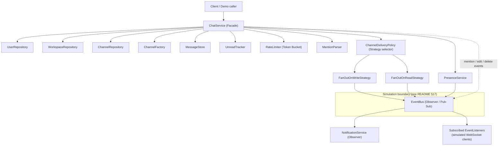

# Component Diagram

High-level module/component view of the in-memory LLD. Arrows denote "depends on" / "calls".

**Reading guide:**
- `ChatService` is the single Facade a caller interacts with; it never exposes the subsystems
  directly, so callers cannot bypass validation (membership checks, rate limiting) by reaching
  around it.
- `ChannelDeliveryPolicy` is the Strategy pattern applied to the fan-out-on-write vs
  fan-out-on-read trade-off (README §14): it inspects channel size and picks a strategy per
  send, rather than the caller having to choose.
- `EventBus` is the single Observer/Pub-Sub mechanism used for *all* real-time signals
  (message delivery, presence, mentions, edits, deletes) — it is explicitly called out as the
  simulation boundary standing in for WebSockets/a message broker in a real deployment.
