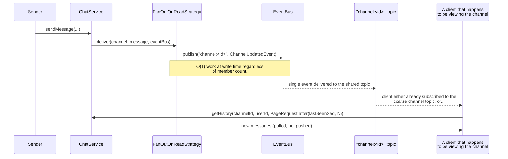

# Sequence Diagram — Fan-Out-On-Write vs Fan-Out-On-Read

Two sequence diagrams for the same action — "a message is sent into a channel" — contrasted
side by side. This is the key Staff-level discussion point for this problem (README §14).

## Fan-Out-On-Write (small/medium channel, e.g. a 12-person team channel)

```mermaid
sequenceDiagram
    participant Sender
    participant CS as ChatService
    participant Strat as FanOutOnWriteStrategy
    participant EB as EventBus
    participant M1 as Member 1 client
    participant M2 as Member 2 client
    participant M11 as Member 11 client

    Sender->>CS: sendMessage(...)
    CS->>Strat: deliver(channel, message, eventBus)
    loop for each of the 11 other members
        Strat->>EB: publish("user:<memberId>", MessageSentEvent)
        EB-->>M1: onEvent (push)
        EB-->>M2: onEvent (push)
        EB-->>M11: onEvent (push)
    end
    Note over Strat,M11: O(members) work at write time;<br/>every member is instantly, individually notified.
```

## Fan-Out-On-Read (large/broadcast channel, e.g. a 50,000-person #announcements channel)



**Why both exist:** fan-out-on-write minimizes per-member read latency and complexity at the
cost of write-time work proportional to membership size; fan-out-on-read keeps write cost
constant by shifting the discovery cost to readers (who pull on their own schedule, and who
are often not even connected at send time for very large channels). Neither dominates the
other across all channel sizes, which is why `ChannelDeliveryPolicy` picks per-channel rather
than the codebase picking one globally.
