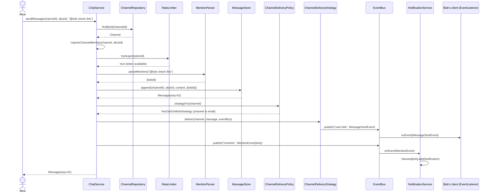

# Sequence Diagram — Send Message (happy path + fan-out)

**Notes:**
- Membership and rate-limit checks happen *before* any state mutation, so a rejected send
  never allocates a sequence number or appears in history (no "phantom" partial writes).
- Delivery and mention notification are both just publishes on the same `EventBus` — the
  Observer pattern is applied uniformly rather than having a separate mechanism per feature.
