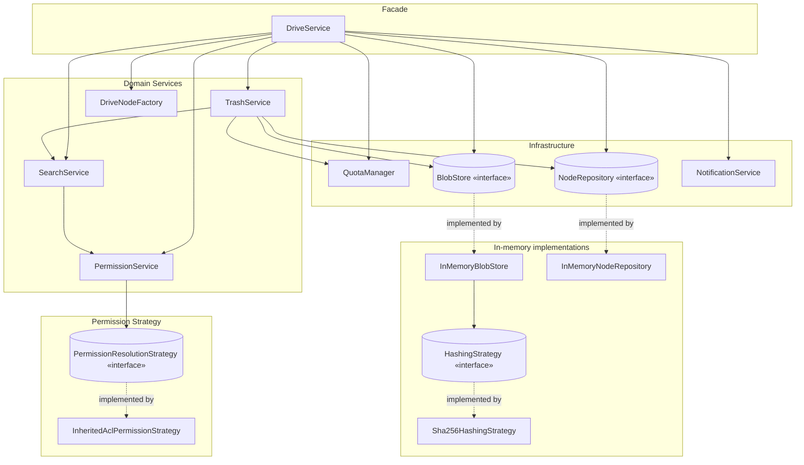

# Component Diagram

High-level module boundaries. Arrows show "depends on". Every arrow points toward an
interface, not an implementation, except where noted -- this is what keeps
`DriveService` swappable/testable (see README section 7, Dependency Inversion).

