# Class Diagram

This matches the actual classes under `src/main/java/lld/clouddrive`. Composite pattern:
`DriveNode` <|-- `Folder`/`File`; `Folder` aggregates `DriveNode`. Memento pattern:
`File` *-- `FileVersion` (append-only, immutable).

```mermaid
classDiagram
    class DriveNode {
        <<abstract>>
        -String id
        -String name
        -String ownerId
        -Folder parent
        -List~AccessEntry~ aclEntries
        +isFolder() boolean
        +upsertAclEntry(AccessEntry)
        +removeAclEntry(String)
    }

    class Folder {
        -Map~String,DriveNode~ children
        +addChild(DriveNode)
        +removeChildByName(String) DriveNode
        +listChildren() Collection~DriveNode~
        +listDescendants() List~DriveNode~
    }

    class File {
        -List~FileVersion~ versions
        +addVersion(FileVersion)
        +getCurrentVersion() FileVersion
        +listVersions() List~FileVersion~
        +getVersion(int) FileVersion
    }

    class FileVersion {
        <<immutable>>
        -int versionNumber
        -String contentHash
        -long sizeBytes
        -String authorUserId
        -Instant createdAt
    }

    class AccessEntry {
        <<immutable>>
        -String userId
        -Role role
    }

    class Role {
        <<enumeration>>
        NONE
        VIEWER
        EDITOR
        OWNER
        +isAtLeast(Role) boolean
    }

    class Blob {
        -String contentHash
        -byte[] content
        -long sizeBytes
        -int refCount
        +incrementRef()
        +decrementRef()
    }

    class User {
        -String id
        -String displayName
        -String email
    }

    class TrashRecord {
        -String nodeId
        -String originalParentId
        -String originalName
        -Instant deletedAt
        -Instant purgeAfter
        +isExpired(Instant) boolean
    }

    class BlobStore {
        <<interface>>
        +storeAndRetain(byte[]) Blob
        +release(String)
        +get(String) Blob
    }

    class InMemoryBlobStore {
        -ConcurrentHashMap~String,Blob~ blobs
        -HashingStrategy hashingStrategy
    }

    class HashingStrategy {
        <<interface>>
        +hash(byte[]) String
    }

    class Sha256HashingStrategy

    class NodeRepository {
        <<interface>>
        +save(DriveNode)
        +findById(String) Optional~DriveNode~
        +deleteById(String)
    }

    class InMemoryNodeRepository

    class QuotaManager {
        -ConcurrentHashMap~String,AtomicLong~ usedBytesByUser
        +reserve(String, long)
        +release(String, long)
        +getUsedBytes(String) long
    }

    class PermissionResolutionStrategy {
        <<interface>>
        +resolveEffectiveRole(DriveNode, String) Role
    }

    class InheritedAclPermissionStrategy

    class PermissionService {
        +effectiveRole(DriveNode, String) Role
        +requireRole(DriveNode, String, Role)
        +grant(DriveNode, String, String, Role)
        +revoke(DriveNode, String, String)
    }

    class SearchService {
        -Map~String,Set~String~~ tokenIndex
        +indexNode(DriveNode)
        +search(String, SearchQuery, Function) List~DriveNode~
    }

    class TrashService {
        -Map~String,TrashRecord~ trashByNodeId
        +recordTrashed(DriveNode, Folder, String, Instant)
        +purgePermanently(DriveNode)
        +purgeExpired(Instant, Function) List~String~
    }

    class DriveNodeFactory {
        +newFolder(String, String, Folder) Folder
        +newFile(String, String, Folder) File
    }

    class NotificationService {
        -List~FileChangeListener~ listeners
        +subscribe(FileChangeListener)
        +publish(FileChangeEvent)
    }

    class FileChangeListener {
        <<interface>>
        +onEvent(FileChangeEvent)
    }

    class DriveService {
        -ReadWriteLock structuralLock
        +createFolder(...) Folder
        +createFile(...) File
        +uploadNewVersion(...) FileVersion
        +move(...)
        +rename(...)
        +share(...)
        +moveToTrash(...)
        +restoreFromTrash(...)
        +purgePermanently(...)
        +search(...)
    }

    DriveNode <|-- Folder
    DriveNode <|-- File
    Folder "1" o-- "*" DriveNode : children
    File "1" *-- "*" FileVersion : versions (memento)
    DriveNode "1" o-- "*" AccessEntry : aclEntries
    AccessEntry --> Role
    FileVersion --> Blob : contentHash references

    BlobStore <|.. InMemoryBlobStore
    InMemoryBlobStore --> HashingStrategy
    HashingStrategy <|.. Sha256HashingStrategy
    NodeRepository <|.. InMemoryNodeRepository
    PermissionResolutionStrategy <|.. InheritedAclPermissionStrategy
    PermissionService --> PermissionResolutionStrategy
    SearchService --> PermissionService
    TrashService --> BlobStore
    TrashService --> QuotaManager
    TrashService --> NodeRepository
    NotificationService --> FileChangeListener

    DriveService --> NodeRepository
    DriveService --> BlobStore
    DriveService --> QuotaManager
    DriveService --> PermissionService
    DriveService --> SearchService
    DriveService --> TrashService
    DriveService --> NotificationService
    DriveService --> DriveNodeFactory
```

