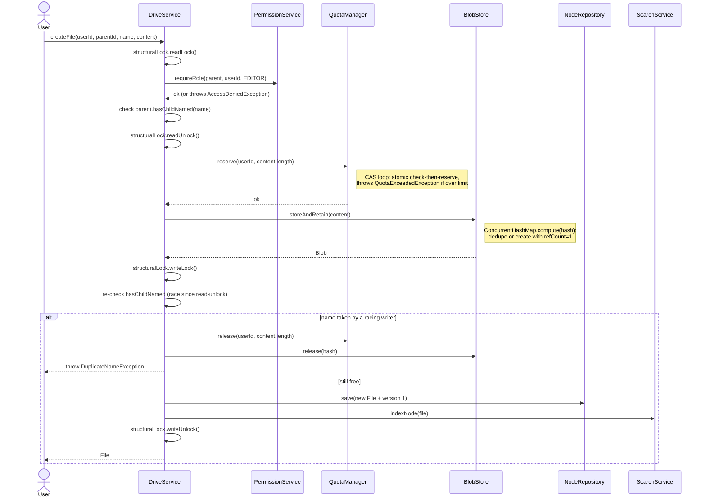
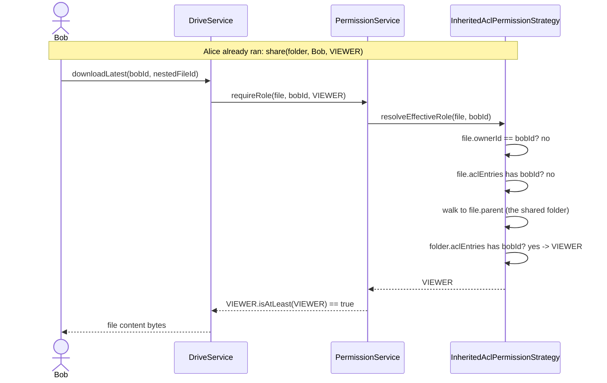

# Sequence Diagrams

## 1. Upload a new file (quota reserve -> dedup -> structural commit)



## 2. Upload a new version of an existing file (Memento)

```mermaid
sequenceDiagram
    actor U as User
    participant DS as DriveService
    participant PERM as PermissionService
    participant QM as QuotaManager
    participant BS as BlobStore
    participant F as File (per-file monitor)

    U->>DS: uploadNewVersion(userId, fileId, content)
    DS->>DS: structuralLock.readLock() [resolve node]
    DS->>PERM: requireRole(file, userId, EDITOR)
    DS->>DS: structuralLock.readUnlock()
    DS->>QM: reserve(userId, content.length)
    QM-->>DS: ok
    DS->>BS: storeAndRetain(content)
    BS-->>DS: Blob (new or deduped)
    DS->>F: synchronized(file) { addVersion(new FileVersion) }
    Note right of F: Prior FileVersion objects are untouched;<br/>any thread holding one keeps reading it safely.
    DS-->>U: FileVersion
```

## 3. Permission check with inheritance (share a folder, access a nested file)



## 4. Trash -> permanent purge (reference-counted blob release + quota release)

```mermaid
sequenceDiagram
    actor U as User
    participant DS as DriveService
    participant TS as TrashService
    participant BS as BlobStore
    participant QM as QuotaManager
    participant NR as NodeRepository

    U->>DS: moveToTrash(userId, nodeId)
    DS->>DS: structuralLock.writeLock()
    DS->>DS: detach node from parent.children
    DS->>TS: recordTrashed(node, oldParent, userId, now)
    DS->>DS: structuralLock.writeUnlock()

    Note over U,NR: ... retention window elapses, or owner purges explicitly ...

    U->>DS: purgePermanently(userId, nodeId)
    DS->>DS: structuralLock.writeLock()
    DS->>TS: purgePermanently(node)
    loop for each file version in node (and descendants if folder)
        TS->>BS: release(version.contentHash)
        Note right of BS: compute(hash): decrement refCount;<br/>remove mapping only if it reaches 0
        TS->>QM: release(version.ownerId, version.sizeBytes)
    end
    TS->>NR: deleteById(node.id) [+ each descendant]
    DS->>DS: structuralLock.writeUnlock()
    DS-->>U: done
```
