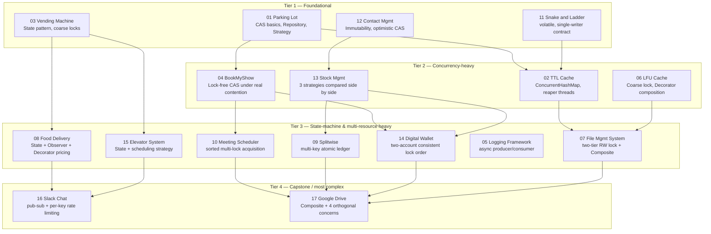

# Preparation Roadmap

A learning-ordered plan for working through all 17 problems in this repo. The
order is driven by **which concepts each problem teaches that later problems
assume you already have**, not by difficulty alone or by the numbering of the
directories.

## Concept dependency graph

## Tier 1 — Foundational (do these first)

| Problem | Why it's first | Concepts to master |
|---|---|---|
| **01 Parking Lot** | Simplest end-to-end introduction to Strategy + Repository + Builder + lock-free CAS on a single field. Every later problem's "shared mutable state inventory" section assumes you can read this one cold. | `AtomicReference.compareAndSet`, `ConcurrentSkipListSet`/`ConcurrentHashMap` basics — see [JAVA_CONCEPTS_REVISION.md §Atomic classes](JAVA_CONCEPTS_REVISION.md#atomic-classes) |
| **03 Vending Machine** | Cleanest, smallest full GoF State-pattern example, plus the clearest illustration of "when a coarse lock is fine" (hardware already serializes the front panel). | State pattern mechanics; `ReentrantLock` basics — see [JAVA_CONCEPTS_REVISION.md §synchronized vs ReentrantLock](JAVA_CONCEPTS_REVISION.md#synchronized-vs-reentrantlock-vs-readwritelock-vs-stampedlock) |
| **11 Snake and Ladder** | Teaches the *other* end of the spectrum from heavy locking: a documented single-writer contract with `volatile` for safe publication only. You need this contrast before Tier 2, where every problem picks a point on this spectrum deliberately. | `volatile` semantics, happens-before — see [JAVA_CONCEPTS_REVISION.md §Java Memory Model](JAVA_CONCEPTS_REVISION.md#java-memory-model-happens-before-volatile-visibility-vs-atomicity) |
| **12 Contact Management** | Introduces immutability-as-concurrency-strategy and reference-identity CAS (`current == expected`), which is reused conceptually (though not verbatim) by Stock Management's optimistic strategy in Tier 2. | Immutable value objects; `equals`/`hashCode` contract pitfalls — see [JAVA_CONCEPTS_REVISION.md §equals/hashCode](JAVA_CONCEPTS_REVISION.md#equalshashcode-contract) and [§Immutability](JAVA_CONCEPTS_REVISION.md#immutability) |

**Prerequisite note:** Snake and Ladder's `volatile`-only model only makes
sense once you've seen Parking Lot's CAS model — you need to be able to
articulate *why* `volatile` alone is insufficient for Parking Lot's spot
allocation (a compound check-then-act) but sufficient for Snake and Ladder's
single field under a single-writer contract. Read them in this order, not
reversed.

## Tier 2 — Concurrency-heavy (the core of Staff-level LLD interviews)

| Problem | Why now | Concepts to master |
|---|---|---|
| **02 TTL Cache** | First problem combining a concurrent collection (`ConcurrentHashMap`) with a *conditional* remove (`store.remove(key, expectedEntry)`) to close a check-then-act race — this exact idiom reappears conceptually in several later problems. Also the first background-thread (reaper) problem. | `ConcurrentHashMap.remove(k,v)`/`compute`, `LongAdder`, `ExecutorService` shutdown — see [JAVA_CONCEPTS_REVISION.md §ConcurrentHashMap](JAVA_CONCEPTS_REVISION.md#concurrenthashmap) and [§ExecutorService](JAVA_CONCEPTS_REVISION.md#executorservice) |
| **06 LFU Cache** | Deliberately the "pessimistic coarse lock is the right call" counter-example to Parking Lot's lock-free model — read them back-to-back to internalize *why* (multi-pointer linked-list mutation has no clean CAS decomposition). Also the cleanest Decorator-for-thread-safety example (`ConcurrentLFUCache` wraps `LFUCache`). | `ReentrantLock` critical-section sizing; Decorator composition order | 
| **04 BookMyShow** | The canonical "real contention, short critical section" CAS example — the textbook case *for* lock-free design, immediately followed by Stock Management's case *against* defaulting to it everywhere. | CAS retry loops, ABA awareness, liveness vs. safety — see [JAVA_CONCEPTS_REVISION.md §Atomic classes, CAS loops, ABA](JAVA_CONCEPTS_REVISION.md#atomic-classes) |
| **13 Stock Management** | The capstone of Tier 2: implements **all three** concurrency strategies (optimistic-versioned, pessimistic-locked, CAS) over the *same* domain operation specifically so you can compare them empirically instead of from memory. Do this right after BookMyShow and LFU Cache while their trade-offs are fresh. | Optimistic versioning vs. pessimistic locking vs. CAS — when each wins; see [DESIGN_COMPARISON.md §4](DESIGN_COMPARISON.md#4-lockingconcurrency-strategy-across-all-17-problems) |

**Prerequisite note:** Understanding TTL Cache's `store.remove(key,
expectedEntry)` conditional-removal idiom (closing a check-then-act race via a
conditional atomic operation rather than a lock) is what makes BookMyShow's
seat-locking CAS loop immediately legible — both are instances of "read a
snapshot, validate, atomically commit only if nothing changed underneath you."
Skipping TTL Cache and jumping straight to BookMyShow means re-deriving this
idiom from scratch under interview pressure instead of recognizing it.

## Tier 3 — State-machine & multi-resource heavy

| Problem | Why now | Concepts to master |
|---|---|---|
| **08 Food Delivery** | Combines three patterns you've now seen individually (State from Vending Machine, Observer informally, Strategy from Parking Lot) into one orchestrated system, plus introduces Decorator for *composable* pricing — the first "stack N optional behaviors at runtime" problem. | Combining State + Strategy + Observer in one service; Decorator composition — see [DESIGN_COMPARISON.md §2–3](DESIGN_COMPARISON.md#2-state-pattern-four-lifecycle-machines-compared) |
| **15 Elevator System** | Second full State-pattern lifecycle, but now the state's behavior reads *concurrently mutating* data (car position) instead of Vending Machine's effectively-single-user state — the step up in concurrency sophistication within the same pattern. | State pattern + concurrent reads of mutable fields (`volatile` + `synchronized` combined per-field) |
| **10 Meeting Scheduler** | First **multi-resource** locking problem — introduces the sorted-lock-acquisition-order technique for deadlock avoidance, which Digital Wallet reuses immediately after. | Lock ordering, `tryLock(timeout)`, Coffman conditions/deadlock — see [JAVA_CONCEPTS_REVISION.md §synchronized vs ReentrantLock](JAVA_CONCEPTS_REVISION.md#synchronized-vs-reentrantlock-vs-readwritelock-vs-stampedlock) |
| **09 Splitwise** | First "one lock must cover an inherently multi-key operation" problem (one expense touches N participants' balances atomically) — contrasts directly with `ConcurrentHashMap`'s only-per-key atomicity from Tier 2. | `ReentrantReadWriteLock` for multi-key atomicity; why per-key concurrent maps aren't enough alone |
| **14 Digital Wallet** | Directly reuses Meeting Scheduler's sorted-lock-ordering technique, now applied to exactly two resources (source/destination account) — the minimal, cleanest version of that technique to internalize before Google Drive's more complex locking in Tier 4. | Consistent lock ordering across exactly 2 objects; idempotency as a concurrency problem |
| **05 Logging Framework** | Introduces the producer/consumer pattern (`BlockingQueue` + single consumer thread) for decoupling caller latency from I/O latency — a technique that generalizes to any async-dispatch requirement. | `BlockingQueue` implementations, `CompletableFuture` as an alternative — see [JAVA_CONCEPTS_REVISION.md §BlockingQueue](JAVA_CONCEPTS_REVISION.md#blockingqueue-implementations) |
| **07 File Management System** | Combines Composite (structure) with a two-tier locking model (`ReadWriteLock` + per-leaf lock) — the direct precursor to Google Drive's more elaborate version of the same idea. | `ReentrantReadWriteLock`, two-tier lock granularity; Composite pattern basics — see [DESIGN_COMPARISON.md §6](DESIGN_COMPARISON.md#6-composite-pattern-file-management-system-vs-google-drive) |

## Tier 4 — Capstone / most complex

| Problem | Why last | Concepts to master |
|---|---|---|
| **16 Slack Chat** | Combines Observer/pub-sub (Logging, Food Delivery), Strategy (fan-out-on-write vs. on-read), and fine-grained per-key locking (rate limiting) — the most pattern-dense problem before Google Drive. | Fan-out strategy trade-offs; per-key rate limiting (token bucket); `ConcurrentHashMap.newKeySet()` |
| **17 Google Drive** | The explicit capstone: Composite (File Mgmt System) + Memento (Contact Management's undo concept, reapplied to versioning) + multiple independent concurrency mechanisms layered on one object graph (structural `ReadWriteLock`, per-file monitor, per-user CAS quota, `ConcurrentHashMap.compute()` refcounts). Everything in Tiers 1–3 shows up here in combination. | Composing 4+ independent concurrency mechanisms correctly in one system — see [DESIGN_COMPARISON.md §6](DESIGN_COMPARISON.md#6-composite-pattern-file-management-system-vs-google-drive) |

## Revision strategy

1. **Spaced repetition cadence.** After finishing a tier, wait 2–3 days, then
   re-derive (from memory, no README) that tier's **concurrency table** (the
   "shared mutable state inventory" from each problem's §11) on paper or a
   whiteboard. Check against the README only after you've committed to an
   answer — the goal is retrieval practice, not recognition.
2. **What to re-derive from memory vs. re-read:**
   - **Re-derive from memory:** the race condition itself (what goes wrong
     without protection), the chosen mechanism, and *why* that mechanism fits
     this specific access pattern. This is the part interviewers actually
     probe.
   - **Re-read, don't memorize:** exact class/method names, the precise
     Mermaid diagram syntax, and the full rejected-alternatives table — these
     are reference material, not things you need verbatim in an interview
     (you need the *reasoning*, which you reconstruct live).
3. **Weekly full-repo skim.** Once a week, re-read just the "Design Patterns"
   and "Concurrency" section headers (not full bodies) across all 17 READMEs
   in one sitting (~20 minutes) to keep the cross-problem comparisons in
   [DESIGN_COMPARISON.md](DESIGN_COMPARISON.md) fresh — this is what lets you
   answer "how would you compare this to the X problem" follow-ups fluently.
4. **Before a real interview loop,** re-read
   [JAVA_CONCEPTS_REVISION.md](JAVA_CONCEPTS_REVISION.md) end-to-end once; it's
   intentionally short enough to do in one sitting and is the fastest way to
   reload the vocabulary (happens-before, CAS, lock granularity) you'll need to
   *talk about* whatever problem you're given, even one not in this repo.

## Mock-interview checkpoints

After every tier (roughly every 4–5 problems), run a self-test:

- **Checkpoint 1 (after Tier 1 — 4 problems).** Pick one of the four cold.
  Open its `IMPLEMENTATION_GUIDE.md`, cover the code, and implement the
  "simplified version" section from memory in 20–30 minutes, timed. Compare
  against the actual `src/` afterward — don't just check "did it compile",
  check "did I reach for the same pattern, or did I over/under-engineer it."
- **Checkpoint 2 (after Tier 2 — 4 problems, 8 total).** Same exercise, but
  pick **Stock Management** specifically at least once across your attempts —
  implement just one of its three locking strategies from memory, then
  explain out loud (to yourself or a partner) why the other two would *not*
  have been the right choice for that same operation. This directly rehearses
  the single most common Staff-level follow-up question pattern in this repo.
- **Checkpoint 3 (after Tier 3 — 7 problems, 15 total).** Pick one
  multi-resource-locking problem (Meeting Scheduler or Digital Wallet) cold,
  and from memory write out just the lock-acquisition-order logic (not the
  whole service) — this is the highest-leverage 10 lines in the whole tier to
  have muscle memory for.
- **Checkpoint 4 (after Tier 4 — all 17).** Full mock interview: have someone
  (or yourself, a day later) give you a *new* variation of one of these 17
  problems (e.g., "design a library book-lending system" as a Parking-Lot
  variant, or "design a ride-sharing dispatch" as an Elevator-Scheduling
  variant) and run the full 45-minute flow — requirements, domain model,
  patterns with rejected alternatives, concurrency analysis — using this
  repo's README structure as your mental checklist, not as a script to recall
  verbatim.
